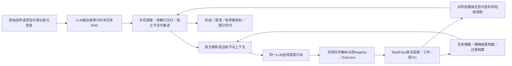

# Issue #52：强 Plan-and-Execute 与 EEG 科学交付／分层证据记忆

设计起点：`3d99b4c7644119a4ed5b4e6f1dbf82695da37165`，继续原研究分支及 Draft PR #37。本文在实现前冻结比较含义；后续实现位置、离线结果与偏差须显式补记，不能把拟实现内容提前写成验证成功。**本阶段外部付费 completion 授权为0**，旧阶段余额不可用。

## 1. 唯一问题与已有方法的能力

研究问题是：在具有正常计划、结果传递、重规划、来源及版本管理的多任务 EEG Agent 中，**以实际科学交付状态决定节点结束，并按已声明的依赖选择所需证据粒度**，是否比合理的完整结果传递或一般任务记忆更可靠／更经济，额外复杂度是否值得？

这不是“普通 DAG 做不到什么”的论证。成熟 P&E 已能表达多个步骤、上游输出引用、工具失败后的重规划以及独立任务执行。若给强基线相同谓词和自动检查，它可能与候选完全等价；届时交付机制的差异应撤回，只能继续评价信息呈现成本，而不能换一个名字宣称新算法。

|已核实的来源|直接支持的机制|对本项目的限制与采用方式|
|---|---|---|
|[LangChain 官方 P&E 说明](https://www.langchain.com/blog/planning-agents)，Plan-And-Execute／ReWOO／LLMCompiler小节|Planner提出步骤，局部Executor执行；执行后可重规划或回答；结果变量与依赖DAG已有成熟实现|本项目不能拿“不能传结果、不能重规划”的弱实现充当普通P&E。选择同一LLM、同一DAG格式与共同科学工具作为对照基础|
|[Plan-and-Solve 原论文](https://arxiv.org/abs/2305.04091)|先将推理任务分解再求解，针对遗漏步骤问题|它是推理提示研究，不是EEG数值执行器，也不直接证明科学工具链可靠；不把它当具有全部工程能力的唯一基线|
|[ReWOO 原论文](https://arxiv.org/abs/2305.18323)、[LLMCompiler 原论文](https://arxiv.org/abs/2312.04511)|分别研究推理与观察解耦、函数依赖与调度等执行机制|变量结果传递、DAG与按依赖取输入不是本工作的新发明。这里只用其说明合理强基线应有的能力，不移植另一套执行器|
|[HiAgent 原论文](https://aclanthology.org/2025.acl-long.1575.pdf) §3.1–3.4；[官方实现](https://github.com/HiAgent2024/HiAgent/blob/main/agentboard/agents/cme_final.py)|模型提出子目标；当前行动—观察保留，旧目标改用摘要，必要时恢复轨迹。原文完成判断由模型提出，摘要函数可采用不同实现|继承任务级活动AO、摘要和按需恢复；EEG数值、对象、时间基准和版本由真实程序事实保留。并不完整复现原文环境与提示，不把简单检索排名叫作完整HiAgent|

HiAgent的组织思想适合持续分析，但不能直接让模型声明覆盖科学完成：一个PSD工具成功不等于两个时间窗都分析过，已有合法功率也不等于用户要求的质量前提已满足。反过来，辅助查询失败不应成为整个目标永久未完成的理由。Issue #51 的原始失败仅证明本项目旧控制器存在这些问题，不能外推为普通P&E必然失败。

## 2. 最小共同架构与不变式

所有组共用同一规划格式、调度器、工具入口、数据和错误信息。模型从自然请求提出DAG，程序只检查结构与合法性、维护真实结果。正式入口不接收评测器给定的正确DAG、目标ID或执行顺序。单元回放可以注入动作，但必须标为受控机制检查。

|数据对象|最小含义|不能承担的职责|
|---|---|---|
|TaskSpec|稳定task_id、可读goal、dependencies、required_outputs、状态与修订版本|标题不是身份；不靠重命名丢掉原有科学义务|
|DeliveryItem|独立key、capability、记录及requested_scope、input_refs、required、可选acceptance_rule|参数来自用户／合法历史，不能由LLM凭空授权；同工具不同窗口是不同结果项|
|EvidenceEntry|原TaskEntry的result_id、所属任务、实际记录/范围/参数、输入/输出工件、版本、结果及AO定位、真实单位|索引不冒充数值；同内容不冒充同工件；失败观察不登记为有效结果|
|TaskSummary|目的、实际完成状态、结果指针、必要科学条件、未决项|不重新生成或改写数值；不代替外部完整档案|
|AO记录|真实工具调用、成功/失败观察、当前节点、实际模型交换及可恢复指针|记录存在不等于模型读过，更不等于后续实际使用|

程序统一自动匹配真实输出的key，并检查record、capability、scope、工件、版本和结果存在。普通不带额外验收谓词的全交付在所有组都能自动完成，**不能强迫A/B多抄ID、多做完成调用或重复计算**。用户要求修订时保留旧版本、原引用和新版本；仅实际依赖受影响的后继需重新审查，其余独立节点不因全图重规划而重算。

状态至少区分工具执行成功、交付满足、任务完成、缺参等待、失败／部分、结果失效。一次辅助动作的失败只写尝试日志；只有关联未满足必需结果或实际必要前提时才阻塞。完成判断与整个原始自然请求的意图完备性分开，任何组都不能靠模型声明证明后者。

### 生命周期与恢复

1. 模型提出新计划或以稳定ID修订已知节点；不按标题合并身份。
2. 共同调度选择一个依赖具备的节点，向同一局部执行循环提供原需求、节点和适用证据。
3. 每次数值行动经过共同科学接纳和原Executor。结果进入现有不可变档案，参数／来源／工件无需模型重复登记。
4. 共同输出绑定判断完整结果集合，辅助失败单独记录。存在额外验收规则时按实验臂执行自动或模型判定。
5. 已完成节点自动归档真实摘要；未完成保留WAITING_INPUT或PARTIAL及具体未决条件。独立节点仍可推进。
6. 下游只引用实际有效结果或原工件。需要历史标量时读结果；需要核对处理过程时恢复AO到下一输入。不能把一次恢复回执当作过程已被实际利用。

## 3. 在实现前冻结的A／B／C差异

|能力或职责|A：强P&E|B：P&E＋一般任务记忆|C：候选适配|
|---|---|---|---|
|LLM规划DAG、正常重规划、当前节点局部动作|相同|相同|相同|
|记录隔离、授权、科学参数、工件身份、版本与单位安全底线|相同|相同|相同|
|真实结果自动绑定、全部普通结果完成、辅助失败不全局阻塞|相同|相同|相同|
|用户明确科学acceptance_rule的判定|模型见同一规则和真实结果，可调用共同check_deliveries后完成／重规划|同A|程序按实际证据自动核验并驱动节点状态|
|当前AO|正常保留|正常保留|正常保留|
|上游默认呈现|合法完整结构化Result，可直接使用；所有历史AO正常可读，不是每步主动附上完整原生聊天|一般任务摘要保留最多64个真实标量字段及定位，且有正常完整结果／AO读取权限|根据真实DAG input_refs和需要提供摘要／精确字段／工件；必要过程可恢复|
|正常历史读取及过程恢复|有|有|有|
|模型／数据／预算／最终评分|相同|相同|相同|

这里的科学acceptance_rule必须来自明确用户要求或已核实任务科学前提，可涉及真实质量量、计数或其他现有工具字段；不新增任意疾病阈值或预测假设。三组都可见规则和真实结果，A/B也可调用同一检查。**C的差别是将规则检查与完成／证据供给自动协同，而不是独占正确科学知识。** 普通数值完整性和对象合法性属于共同底座，不能计作C独有收益。

A完整Result不能被人为裁短，B摘要应保留合理关键事实及读取定位；所有组有同等档案读取权、正常上下文容量和最终回答空间。当前A是普通完整上游结果传递，不等于旧F的每步完整聊天重放，不能把A成本解读为“保留全部原生会话”的成本。B的64字段规则继承合理强摘要实现，足以保留本批不少小结果，不通过剥夺数值迫使它读取。短任务若完整结果更便宜，按事实报告，不要求分层方案获胜。需要的值已在上下文时不得强迫额外read/restore。

### 必要敏感性／消融

- **C-no-delivery**：保留依赖证据供给，科学验收交回模型及共同check_deliveries；基本科学安全校验不删除。
- **C-no-selection**：保留自动科学验收，合法上游完整结果直接提供；不能剥夺结果读取。
- **A-equivalent**：合理强P&E也启用同一科学谓词自动gate。若此时与C完成行为相同，应明确报告交付增量已消失。该条件用于避免把通用校验配置包装成不可替代算法；不必占用未授权API。

## 4. 研究假设、可以证明什么与额外代价

|可证伪主张|应观察的证据|足以否定／收缩的情况|代价|
|---|---|---|---|
|H1：明确科学验收自动介入可减少“工具合法但科学交付未满足”的错误完成|相同原始请求下真实A/B仍错误完成，C拒绝并可合法恢复；独立数值／状态评分|A/B正常调用检查或自行判断就同样可靠；A-equivalent与C相同|规则表达、检查反馈、科学规则维护和误拒风险；不保证模型声明覆盖所有用户意图|
|H2：依赖所需证据粒度可以减少不必要上下文与读取，同时不损害续算|同DAG、同原始证据，实际呈现字段及模型后续引用、工具续算、最终交付；最终统计API总成本|A完整结果更简单且低成本；C缺关键字段导致多一次读取／错误；B同样有效|input_refs维护、选择与升级读回开销；DAG本身漏依赖时会选错，不能假定规划正确|
|H3：两者联合对EEG持续分析有应用方法价值|以上归因成立且连续、事件、修订、历史使用均可重复验证|只有受控故障注入通过、没有真实自主收益；或收益完全由共同工程修复解释|系统复杂度、测试维护和可用性成本，应与最简单同等方案比较|

离线可以证明“某个错误完成提案被实际接纳或拒绝”“给定依赖真实供给了哪些字段”“原工件正确续算”，不能据此估计真实LLM错误率、自然语言规划能力或API节省。可注入**同一个**错误提案给A/B/C考察防线，但必须标记为人为干预，不能让Fake专门写坏A。还应保留A合法完整执行与自行检查恢复的正例。

“应提供—实际呈现—后续使用”分别记录：依赖解析期得到应供证据；完整下一模型输入记录真正呈现内容；后续工具引用实际result_id／artifact_id可证明使用，文字提到仅算表达证据。只有读取日志而无实际输入／后续行为不算使用成功；无需过程时没有restore不是失败。

## 5. 原代码复用与需要替换的控制职责

|当前代码|复用内容／新增接口位置|限制|
|---|---|---|
|`agent.py::EEGAgent.run`；`working_memory_agent.py::WorkingMemoryEEGAgent`|原模型／原生工具循环、run/continue、预算与结束钩子；新路径以独立opt-in控制层接入|不得用实验脚本预先执行正确DAG，旧模式继续回归|
|`working_memory_scientific_tasks.py::ScientificTaskStore.execute_action`；`working_memory.py::WorkingMemoryStore.execute_numeric`|共同来源接纳、真实数值路径及原ExecutionContext/Executor|旧focus按标题身份、所有pending一票否决不直接作为新DAG生命周期|
|`working_memory_deliveries.py::remember_observation/_binding/_binding_valid`|现有TaskEntry、记录／配置／工件指纹、参数和真实版本；所有组共享|必须区分请求scope与实际scope，内容相同不等于原工件身份|
|`research/task_memory.py::TaskEntry`；`working_memory.py::read_evidence/restore_subgoal`|不可变结果档案和精确字段读取、原AO恢复|不在研究脚本另造数值执行器或第二份事实真值|
|`working_memory_managed.py::_view/build_messages/build_final_messages`|当前AO、档案上下文、已见证据与新读取合并|上下文策略可替换，合法事实与读取权不能只给C|
|`working_memory_scientific.py::_compare`与`result_semantics`|真实数值、单位和可比较性检查|三组共同使用；无因果或临床解释权|
|`planning.py`历史受约束规划器|参考依赖、状态与重规划接口约束|历史事件专用计划不充当新通用LLM Planner，不改写旧实验|

本设计允许最小职责调整，不要求永久叠加旧生命周期包装；但要保留旧入口和原数值执行链。

### 已落实的实现映射（审查版本`ff0cbc2`）

以下是本阶段已实现的代码映射，功能可运行不等于真实模型自主效果已验证：

|实际模块／函数|职责与读取证据|
|---|---|
|`task_plan.py::InputRef/DeliveryItem/TaskSpec`|类型化节点与独立交付项；输入引用可显式固定历史revision，普通引用跟随当前合法版本|
|`task_plan.py::PlanGraph.submit/dependency_state/ready_nodes`|拒绝循环／不存在的引用；依据实际输出交付状态调度，独立节点可执行|
|`task_plan.py::PlanGraph.revise/resolve_ref`|稳定task_id局部修订，历史快照保留；仅改变的输出key影响相关后继，显式旧版本引用可读取旧事实|
|`task_plan_agent.py::PlannedTaskStore`|继承ScientificTaskStore，辅助失败与科学结果集合分离；只读元信息不误套连续／事件计算窗口；数值仍调用原`WorkingMemoryStore.execute_numeric`和Executor|
|`TaskPlanController._activate/_schedule/_invalidate_unusable_bindings`|当前节点选择与执行episode独立；共享实际binding失效检查，所有组同样阻止旧数据冒充当前输入|
|`TaskPlanController._effective_scope/_matches/_sync_outputs/delivery_check/_complete`|合法历史条件继承、真实输出key自动绑定、科学谓词检查和完成；没有谓词的普通完整交付三组同样自动完成|
|`TaskPlanController._inputs/_read/_locator`|按组提供完整结构化上游结果、强摘要或依赖所需字段／过程；纯定位不含比较数值，历史精确读取及完整AO恢复均有同权入口|
|`TaskPlanController._view/build_messages/build_final_messages`|当前AO与依赖证据在下一决策前进入实际消息；期望／实际呈现分别留痕，最终已有有效证据沿用原交接机制|
|`TaskPlanController._dispatch`|plan/revise/select/wait/check/complete/read的公共接口；真实工具、明确上游工件与确定性比较复用原控制器；同时记录模型原参数和适配器补齐后的实际参数|
|`TaskPlanEEGAgent.run/continue_run`|继承原`EEGAgent.run`。同一LLM循环以消息中的规划／局部执行阶段工作，没有第二个数值Executor，也没有实验脚本替代正式规划|
|`research/working_memory_issue52.py`、`tests/test_task_plan*.py`、`tests/test_working_memory_issue52.py`|受控工具链回放、独立数值／数据流检验、三臂协议与预算预检；不称真实LLM自主实验|

`EvidenceEntry`目前是`TaskSpec.outputs`中的证据定位结构，指向原不可变`TaskEntry`，没有复制另一套数值事实仓库。它包含实际参数、来源、版本、输入／输出工件、单位及AO定位；字段真实值仍由原结果档案读取。程序自动补齐工件与比较操作数后发生的工具使用记录，明确标为adapter-bound，不等于模型读懂所有字段或恢复内容的因果证明。

### 离线审查引发的必要修订

这些修订适用于全部实验臂，是共同正确性基础，不能计作C独有优势：

1. **验收前输出不可提前解除依赖。** 初稿把工具成功立即写成DELIVERY_SATISFIED，科学谓词未过也可能调度后继；现在有谓词的输出先为TOOL_SUCCEEDED，实际自动接受或A/B明确接受后才升格，其他独立合法key可继续。
2. **任务与执行episode分开。** 旧的标题查找会在依赖修订后重新接上旧suspended goal的工件pin；现在稳定plan task_id保留，新的执行episode单独产生并关联plan revision。修订保留的真实输出依法绑定进新episode，不强迫重算。
3. **共享失效与读取保护。** 曾在受控替换合成记录来源后复现A/B默认视图仍给旧数值；现共享检查binding并阻止所有组把它当当前依赖。旧版本有明确引用时保留历史读取资格，不能混作当前版本。
4. **纯索引和实际证据分离。** 比较output中的完整数值不再跟随summary定位泄露；错误字段读取产生可恢复反馈，不让上下文构造崩溃。过程恢复只在一个上下文位置展开，回执不重复复制完整AO。
5. **公共接口不误结算另一个节点。** 非当前complete_node不能把当前工作归档；最终证据仍经原可见信息交接。比较参数可从明确DAG引用自动补齐，但实际操作数／字段必须完全匹配，不靠模型心算或测试答案。

审查版本的`task_plan.py`约438行、`task_plan_agent.py`约563行，合计约千行控制与数据模型，另有测试、协议和旧档案依赖。即使复用了数值链，这仍是实质维护成本：状态同步、引用版本、科学规则、读取层级和现有控制钩子需要联合回归。不能仅用上下文字节减少证明收益抵偿了这些成本。

离线三臂8类回放中，T04／T07仍有**共同来源绑定器的保守误拒**；不能修改原请求让它消失，不能把它算成C的记忆优势或A的独有失败。详细结果由集中结果材料记录。本轮不再按测试句式扩展关键词，也不因此放松对象来源约束。

自动科学谓词下A-equivalent与候选完成判定相同，是有意义的负面归因：这一差别可由成熟P&E增加相同检查取得，并非新的不可替代算法。它不否认共同科学底座、可复现实现和EEG适配的工程价值；但单独据此不足以证明候选的独立方法贡献。

## 6. 冻结对照准备与阶段门槛

任务覆盖正常连续多步骤、同工具双窗口、连续／事件混合、多记录对象归属、参数修订与依赖失效、缺少交付及辅助失败、精确历史读取／原工件复用、过程核对与AO恢复。任务科学要求不根据候选结果改动。

离线机制回放与未来自然语言自主实验分别记录。未来三组完整配对的用户请求、合成数据、字段公式、科学允许范围、评分和停止规则先冻结；Planner输入只有正常需求、记录元信息及工具描述，没有gold DAG／ID。比较时须区分规划错误、执行错误、完成假阳性、证据选择／读取错误、最终表达错误。数据准备、动作次数、重复计算、修订额外计算、上下文呈现量、读取／恢复及完整成本分别记账。离线字节数不是实际API tokens或实际费用。

本阶段先完成实际代码和原工具离线证据；外部付费调用保持0。完成后只提出新预算建议及最小完整三臂运行单元，等待用户另行授权。当前阶段不以模拟成功代替模型自主成绩，也不以某次错误注入差异宣布论文创新成立。

**收敛标准**：若共同科学底座已解决大部分问题，三组在合法执行上持平，应明确保留共同能力并缩小候选主张。工作点一能否成立取决于明确的EEG适配、完整真实使用与可归因证据；DAG、摘要、版本记录或回归测试数量本身均不是创新证明。
