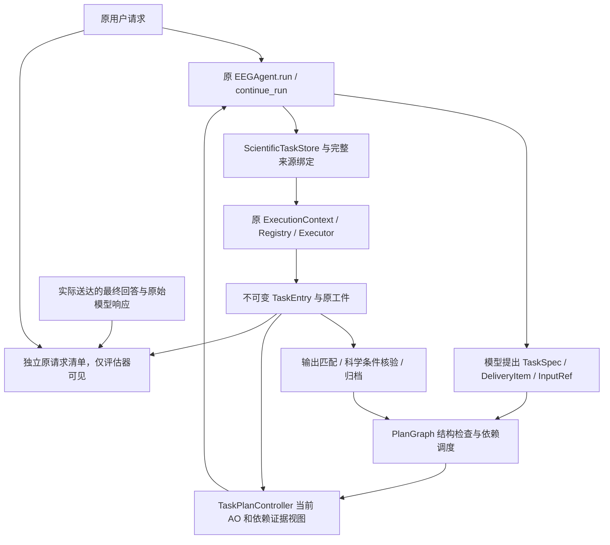

# Issue #55：真实自主执行准入审计与冻结确认协议

日期：2026-11-01（Asia/Shanghai）。状态：**无需付费阶段已实现并验证；真实自主确认未运行，等待单独预算授权**。起点本地/远端均 `4bd74d10a09fc0b006f1e0db8c20c84c1f02365a`，工作区干净；原分支、Draft PR #37。没有修改研究内容二、PR #54、main、旧账本或历史结果。

## 1. 三模块职责与证据边界



|层/接口|已实现与复用输入契约|寿命、限制及未验证部分|
|---|---|---|
|`TaskSpec` / `DeliveryItem`|稳定 task_id、记录、工具能力、scope、必需结果、可选科学条件；同工具多窗口不同 key|模型声明不是原意图证明；复杂省略不由 DAG 解决|
|`PlanGraph.submit/revise/resolve_ref`|有向无环依赖、明确 output key/历史 revision，缺参节点可等待；修订保留历史|只有受影响引用失效；稳定身份需模型正确续接；真实模型行为尚未确认|
|`TaskPlanController._schedule/_sync_outputs/delivery_check/_complete`|调度 ready 节点、核对真实结果和可选谓词；无谓词的正常自动完成为共同能力|TOOL_SUCCEEDED、DELIVERY_SATISFIED、TASK_COMPLETED、最终用户请求完成是四层；后者无通用自动证明|
|`ScientificTaskStore.execute_action` → `WorkingMemoryStore.execute_numeric`|完整用户来源/合法历史、真实记录与工件、工具参数 schema；原数值 Executor|共享有界字面绑定仍可能误拒；不新增模型/算法/Planner|
|当前 AO|实际原生调用及成功/失败观察，在下一决策前构造上下文|完成/切换后退出活动视图，完整轨迹保留；不是永久删除历史|
|精确档案/工件|原 TaskEntry、参数、来源、fingerprint、版本父项、artifact_id|会话内保存；不声称跨进程持久恢复；记录/工件变化使当前绑定失效|
|摘要/精确读回/过程恢复|`_inputs/_read` 按 InputRef.level 呈现；A完整结果，B合理摘要，C依赖粒度，全部同读权|Planner选错层级仍可能少供信息；可升级读取。自动附带、读取、执行成功、下一模型实际使用分别记录|

数值链依赖当前工程的 NumPy/SciPy、原默认 Registry 和 `baseline.json`；本阶段仅内存合成 EEG、128 Hz、两通道、8秒，不加载真实 EEG、模型权重或临床标签。RMS/PSD输入为记录绝对窗，事件分析输入为合法 Epoch 的相对窗/实际工件；事件频带窗须满足至少1秒。本次不扩展支持处理操作，质量阈值只是原实现的经验筛查条件。

真实生命周期为：READY → RUNNING → TOOL_SUCCEEDED → DELIVERY_SATISFIED → TASK_COMPLETED；缺参进入 WAITING_INPUT，独立节点仍调度；修订保留历史，实际受影响输出进入 STALE，再建立新执行 episode；科学条件不足保留实际产物及未满足项，最终只能诚实部分交付。节点归档不证明原请求齐全，成功 finish 提案还须真正被运行时接受并送达。

## 2. 失败归因、最小方案与本轮修正

|现象/轨迹|根因层级与原职责|方案比较、决定|
|---|---|---|
|#52 T04，A/B/C均只产1结果后 SCIENTIFIC_SCOPE_UNGROUNDED|`_request_frames` 换记录会清空对象父关系，记录B“同名通道”无字面锚点；是来源绑定表达不足，不是记忆收益|不能让模型选择的通道或计划成为授权。补“同名”关键词只解决句式；引入完整语义对象解析需单独验证。保留首次失败，真实开发先检验是否自主澄清/合法定位可恢复，不新增第二套解析器|
|#52 T07，混合连续/事件共同误拒|事件句含用于报告的通道，`ground_bound_scope` 又把异域名称当范围冲突；输入对象与输出选择的边界仍不充分|全局忽略异域名称会重新允许事件相对窗串用于连续量。需对象角色级接口证据，当前不以宽松放行换通过；冻结确认保留混合请求，不把它改成单工具|
|#51 可选 list_events 失败阻断主要结果 finish|旧 pending 尝试和必需科学债务耦合；#52 `PlannedTaskStore.completion_check` 已按 requirements 判定，元信息不继承计算窗|复用现有共享修正和原反例测试，不再叠一套 gate；旧模式/首次失败不改|
|本轮反例：只声明 RMS 的 DAG 成功，但原请求还有 PSD|规划漏项，程序只能核查被声明的交付|独立评分器持有原需求清单；三项中仅1项真值通过，完整结果为 false，整会话仍待回答审查。不能靠更多节点门控证明原意图|
|本轮代码审计：拒绝后的数值调用仍写 `event=used`|观测计量混淆尝试和成功消费，不是科学计算本身错误|唯一运行时修正：拒绝写 `use_attempt/success=false`，成功 observed/reused/compared 才写 used；保留模型原参数、适配器参数和错误。A/B/C/A-equivalent共用。成功使用句柄也不是模型理解/因果收益证明|

本轮没有把未知语义问题猜作可用局部 Bug 修掉，没有修改提示词、科学范围门槛、原数值算法或 #52 冻结请求。保留简单强 P&E、原事实档案和安全底座；在实际诊断前停止增加运行时模块。T04/T07仍是**已知阻塞**，不把未修复写成已解决。

## 3. 新冻结确认任务与独立评分

机器协议：`config/point1_working_memory_issue55.json`；工具：`research/working_memory_issue55.py`。三例均为综合请求，8个自然用户轮次，先后 C01→C02→C03，每例只确认一次。

|例|复杂度与完整需求|确认边界|
|---|---|---|
|C01（3轮）|两记录同名通道，A RMS/alpha、B RMS；只修订A alpha并比较；第三轮读最初精确值/区分新旧版|0.5–2.5、2.5–4.5、4.5–6.5秒；不得重算B；保留省略难点|
|C02（3轮）|B连续RMS/alpha先交付，A事件缺窗澄清；补−0.25–1.25秒后计数/theta；核对实际过程，在原工件上追加质量及旧theta|首轮禁止猜窗；不得重切分、筛选、基线校正；过程可直接已见，不强迫restore|
|C03（2轮）|A两窗口alpha，B事件有效计数且至少5个；不足时安全部分交付；后续比较两连续窗口且保留不满足说明|实际B只有2个；0.25–2.25、4.25–6.25秒，事件0–1.5秒；不扩大范围|

确认数据沿用公开可审计合成工厂，A×1.17、B×0.81，再各通道叠加1.3µV、7Hz确定性正弦；原事件表不变。没有真实数据下载及许可新负担。这是不同措辞/参数/合成数值上的结构相关确认，**不是完全未见语言泛化**。#51/#52、T04/T07/T06/T08都是开发/回归材料。

`evaluation_only` 不送入 Agent。`drive_requests` 仅调用 `run(text)/continue_run(text)`，不注入 DAG、工具顺序、ID、oracle 或人工恢复；资源/技术终止不消费后续用户轮。它是可复用自然轮次驱动，非已完成的付费实验。确认前应沿用既有 journal、会话锁、预算钩子，冻结授权收据/代码/协议后运行；CLI 当前 `--real` 在任何客户端构造或输出前拒绝。

评分以每轮实际截止时的档案、实际 messages、原始 response 和真正送达 final_answer 为依据，不能在第三轮补齐后倒改第一轮：

1. `score_obligations(case, store, turn)` 独立匹配记录、能力、精确 scope、有效 binding、source、时基，原采样 oracle 校验；不读取模型 DAG 的 completed 判断。错误数值、错对象、错范围、错时基和版本分别列出。此评分必须在每轮结束时调用并保存，不用会话末状态冒充历史截止状态。
2. 人工逐项核对机器协议 review：所有要求是否声明/计算/实际交付、计数/单位/差值比值/新旧版本、合法澄清、没有额外因果或临床断言。每项需引用实际轮次、消息/结果路径和原文。未经独立审查的 `whole_request_correct`、`autonomous_memory_use` 恒为 null，不因数值通过或模型自评变 true。
3. 完整会话正确必须每轮原始需求、科学事实和实际回答均通过。C03的正确安全停止单列，不记“科学条件满足”；C02首轮正确澄清不记“全部事件交付”。被拒绝 finish、partial占位文字、没有送达答案均不算完整。
4. 记忆逐项记录：InputRef期望 → 下一次实际输入呈现 → 真正read/restore及工具成功/复用 → 后续模型参数/实际回答使用。适配器补句柄和自动附带分别列出；没有自然恢复即未观察到，不强迫使用。无需恢复但正常使用已有信息是合法行为。
5. 真正重复计算按原 Executor `(record, capability, scope, binding/artifact/version)` 统计，合法修订单列；API次数、输入/输出、缓存、失败/预约、实际返回模型ID、API耗时与会话墙钟逐项记账。旧阶段数据不可合并成本/成功率。

连续RMS/alpha/theta、事件计数/功率复用 `independent_oracle`，从原采样通过独立NumPy/SciPy公式重算；事件质量另从原采样切片检查边界、flatline、高幅值、usable计数、各条件计数与标记。质量阈值/工件身份/经验限制仍需元信息和回答审查，未宣称一般科学解释可自动证明。新增协议12个交付对象、17个数字/结构检查全部通过，这是原工具可执行性预检，**没有通过来源绑定/自主规划/自然回答整链**。

## 4. 冻结、预算预检与统一申请

协议 SHA-256：`cbecb0ff333a8921381f1c806899524ca6aeb98a66e3bd4b954d008ec7531710`。
系统提示 SHA-256：`a0ef4d661fc22680f69b22c975d6eb1fecf431d712baef9ff8503696eaa37753`（本轮未改）。数据采样 SHA-256：

- A：`62fec281fb5f8e9a5e7dfc4ff48bc8a7f522b984c59dda0c604041b85594d7f6`
- B：`51ecce8b05218b1c0946657d0a057fb43ec5e6bfe97d31980b837b390e8cd0cf`

完整数据元信息/事件表、实际工具schema哈希及见证在本地 `artifacts/point1_task_memory/issue55/preflight-final.json`。复现时随机工件/耗时可不同，采样和协议哈希须一致。候选提交 SHA 在发布留痕中锁定；若授权后的开发确有必要修订，最多1次，有离线反例再冻结新 SHA，确认开始后不得改协议/提示/分数或复跑挑分。

实际初始输入＋2200输出的预约为19,616–20,150；初始完整final预约5,273–5,567。已知T06/T08真实工具路径捕获每个决策的完整final视图，最大“normal＋final”57,948；T08单臂全路径normal预约181,091–222,652。所有值为**UTF-8 wire字节＋最大输出的保守预约单位**，不是真实API tokens，也不是未知模型轨迹上界。记录保留完整结果，不缩弱A/B。后续每次必须重新按真实wire预约并保留当前完整final快照，异常缺失usage保守收费，零自动重试。

**一次性待申请上限：144次 completion / 6,000,000输入＋输出API tokens，任一先到即停。** 开发至多48次/2,000,000 tokens，只诊断已知T04/T07，含必要修订后的开发验证；确认预留96次/4,000,000 tokens，C01/C02/C03共8轮、每轮最多12次，使用候选C，所有失败/最终回答计入。这是模块验收，不是三臂收益试验；A/B/A-equivalent离线能力和同权保留，正式配对/消融须另行冻结授权。6M按已测最高约39k正常预约×144并给收尾余量制定，不保证任意轨迹成功；超容量即停止，不追加调用。每轮36工具调用、900秒、256000上下文字节上限。

拟延续既有服务请求别名 `deepseek-chat`、non-thinking、最大输出2200、零重试，不购买/升级或私自切换。旧响应 `deepseek-flash` 只是历史事实；本阶段实际返回版本尚未验证。官方2026-11-01价格页列 `deepseek-flash` / DeepSeek-V4.1-Flash-1017，峰时未缓存输入$0.30/M、输出$1.20/M；据此条件估算总6M、输出最多144×2200=316800时，上限约 **US$2.08512**，建议货币硬上限 **US$3**。来源：[DeepSeek官方价格](https://api-docs.deepseek.com/quick_start/pricing/)。此为相同官方Flash计价成立时的计算，不是既有服务账单；授权后先核实既有端点/别名与费率，若不一致停止，不擅自换模型。不开Search/Fetch等服务。

`Issue55BudgetClient`复用原Issue50实际wire/final lease机械实现，独立stage/header/协议哈希和开发/确认额度；缺少单独授权拒绝、旧账本不接受、关闭后不重开。只在临时目录用假客户端测试，**没有开立可消费实验账本**。授权收据不能从 proposed_budget 自动生成；仍须用户单独明确授权。

停止条件：科学对象/时基/版本错误实际执行、同一错误无进展、显著共享缺陷、上下文/资源上限；原始失败保留并停止扩展。确认期间不换窗口/评分/提示追分。授权不等于承诺一定通过，若共享绑定缺陷继续阻断，按负面结果结束本Issue研究阶段并给最小简化建议。

## 5. 实际验证、证据等级与准入

- 全量659项：644通过、15资源跳过、0失败；compileall、pip check通过。默认系统Python3.14缺NumPy，改用已有eegagent环境；没有为测试下载或安装依赖。
- 7项Issue55测试：数值预检、零额度拒绝、仅自然轮次输入、技术终止不消费未来轮、DAG漏项与错来源/时基/范围/记录反例、四臂拒绝不计实际使用、独立账本/保护确认池。其余版本失效/裁剪来源/辅助失败/原工件反例由既有全量回归覆盖。
- T04/T07三臂均稳定partial、1次数值执行；T06三臂安全partial；T08三臂两轮completed，均为固定计划/动作回放，绝非真实模型成绩。原始首次失败在#50/#51/#52原文件保持不变。
- 本轮外部completion **0**、API tokens **0**、实验费用 **0**，没有复用旧余额。

|维度|当前证据等级|未通过/未验证|
|---|---|---|
|DAG规划完整性|结构/调度/修订机制离线可用，独立漏项反例有效|本阶段真实自主DAG、完整原意图覆盖未验证|
|科学交付真实性|原工具数值与对象/版本反例回归通过，新协议17项oracle通过|T04/T07来源误拒未解决；最终自然语言/完整会话未验证|
|依赖记忆自主使用|应供/呈现/尝试/实际成功分开，原工件恢复路径离线可用|真实下一模型使用、自然恢复、压缩成本收益尚无新证据|

**准入判断：暂不进入正式公平三臂/大规模消融。** 可进入的是另获授权的有限自主诊断，不能将现有回归数或oracle数写成创新/效果成立。共同来源局限对所有臂同样适用；C差异仅自动科学条件验收与依赖证据粒度。A-equivalent已能消解自动验收差别。若真实确认或后续公平试验不支持独立收益，应保留共享事实与科学底座，默认简单强P&E，按需开启记忆，不再加模块追分。

复现（已有兼容环境；输出路径必须为新文件，不能覆盖原失败）：

```powershell
$env:PYTHONPATH='src'
python -m eeg_harness.research.working_memory_issue55 --preflight --output artifacts/point1_task_memory/issue55/reproduce-preflight.json
python -m unittest discover -s tests -q
python -m compileall -q src tests
python -m pip check
```

本地原证据：`preflight-initial.json`、`preflight-final.json`、`regression.txt`、`regression-final.txt`；不提交生成产物/真实数据/密钥/个人配置。付费原始请求/响应/成本账本尚不存在，不能虚构。GitHub CI及候选精确SHA见下方发布留痕及PROJECT_STATUS。
