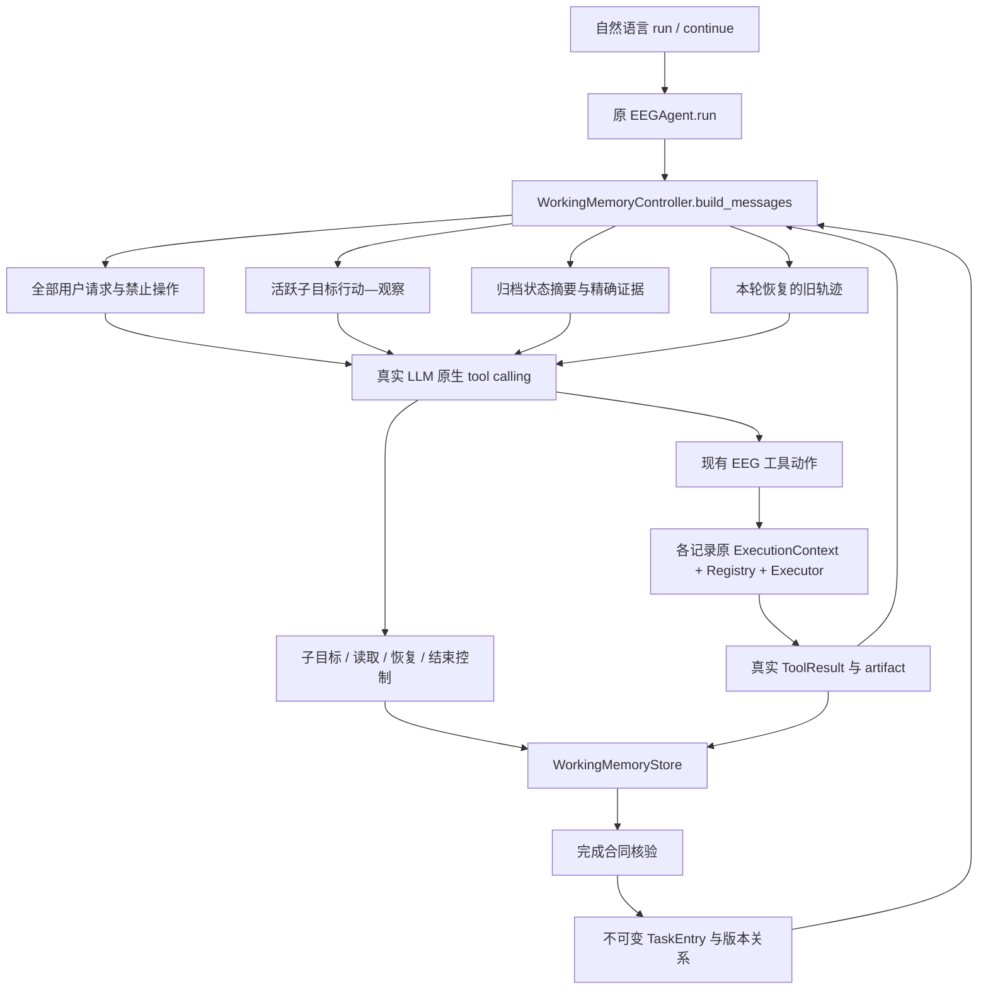
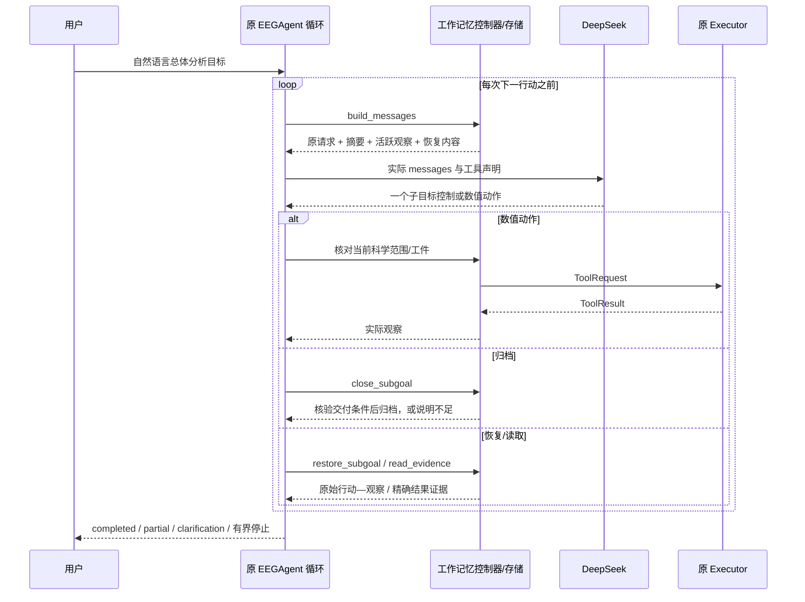
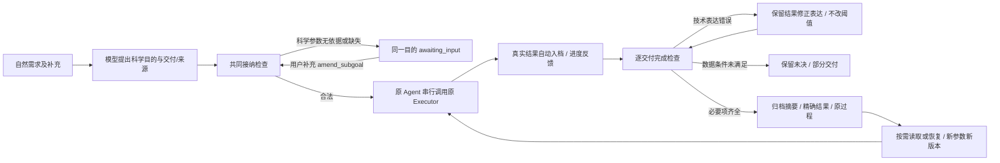

# HiAgent→EEG 工作记忆：适配依据与 Agent 集成

> Issue #47 进行中：在保留以下历史记录的基础上，修复公共重复保护、历史档案/当轮证据工作集和字段单位。新预算48次/300,000tokens已由用户独立授权；开发上限16次/100,000，确认至少预留32次/200,000。先离线锁定，再真实调用；结果在本文末尾追加。

日期：2026-10-26；Issue #45；起点 `e6f7829`，继续 Draft PR #37。本文先冻结实现选择，再追加真实验收与修订。旧 Issue #44 的资格判断及全部历史结果保留；本阶段优先落实执行期工作记忆，不运行策略排行榜。

> 2026-10-26 后续用户阶段任务启动：从 `2c34049` 继续完善多结果交付闭环并整理开题依据；下面 Issue #45 原结果按原版本保留。本阶段无新付费模型预算，不续用 Issue #45 账本。最新实现/验证在文末追加。

**最终状态：核心机制和统一 Agent 入口已交付，真实完整任务验收尚未全部通过。** 真实模型实际完成连续/事件工具动作、恢复旧轨迹、修订旧窗口并复用真实事件工件；同时出现子目标归档失败与确认阶段重复分析。预算已安全停止，不能把这些轨迹包装成完整成功。以下区分方法实现、系统接入和效果证据。

## 原方法核对（原始事实）

核对 [HiAgent ACL 2025 正文](https://aclanthology.org/2025.acl-long.1575.pdf) §2–3、§5.1、§5.3：它面向单次长任务，以模型提出的子目标组织当前行动—观察；完成后以摘要替换详细轨迹，必要时恢复旧轨迹。摘要围绕子目标状态与达成情况，可由 LLM 或其他摘要模型实现；不是另训专用模型的必要要求。消融区分了分解、摘要和恢复，原游戏实验收益不能移植到 EEG。

官方仓库检查版本 `cebdd8e4eacec1a532ce2c0041db8902217b90ba`：[evaluate_model.sh](https://github.com/HiAgent2024/HiAgent/blob/cebdd8e4eacec1a532ce2c0041db8902217b90ba/evaluate_model.sh) 传入 `ContextEfficientAgentV2`；`agentboard/eval_main.py:122` 覆盖 YAML 的 agent 名称；`agents/__init__.py` 注册加载 `cme_final.py::ContextEfficientAgentV2`。该类 `make_prompt`（106）、内部 `serialize_history`（114）按子目标替换旧轨迹，`run`（285）处理子目标与 `retrieve(...)`。代码还按环境选择最后观察或 `TrajectorySummarizer`，不能只据论文抽象声称所有任务都调用摘要模型。`summarize.py::generate_summary` 使用已有 llm_model，并有回退。仓库根树未见明确 LICENSE；本项目不复制其代码、不安装 AgentBoard 环境，只按机制独立实现。LongMemEval 继续仅用于索引/选择/读取分层评价。

## 设计依据与取舍（实现前冻结）

| EEG 场景/已有缺口 | 原机制与直接采用的适用性 | 选择与更简单替代 | 代价/风险与验收 |
|---|---|---|---|
| 事件功率需要先建立真实 Epoch；有效试次/质量观察决定能否继续。旧一次 `run_instances` 后才存卡无法观察中间决策。 | 模型提出子目标再行动适用；游戏动作粒度不能直接搬成逐样本计算。 | 一个子目标是有科学范围和可核查终端产物的分析目的，可含多次原工具调用；直接简单幅值可一次原工具自动形成单步档案。替代是所有任务全历史 ReAct，保留同权参考。 | 开始/关闭子目标增加控制调用；不能把每个工具换名成子目标。验收实际 create_epochs 观察出现在下一次模型决定之前。 |
| 模型说完成不代表请求的结果已计算；失败与缺参不能被摘要抹去。 | 原模型提议完成，适合控制；EEG 需增加真实产物检查。 | 模型声明终端能力、scope 与必要检查，程序根据成功工具、同记录/同 Epoch 输入和参数验证完成。暂挂、失败、待用户与完成区分。 | 只能校验所声明合同，不能证明模型没有漏解用户总目标；不加新意图 Planner。无产物的完成必须拒绝。 |
| 后续比较要知道状态、范围、版本及结果；只有 task_id 索引太弱。 | 围绕子目标归纳达成状态适用；LLM 改写数值有风险。 | 确定性状态摘要＋有界真实字段预览＋来源/单位/修订/依赖/未决项；模型仅提供非权威的简短目的说明。替代为完整轨迹。 | 字段预览可能不足，必须明确遗漏并允许读回；不为摘要额外调用付费模型，不调 HC 阈值。 |
| 标量追问只需一个结果；修订先前分析或诊断失败需要过程、输入工件与实际失败观察。 | §3.4 恢复完整行动—观察适用。 | 分开 `read_evidence` 与 `restore_subgoal`；恢复的真实轨迹进入下一步行动上下文，可引用其中工件/版本再分析。已有摘要足够时不强制恢复。 | 恢复增加上下文/调用，设容量及次数上限；真实演示未自然触发则只报告离线覆盖。 |
| 相同数字可能来自不同记录、连续绝对窗或事件相对窗；修订不能覆盖旧值。 | 一般 provenance 足够表达一部分；需要 EEG 工具的真实 scope/单位来绑定。 | 使用原 EEGRecord/ExecutionContext/TaskEntry 和证据合并；读回声明的记录/参数须匹配存储身份，工具 artifact 只能来自同记录实际产物。 | 不能承诺任意自然语言意图正确；不沿用会误拒新分析依赖的“当前句子必须逐字含旧 scope”要求。 |
| 旧脚本预定 turn.kind；模型未在真实循环内选择分析/回顾/继续。 | 工作记忆应参与每次行动前的输入。 | 给 `EEGAgent.run` 增加默认关闭的可选 memory hooks；工具仍走原 Executor；正式统一 run/continue 只收自然语言。替代是独立控制器复制 Agent Loop，放弃以避免两套循环。 | 需保持原生 assistant tool_calls 与 tool 消息配对；记录每次实际 messages，所有旧 baseline 测试应保持通过。 |

范围：本阶段仅合成记录联网；支持现有连续信息/质量/幅值/PSD、事件发现/Epoch/质量/计数/频带功率。筛选、重参考和模型推理不在本轮新入口开放，缺失能力明确报告；用户禁止操作与全部原请求始终保留。多记录按独立原 ExecutionContext 保存工件，数值执行器不复制。存储仍进程内，不新增数据库或跨进程恢复。

## 拟实施模块与可核查边界

- `working_memory.py`：执行期子目标、同记录工具观察、完成合同、归档摘要、精确读回/轨迹恢复、TaskEntry 与版本。
- `working_memory_agent.py`：现有 EEGAgent 的可选上下文/控制钩子，统一自然语言入口、消息配对、终止及预算之外的本地边界。
- `working_memory_cli.py`：默认需显式开启的合成演示/交互入口；实验脚本只构造合成记录、传用户请求和后验评分。
- 旧研究脚本仍可重跑，不修改 EEG 数值算法。程序能核对产物、参数、版本、错误和状态，用户目的的语义完备性与最终自然语言仍由模型负责，不新增回答审查 Agent。

## 验收与资源预留（实现前冻结）

先离线检查：活跃观察→下一次模型 messages；有/无产物完成；归档压缩与合法原生协议；轨迹恢复→下一行动；修订保留旧值；错对象/版本拒绝；缺参/暂挂/失败/部分交付；重复/轮数/取消/超时/容量停线。数值来自真实工具，RMS、PSD、事件均值与计数从原采样独立核验。Fake 只验证机制。

真实阶段独立追加账本上限 **96 completions / 240,000 API tokens**；默认请求单次输出 ≤1200，自动重试关闭。预留至少 40 次/100,000 tokens 给方法锁定后的完整演示；开发最多两轮根因驱动实现修订，预算不是目标。开发先一条高层组合分析加同会话修订/比较，再锁定不同组合确认与短任务/缺参。不向正式入口提供 turn.kind、正确任务 ID 或子目标序列；工具动作/恢复由模型真实决定。日志明确首次失败、修订、实际触发及未触发机制，实验收益不由本轮实现验收推断。

## 迭代状态

- 设计冻结：已核对原论文/官方实际加载路径与当前代码；尚未实现或进行新的真实模型调用。后续条目在实际验证后追加。
- 实现检查点 `1f5f6fe`：原 Agent 可选钩子＋工作记忆模块＋统一自然语言入口已完成；374 tests（359 pass、15资源跳过），Fake 机制回归与原采样数值 oracle 通过。
- 首次真实开发失败（保留）：2 completions / 6,319 tokens，无数值工具执行。模型先并行 begin/list_events 被单动作边界拒绝；改成单步后把事件输出通道误放进计算 scope，接口返回笼统错误，并把同批两次拒绝计为两次无进展，提前停止。原始输出为 `development-20261026T041329334721-audit.json`（本地忽略目录），不重写失败。
- 根因修订 1：能力输入范围与结果选择的公共接口边界不清，修为结构化 allowed/required/unexpected/missing 字段与输出选择说明；仍拒绝非法范围，不静默删除参数。连续相同错误才累积 no-progress，其他纠正过程仍受总轮数/工具/重复上限约束。科学标准和原请求不改；新增离线反例通过后重跑相同开发请求。此为接口/恢复工程修订，不称新方法贡献。
- 开发复跑：第一轮事件和连续数值均正确，但模型把事件交付暂挂，重复关闭未激活目标，20轮后 repeated_action；续接11轮完成窗口修订，真实恢复原事件完整轨迹并据其 artifact 执行 epoch_summary/epoch_quality，没有重算事件功率。旧事件目标仍 suspended，首轮不能记为完成。最终回答大部分事实正确，但“不同窗口功率不可直接相减”等表述过强，且整体意图完成未自动证明。
- 根因修订 2（最后一次）：双 ID 和“恢复不等于激活”的生命周期负担使已正确算出的目标无法归档。增加由实际完成合同计算的 delivery_check/合法后续操作；允许按明确 subgoal_id 关闭已满足合同的暂挂目标，不重算、不跳过校验；已完成 subgoal 明确解析到其唯一 TaskEntry 版本。恢复过的未完成目标不能被随后 completed 隐藏。去掉已在恢复载荷/档案中出现的成功 control 协议整对副本，不留下孤立消息。
- 预算偏差：开发已用33次/202,622 tokens，虽然未超阶段上限，但仅请求数的阶段限制未保护预留100k tokens，这是本轮执行/预算工程缺陷。新增累计开发token保护，停止开发调用；剩余37,378 tokens只做修改前冻结的缩小完整确认单元（见协议 amendment），不追加预算。不再声称原跨记录事件确认已执行。

## 实际架构、权责与运行时序





四个层次：**总体目标**是用户请求原文；**科学子目标**是记录＋作用域＋交付物＋可选前置检查/可观察条件；**动作**是一次原数值工具或控制操作；**档案**是已核验完成的 TaskEntry。事件子目标通常需建立工件、检查、分析多个动作；连续 PSD 可以一动作隐式归档。Welch、滤波等工具内部计算仍是原子动作，未拆开或重写。

| 代码与实际入口 | 职责 | 谁决定/什么尚未证明 |
|---|---|---|
| `agent.py::EEGAgent.run`（L80） | 原循环增加默认关闭的 memory hooks，仍负责原生工具消息、LLM 异常及步数边界 | 模型选动作；旧 baseline 无 hooks 时保持原行为 |
| `working_memory_agent.py::WorkingMemoryEEGAgent`、`continue_run` | 接受已加载记录和自然语言；复用同一个 `run` | 没有 turn.kind、gold、正确任务 ID、预定动作列表 |
| `WorkingMemoryController.build_messages`（L110） | 每次行动前实际组织原请求、活动观察、归档摘要、恢复轨迹和证据并保存 messages | 程序构造，不执行关键词排名；当前全部简短档案可见，非大规模检索系统 |
| `WorkingMemoryStore.begin_subgoal`（L97） | 记录与能力范围、不可变版本父项、checks/criteria | 模型提出；程序核验声明与真实工具，不核验完整用户意图 |
| `execute_numeric`（L189） | 逐动作走原 Executor，同记录 artifact、相同科学 scope | 无第二套数值执行器，不调用旧 `analyze/run_instances` 整条同步链 |
| `completion_check`（L232）、`close_subgoal`（L283） | 必要工具真实成功、同工件、最新失败、声明的结果字段条件；成功/暂挂分开 | 科学前提没有被模型声明则程序不能自动补全；不把合同通过当作科学意图完备 |
| `summary`（L349） | 状态/未决项/依赖/版本、实际检查事实、终端结果固定前12个精确叶子及可读路径 | 不额外调用摘要 LLM；不修改数值。其余详细结果仍保存，未声称所有摘要足够 |
| `read_evidence` / `restore_subgoal`（L400） | 按真实版本查字段/结果，或恢复完整行动—观察；scope 与记录匹配 | 模型选择目标和恢复理由；已完成 subgoal alias 仅解析其确切 TaskEntry |
| `task_memory_evidence.py::merge_evidence` | 旧结果可见值与新读回值取有来源的并集 | 共有工程基础；索引/错误不成为数值证据 |
| `working_memory_cli.py` | 明确 `--real` 的合成入口、持久预算、逐轮原始日志 | 凭据仅环境；输出留忽略目录；不跨进程恢复会话 |
| `research/working_memory_validation.py` | 仅加载请求与合成记录，事后独立核验数值 | 评分器不能决定 Agent 子目标/顺序；audit 通过也不代表完整任务通过 |

控制工具：`begin_subgoal`、`close_subgoal`、`resume_subgoal`、`read_evidence`、`restore_subgoal`、`finish_task`。数值工具白名单：`record_info`、`amplitude`、`psd`、`record_quality`、`list_events`、`create_epochs`、`epoch_summary`、`epoch_quality`、`event_bandpower`。本模式没有筛选、重参考、基线校正和模型推理；不把这些禁用项写成整个仓库没有的能力。

程序状态为 active/blocked/suspended/awaiting_input/completed；总体回答另有 partial/clarification_required。有界轮数/动作数/重复/无进展、恢复次数、上下文和证据容量限制；取消在下一调用前生效，外部调用有45秒超时，不能承诺中断已发送请求。所有用户原请求始终保留，容量不够返回容量错误，不悄悄删禁令。证据合并沿用8任务/24KB边界；工作上下文96KB，非人为压低的实验设定，未调 HC 阈值。

## 实际真实轨迹与失败保留

请求 `deepseek-chat`，40/40 响应报告 **`deepseek-flash`**；不是保证服务端权重的独立身份认证。所有出站数据为明确合成记录元信息与真实工具结果，没有波形数组、真实受试者事件、私有路径或权重。原始 API 响应、逐次输入和追加预算保存在被 Git 忽略的 `artifacts/point1_task_memory/issue45/`。

公开可核查的最小样本：[合成实际轨迹摘录](evidence/issue45_synthetic_trace_excerpt.json)，包含原始文件哈希、真实动作、scope、数值、归档状态、恢复理由、下一动作前可见信息、被接受的回答与失败结局。它是首次输出的摘录，不是另跑出的演示。

| 运行/版本 | 实际调用与结果 | 能支持的判断 |
|---|---|---|
| 开发首次 `1f5f6fe` | 2 calls / 6,319 tokens；并发动作、非法事件 scope，no_progress；无数值输出 | 首次失败；不能计为任何 EEG 任务成功 |
| 开发复跑 `0226293` 第一轮 | 20 calls；模型提出事件子目标，实际 list_events→create_epochs→epoch_summary→epoch_quality→event_bandpower；随后越范围 PSD 被拒，事件暂挂；另建连续子目标成功。重复归档后 repeated_action | 连续与事件工具链真实存在、观察可见；高层请求完整交付失败 |
| 同会话第二轮 | 11 calls；旧版本 ID 误用被拒后修正，3–5秒 PSD 新版本；模型主动 restore 旧事件轨迹，随后引用原 artifact 做 epoch_summary/epoch_quality；没有重算 event_bandpower；最终回答成功返回 | 真正统一入口续接、真实轨迹恢复参与后续分析；旧事件目标仍暂挂，不能把整体两轮记成全通过 |
| 锁定后缩小确认 `bf744c6` | 7 calls / 26,112 tokens；RMS→PSD→record_info 数值正确，首次并发被拒；关闭幅值目标后模型又声明重复子目标；第8次调用前预算预约拒绝，未生成最终回答 | 未通过完整确认；非 DeepSeek 不可用。原日志保留 `llm_error/LLM_ERROR`，事后依据账本归因为预算停止，未重写旧记录 |
| 原完整跨记录确认、短请求/缺参确认 | 未执行 | 不得宣称通过。短请求/缺参只有离线 Fake 机制覆盖 |

真实成本总计 **40/96 completions，228,734/240,000 API tokens**（输入221,577，输出7,157；无未结算请求；API墙钟累计约60.47秒）。最后余11,266 tokens，少于当前完整请求的保守预约，因此停止；不是补领旧余额或压缩接口继续刷分。开发未保住原确认预留是明确不足，已添加跨运行开发token保护及离线重启测试。预算错误新代码单独报告 `budget_exhausted/STAGE_BUDGET_EXHAUSTED`，不再伪装服务故障；此为诊断工程修复，没有第三轮方法试验。

### 一个可审查的真实续接

1. 首轮模型自行提出事件功率子目标；真实 `create_epochs` 得到3个试次、0边界拒绝。
2. 后续模型调用 `epoch_quality`，实际标记0、可用3、经验阈值未经临床校准。模型看到该观察后才调用 `event_bandpower`；不是脚本直接运行整条流程。
3. 事件 SYNTH-C1 alpha = `3.2799997787269497e-10 V²`；连续0–2秒 alpha=`2.00e-10 V²`。首轮归档控制失败保留。
4. 用户续接要求3–5秒修订、核对旧质量过程。模型以新 PSD 结果 `3.92e-10 V²` 建立 `revision_of`，旧结果未覆盖。
5. 第二轮第5个动作恢复旧事件子目标，恢复理由在原始消息中；包含原 create/check/power 及失败 PSD 观察。实际下一决策输入含恢复内容。
6. 第二轮第7个动作提出核对事件试次与质量的子目标，第8/9个动作使用**旧的真实 artifact_id**计算计数与质量。没有建立新 Epoch，也没有重算已有事件功率。该恢复具有后续分析用途。
7. 最终回答正确列出连续前后数值、3试次、0标记、无筛除及经验阈值限制；但旧事件任务仍 suspended。此时 `completed`只证明当前新声明的交付，遗漏历史未决状态的问题由第二次修订加以收紧，修订后长任务尚缺真实确认。

不能把实际观察进入输入等同于因果证明模型必然依赖它；本轮没有随机干预/消融。能确认的是动作发生顺序、可见输入、真实 artifact 复用和数值一致。

### 独立数值核验

对已成功执行的观察逐一核验，包含未归档结果，不只挑 completed 档案：

| 真实工具输出 | 原合成采样独立 oracle | 结果 |
|---|---|---|
| 开发事件 alpha `3.2799997787269497e-10` | 同值 | 通过 |
| 开发连续0–2秒 `2.00e-10` | `1.9999999920083944e-10` | 原工具字符串舍入，允许0.5%误差，通过 |
| 开发修订3–5秒 `3.92e-10` | `3.9199996720862273e-10` | 同上，通过 |
| 确认1–3秒 RMS `1.60e-05` | `1.598061305042897e-05` | 同上，通过 |
| 确认1–3秒 alpha `2.55e-10` | `2.553800122762073e-10` | 同上，通过 |

这些是数值与范围校验，**不是5/5完整任务成功率**。事件计数、质量与未筛选来自实际 Epoch/质量结果；科学阈值本身不作临床有效性声明。

## 运行、回归及版本

在现有 `eegagent` 环境（Python 3.10 / 项目现有依赖）从根目录运行：

```powershell
$env:PYTHONPATH='src'
$env:PYTHONIOENCODING='utf-8'
python -m compileall -q src tests
python -m unittest tests.test_working_memory -v
python -m unittest discover -s tests -q
python -m pip check
python -m eeg_harness.research.working_memory_validation --offline-audit
```

最后一条只读取本机本轮忽略日志；无日志则没有数据，不会联网。远端可检查公开摘录并运行真实工具的离线机制测试。最终全套 **379 tests：364 passed、15 resource-gated skipped、0 failed**，新增工作记忆24项。compileall/pip check/diff check通过。恢复/身份别名/暂挂后核验关闭等第二次修订有真实工具离线反例；不冒充改进后的真实长任务成绩。

正式自然语言接口，无评测器参数：

```python
from eeg_harness.working_memory_agent import WorkingMemoryEEGAgent
from eeg_harness.research.task_memory import synthetic_records
# client 必须使用有持久预算的适配器；本阶段真实额度已停止。
agent = WorkingMemoryEEGAgent(client, synthetic_records())
first = agent.run("分析 A 的 SYNTH-C1 连续0到2秒 alpha 功率，不筛选。")
followup = agent.continue_run("保留旧结果，改为3到5秒并比较。")
```

CLI（仅说明复现入口，**本轮不要再运行真实调用**；需未来明确授权新阶段预算，不能重置本账本）：

```powershell
# 服务、模型、凭据由 EEG_HARNESS_LLM_* 环境变量提供；勿打印或写入仓库。
python -m eeg_harness.working_memory_cli --real --request "当前 A 的采样率和通道是什么？"
```

`--request` 可重复，后续请求走同一会话；`--context-mode full` 是同权限、同合同的完整历史参考模式，仅离线验证过共享控制，没有本轮真实对照胜负。脚本 real开发/确认命令保留，但本轮不继续使用。跨进程重启预算不会归零，真实会话本身不持久化恢复。

提交：`94aaaf3`设计；`1f5f6fe`核心集成；`0226293`修订1；`bf744c6`修订2及确认锁定；`a15c173`预算诊断和失败交付数值核验。后续仅文档交付，没有第三轮方法调整。均沿 PR #37 原分支普通提交/推送，不合并 main。

## 方法、集成与效果分别如何评价

| 层面 | 已完成 | 未完成/不能宣称 |
|---|---|---|
| 核心方法落实 | 活跃子目标逐动作观察、核验后归档、执行前上下文替换、按需真实轨迹恢复、精确事实不被模型摘要改写 | 单终端档案不足以表达子目标中多个有效输出；条件解析/全部用户目的仍有遗漏风险 |
| Agent 集成 | 原循环＋原数值执行器；同入口真实自然语言分析/续接/版本修订/恢复/工件复用，非 turn.kind 脚本路由 | 真实首轮高层目标没有完整交付；修订后完整事件闭环和真实短任务/澄清未确认 |
| 实验效果 | 真实机制轨迹、独立数值正确性、离线错误/状态/协议回归 | 无优于强 S 或降低总成本证据；本轮不做方法排行榜，不能称完整 HiAgent复现或论文创新成立 |

可以称为**已嵌入 Agent 决策输入的实验性工作记忆**，不能称为已经稳定完成任意自然语言 EEG 多任务。继承的是 HiAgent 子目标—活动轨迹—摘要—恢复；EEG 适配是实际科学范围、原始工件/版本、可验证交付、数值来源及两种时间基准；生命周期反馈、别名解析、预算错误分类属于工程修复。共有 provenance/结构化工具技术不算独有创新。

更简单的替代方案仍有价值：短请求用原 EEGAgent/直接工具；短历史强 S 可保留全部必要结果并减少控制动作。本模式增加显式生命周期动作、摘要/恢复结构和验证开销；本轮未证明其节省 token，反而观察到归档/恢复错误与冗余调用。暂不替换强 S 默认，不扩 HE，不新增摘要 LLM 或验证 Agent。

**下一步唯一值得解决的核心环节**是“子目标可交付结果集合与记忆归档闭合”：本轮确认中 amplitude 子目标已经产生 PSD/record_info，但仅 amplitude 被编为独立 TaskEntry；其余数值留在轨迹，模型随即重建含三个 checks 的重复子目标。这说明当前完成合同与科学目的的多结果关系仍不够明确。应在现有档案/原 Executor 上研究最小多结果交付表达，先用本轮失败做离线回放，检查全部已产生结果可用且无需重算、暂挂不被隐藏；之后才申请一个完整连续＋事件配对确认的新预算。不是新增 Planner/第二工作点，也不是改阈值追分。

如果该最小改动仍需大量专用流程或更多控制动作才能可靠完成，应收缩为“任务历史＋明确证据读取”的简单实现，不继续堆工作记忆层级。本轮有真实集成进展，但不足以把工作点一宣布定型；保留负结果，停在此检查点等待下一阶段决策。

## 后续阶段：多结果闭环设计依据（实现前记录）

已核实 `completion_check` 以单个 deliverable 为完成中心，`close_subgoal` 只创建一个 TaskEntry；同目标中的 PSD/record_info 等非终端成功结果只能恢复轨迹。这是可复现的档案与完成合同表达不足，不等于所有真实失败均由记忆导致，也不能把改好它直接称为创新。

比较三种方案：①每个工具一个子目标，改动少但人为增加控制步骤，无法表达有意义的多结果科学目的；②把全部原始轨迹永久放回上下文，信息齐全但失去任务级记忆价值；③声明交付要求列表，真实结果独立寻址，子目标归档汇总整个结果集合。选择③，不增加图规划或执行器。

- 多结果模式作为明确可选版本；保留 Issue #45 单结果版本和原测试，使用同一 Agent 循环与数值执行器。
- 子目标要求包含局部 key、工具、科学 scope、必要/可选、可选 revision_of。每次成功结果立即形成可追溯结果条目；子目标成功、部分交付和某个工具成功是不同状态。
- 必要要求逐项按实际工具、范围、数据/工件身份核验；相同工具不同窗口不得混为一项。可选失败保留但不否定已完成的必要交付。
- 归档展示所有结果的定位/范围/版本/状态与有界事实，原始结果与轨迹留外部；标量读取继续沿用公共证据接口。
- 复用是显式合法绑定，不重新算、不复制旧值冒充新分析；参数修订必须新要求/新版本。数据或工件不同，即使数值相同也不能据此认定可复用。
- 必须验证：旧缺口复现、连续/事件多结果、部分失败续接、同工具多参数、错版本/范围拒绝、恢复进入下一次模型输入、独立数值 oracle。Fake 只作机制控制；本阶段不调用付费 API。

## 后续阶段实装：显式交付列表与完整结果集合

本节为 `2c34049` 之后的新版本，不改写以上 Issue #45 成绩。入口 `WorkingMemoryEEGAgent(..., memory_version="multi_result")`；默认 `single` 仍走旧实现。原 `EEGAgent.run/continue_run → WorkingMemoryController → ExecutionContext.execute → Executor` 不变，数值工具、Welch 计算及原输出精度均未修改。

### 为什么这样适配

|实际问题|采用的机制与理由|更简单替代及代价|可观察行为|
|---|---|---|---|
|一个科学目的有幅值、功率、质量等多个结果|`deliveries` 为局部 key、tool、scope、required、revision_of 的有限列表；不预设动作序列|单工具子目标无法表达整体交付，增加 begin/close；列表则增加模型声明和程序匹配成本|缺任何必需项不得 completed；可选失败单列|
|实际成功但非 terminal 的结果不可正式读取|每次数值成功立即形成 TaskEntry；子目标汇总全部 result_ids|保留全部轨迹也能找到，但要重复读取/解析长过程|create_epochs、检查、最终分析均独立定位；成功结果可属于未完成目标|
|旧窗口功率被用来满足新窗口要求|结果绑定真实记录指纹、参数、配置、工件身份；revision_of 保存旧新关系|仅 task_id/文本标签便宜但不能核查改变的科学对象|修订范围不符、同值但不同 artifact、数据变化均拒绝复用|
|恢复后重算已完成项|显式 reuse_result 绑定准确旧结果；恢复轨迹取得真实 artifact_id 后追加分析|让模型自行读轨迹也可继续，但不形成可验证完成关系|已有 PSD 无新增数值调用；同 Epoch 增加质量测量|
|归档成功后遗漏先前证据|Controller 合并每个结果摘要事实、本轮执行和读回证据|全历史也有效但成本高；公共交接不算候选独有优势|下一次实际 messages 同时含已见值及新读值|

以上完成合同与版本正确性是软件和科学应用要求，**不是新的通用记忆算法**。HiAgent 继承点仍是当前子目标行动—观察、完成后摘要替换、按需恢复原过程；EEG 适配在科学对象、时间基准、单位和多结果交付的程序约束。摘要为结构化真实事实，不让模型改写数值，也没有再增加摘要模型调用。

### 核心代码与执行边界

- `working_memory_deliveries.py::MultiResultWorkingMemoryStore` 仅扩展存储、完成检查和复用；原 store 新增两个默认空 hook，不复制数值执行器。
- `begin_subgoal` 校验交付 schema；同工具不同窗口有不同 key；每个子目标绑定一个 record，跨记录仍分别声明。实际通道、时间和资源的校验仍由原工具 Executor 执行。
- `remember_observation` 为全部成功输出保存原结果；额外测量可针对已声明科学对象，但不会满足另一工具/范围的要求。
- `completion_check` 检查每项最新有效绑定或最新匹配执行、真实 criteria、数据/配置身份；同一事件范围的必需结果必须来自同一 artifact。可选失败保留在 summary，不使已完成的必需项失败。
- `reuse_result` 不计算、不生成新结果；校验 record、tool、scope、revision lineage、数据/配置与 artifact 身份。后续新执行覆盖该项的复用绑定；显式复用可在一次失败尝试后重新绑定已有有效结果。失败记录不删除。
- `summary` 列出完整结果集合、读回定位、`superseded_by`、`binding_valid`、必要缺口和失败。每个结果预览前 12 个真实标量，最多显示 64 个字段地址；原结果/过程仍在会话档案中。不存在“只归档最后一个结果”。
- `working_memory_agent.py::build_messages` 在下一行动前构建当前观察、归档结果集合、恢复轨迹与精确证据并集；新模式有匹配列表 schema 的提示，旧模式 prompt 保持。
- `applications/evidence_statement.py` 仅示范结构化标量声明及固定模板核验；不理解任意医学文本，不产生诊断或等级，不调用 TC 模型。

完成逻辑可简写为：对每个必要项找到**实际工具相同、科学范围相同、版本/对象仍有效**的结果，检查用户声明的可核条件；事件同范围结果须绑定同一实际工件；全部满足才允许 completed。没有以 gold/case ID/未来问题决定保留内容，也没有证明 LLM 声明列表已穷尽自然语言意图。`finish_task` 仍不证明自由文本最终回答完整或正确。

### 离线诊断、修订与验证

1. 旧模式回放：amplitude 子目标内执行 amplitude＋PSD，2 个真实观察但只有 amplitude 一个 TaskEntry；作为回归测试保留，未“修正”旧成绩。
2. 设计审查发现“先失败后复用”若始终以最后一次数值尝试为准，会把后来的合法绑定误判失败。新实现使用明确的绑定/后续执行覆盖规则；同时保留失败历史。另把旧工具科学计数法字符串作为数值条件比较，未改变工具输出。
3. 首次新测试 13 项中 2 项错误：验证代码猜了不存在的 `epoch_counts`、`mean_absolute_power` 字段。检查真实工具输出后改为 `valid_epoch_count` 与 band 标量；不修改科学真值，不删检查，归类为测试接口错误，不是 LLM 失败。
4. 受控 Agent 两轮共 21 次 Fake 决策、7 次真实数值执行、4 个科学子目标、7 个结果。连续幅值/PSD＋事件 trial count/bandpower；第二轮恢复事件轨迹、复用旧 bandpower、在原 artifact 上补测 epoch_quality，并生成新窗口 PSD。create_epochs、事件 bandpower 各仅执行一次。每次实际模型请求的可见结果 ID、恢复轨迹和行动前时点都有记录。
5. 5 项独立原采样 oracle：连续 RMS、旧/新 PSD alpha、事件有效试次数、事件 alpha；工具字符串精度按 rtol=0.005、atol=1e-13 核对。不是统计性能实验。记录 A 为 128 Hz、2 导、8 秒合成 EEG，事件数据亦为合成。
6. `397 tests = 382 passed + 15 resource-gated skipped`；其中原工作记忆24项、新多结果13项、声明/入口/完整样例5项。compileall 通过。资源跳过不算推理成功。本阶段外部 completion **0**，Issue #45 账本不动。

复现（已激活项目 Python 环境）：

```powershell
$env:PYTHONPATH = 'src'
python -m compileall -q src tests
python -m unittest discover -s tests -q
python -m eeg_harness.research.working_memory_deliveries_validation --output artifacts/working_memory_multi_result/new-example.json
```

输出文件以 `x` 创建，旧结果不覆盖。公开合成样例见 `evidence/multi_result_closure_example.json`；完整原始模型结果仍引用旧 Issue #45 文件，新样例明确标记 Controlled/Fake。

### 真实确认入口与待验证边界

无新授权，本轮不创建启用的预算文件。未来获得明确预算后，在忽略目录配置 `{ "enabled": true, "stage": "new-authorized-stage", "max_requests": 实际授权数, "max_tokens": 实际授权数 }`，环境变量设置服务；使用：

```powershell
python -m eeg_harness.working_memory_cli --real --memory-version multi_result --budget-config artifacts/new-stage.json --request "A 的 SYNTH-C1，连续0到2秒幅值与频带功率；另给stimulus事件后0到1秒试次数和功率，不筛选。" --request "在同一批事件试次上追加质量测量；连续窗口改为0到3秒并与旧结果比较。"
```

另用独立会话做短请求/缺参确认。CLI 不接受默认旧配额，新账本跨运行累计；配置文件不是授权本身，必须先有用户授权。`budgeted_client` 旧研究函数保留供历史复现，**不得用于本阶段续跑**。

建议下一次只验三类用途：多结果完整请求、自然修订/追加、短请求或澄清；优先预留完整会话，失败不得挑问法删去。由真实模型决定列表和动作，评价器只事后读日志。当前仅 A（离线机制）完成；新版本 B（模型自主触发）、C（真实完整交付）、D（公平相对收益）均未验证。旧真实恢复现象只说明旧版本发生过，不能替代新版本确认。

已知代价/限制：指纹校验读取本地数组，成本随记录大小增长；当前会话内的不可变约定和归档尚非跨进程持久恢复；摘要仍有开销，原公共精确证据上限8个结果/24KB、总消息96KB会安全停止，复杂会话不能无限堆结果。一次子目标允许最多12项，但模型执行可能先遇到公共证据容量边界，不能保证12项联合完成。新模式只开放现有9种记录/连续/事件数值工具，未迁移模型推理、筛选、重参考；无临床有效性主张。下一步应验证真实多结果交付是否减少重复分析，而非继续增加工具、调摘要阈值或重启规划研究。

## Issue #47：可靠性修复与真实确认协议（联网前冻结）

原HEAD `1d11cc1` 的真实工具隔离回放保留在本机 `issue47/pre_fix_reproduction.json`：四个合法子目标均已关闭，但第4次相同close参数触发repeated_action；9个档案结果导致下一轮无消息可用；事件count=3和分辨率=1.0被统一标为V²，旧验证器均接受。前两项涉及继承的公共控制逻辑，不全归因于上一轮多结果模块。

修复方案不提高原阈值：重复动作键关联调用前子目标/记录身份，同一目标重复读取/执行仍有界。全部原结果与过程继续保存；历史摘要作为不含结果值的可发现索引，当前精确工作集由本轮执行、显式依赖/修订/复用/读取/恢复组成。精确单字段读取不自动扩成全历史值；比较所需旧新证据共同保留。单轮确需超过8项/24KB仍明确停止，可在后续新轮继续，不永久锁死累计档案。完整历史参考仍能保留原消息，公共修复对其同样适用。

字段单位由独立 `result_semantics.py` 按实际工具字段合同定义，精确工作集逐字段附语义；声明验证直接核对真实值、字段类型/单位、来源与版本，不能再用相同生成器自证。未注册字段明确不推单位；只做结构化接口核验，不声称验证任意医学自然语言。

真实协议在 `config/point1_working_memory_issue47.json` 冻结。开发只做原始合成A连续幅值/功率一次请求；确认使用不同来源、幅值缩放及tone/rest标签，包含B连续+事件的完整请求、同会话窗口修订/原工件质量追加，以及新会话短查询/缺参澄清。请求只给科学目的/必要参数，不给工具顺序、任务ID或答案；评价清单与oracle仅在执行后使用。最多两轮有根因开发修订，确认不能混报为开发成功率，首败保留。

`research/working_memory_issue47.py` 复用原Agent入口、合成记录、原工具和独立原采样audit，新增仅该阶段预算适配：固定48/300000总额，development16/100000跨运行预约，零自动重试、失败按保守预约计费，旧账本不读取或修改。创建账本前需本轮用户授权（现已提供）。方法收益比较仍未开展，不从本次演示推强S或HiAgent基线优劣。

开发记录（确认前）：`f29f139` 下首次真实请求6次completion/27,374tokens，数值及两个已声明交付通过。模型一度并行提出amplitude/PSD，2个工具请求均被公共顺序约束拒绝，后按逐动作执行自行恢复。最终回答有“既有结果、本次未重算”的来源时间歧义：本次实际新算两项，不能把该措辞计作准确历史复用。开发修订1只增加程序派生的 `created_turn`、`current_turn`、`acquired_this_turn`，防止归档后丢失本轮/旧轮身份；无数值、任务真值或提示特例变化。46项工作记忆相关测试通过；不对同一开发请求付费刷分。确认使用预先冻结的不同请求/数据配置，完成后只作事后诊断，不根据确认调候选。

### Issue #47 最终结果：可靠性反例通过，自主完整验收未通过

确认锁定代码 `83e2c00`，未根据确认结果修改方法或提示再刷分。全阶段 **36 completion / 277,191 API tokens**（输入271,817、输出5,374），36次响应均返回 `deepseek-flash`；请求名为 `deepseek-chat`，不能据别名推断未返回的精确权重版本。账本零未结算、零网络失败、零自动重试。开发6次/27,374，确认30次/249,817。确认前保留42次/272,626，满足预留门槛；额度为上限而非消耗目标，现已停止，不自动继续。

|冻结用途|实际行为与交付|成本、停止原因|判断|
|---|---|---|---|
|开发：A/C1连续0–2秒幅值＋频带功率|1个多结果子目标、2项实际计算、归档及最终回答；6个请求字段独立数值检查通过；“本次未重算”时间表述含混|6次/27,374 tokens；completed|开发数值/合同通过，过程措辞不完全忠实；只据此修订轮次元数据|
|确认：B/C2连续1–3秒＋rest事件后0–1秒计数/平均功率|真实执行6次数值工具；全部主要数值已产生；连续目标完成，第二目标未关闭，未形成最终回答|首轮21次/196,983 tokens；24个工具请求后tool_call_limit|**未完整交付**；不能用档案里有数值代替回答正确|
|同会话追加：连续3–5秒旧新theta比较＋原Epoch质量|只尝试关闭旧目标，因错误条件未满足被拒；未执行新窗口或质量，未恢复旧轨迹|1次/16,817 tokens；下一次调用预约被拒|**续接未完成**，不算成功恢复或修订|
|独立短请求：A采样率和通道|正确报告128Hz、SYNTH-C1/C2，来源与范围一致|3次/13,368 tokens；completed|通过本条短请求，不能外推复杂任务|
|缺参：比较两条件事件功率|先读取真实事件，再自行选择rest/tone和−0.5～0.5秒窗，复用事件列表并实际创建Epoch；没有向用户澄清|5次/22,649 tokens；下一次调用预约被拒|**未通过**；尤其不能把未授权时间窗称为科学合法完整任务|

逐例动作、首次失败、原日志哈希及聚合用量见 [`evidence/issue47_reliability_and_confirmation.json`](evidence/issue47_reliability_and_confirmation.json)。原始responses、turn与追加账本保留在忽略的 `artifacts/point1_task_memory/issue47/`，没有真实受试者数据。公开文件只含合成结果和必要摘录。事后审计不是模型输入，未提供正确子目标/工具序列/工件ID或评分答案。

**数值与交付分开：** 原运行audit只检查每项代表字段，事件默认检查C1，因此本阶段额外事后核对实际请求的C2及所有频带：开发6字段、混合确认17字段（其中包含额外C1事件5频带）共23字段全部通过原采样独立oracle。连续字符串按rtol=0.005，事件按1e-6，atol=5e-13；报告保留误差而非把极小非零值解释成科学差异。B/C2 RMS为7.15e−6 V；连续theta为5.11e−11 V²，事件rest有2个有效Epoch，C2事件theta为1.3569885449690733e−10 V²。计数仅指窗口边界有效，不是质量阈值合格；本次未测质量。功率为绝对功率，未做baseline或筛选。以上数值不证明混合请求最终回答成功。

**真实失败归因：**

1. 模型在混合首轮三次提交并行工具批次，7个请求被共同逐动作接口拒绝，未重复执行数值；这是动作协议适配成本，不能归记忆检索错误。模型把未来交付项名`rest_epochs`当成应指向实际结果ID的dependencies而产生INVALID_DEPENDENCY；缺参会话同样使用`events/epochs`交付名，暴露局部交付依赖与已有结果依赖的接口易混性。
2. 第二混合子目标重复声明已完成的连续项；6次成功reuse_result中包含冗余重复绑定。复用本轮较早结果确实避免重算，但**没有发生restore_subgoal，也没有成功历史字段读回**，不能标成跨轮轨迹恢复。当前档案/精确集没有出现原累计容量问题。
3. 模型声明事件条件 `path=["rest"]`，实际字段为 `["labels","rest"]`，语义上已有2个事件，路径不存在却进入已接纳合同。随后read_evidence也用错路径，末轮close报INCOMPLETE_DELIVERIES。现有诊断未将“条件路径错误”与“数值条件不满足”充分分开，且缺乏轻量合同修正过程；这是可定位的公共接口/完成合同缺口，不是PSD或Epoch算法错误。
4. 缺参模型自行填入时间窗，工具只校验数值/对象合法，未验证该范围由用户提供或确认。**科学参数合法≠科学选择已授权**；这是真实安全性缺口，预算停止不能为它免责。保留此首次失败，不在确认上补句式规则。
5. 复杂活跃轨迹与重复控制反馈增长造成输入成本；阶段输入占98.1%。预算预约使用请求UTF-8字节作为输入token保守上界并预约最大输出，在实际总量尚未300,000时也可安全拒绝大请求。两次预算停止均发生在请求出站前，未发生API服务故障，未账外消耗。档案/工作集分离解决了累计结果数误停，**并没有解决活跃目标开销与恢复成本**。

**实现、触发、效果三个层级：** 三项本轮指定修复已有真实工具反例及回归；开发实际触发多结果归档，确认实际触发同轮结果复用和短查询。新版真实完整混合任务、缺参澄清、自然修订和旧轨迹续接未通过；公平相对收益尚未实验，不能宣称比强S或合理HiAgent直接迁移更优。公共保护、工作集分离与字段单位修复均属工程正确性，不单列创新。下一阶段唯一优先目标是**使模型提出的科学交付合同可正确接纳、澄清和有界修正，从而完成一条真实跨任务续接**，先定位合同字段与授权来源，再谈扩大方法比较；不增加工具、新Planner或新研究方向。

最终离线回归412项：397通过、15资源跳过、0失败，compileall与pip check通过。按以下命令重验，不触发API：

```powershell
$env:PYTHONPATH='src'
python -m compileall -q src tests
python -m unittest discover -s tests -q
python -m unittest discover -s tests -p test_working_memory_reliability.py -v
python -m unittest discover -s tests -p test_result_semantics.py -v
python -m eeg_harness.research.working_memory_issue47_audit --output artifacts/point1_task_memory/issue47/new-audit.json
```

最后一条需本机保留的原始日志，输出以x创建，不覆盖旧证据。公开最小摘录可直接读JSON；只有公开摘录不能重构完整模型上下文。真实复现入口 `python -m eeg_harness.research.working_memory_issue47 --real --case mixed --run-id 新唯一目录` 会继续累计同一账本，**不应在本阶段结束后自动调用，也不能新建账本恢复余额**。

## Issue #48：可接纳、可修正、可续接的共同生命周期

承接`7259345`的P1问题定义，新增opt-in `memory_version="lifecycle"`，旧single/multi_result保留。详细协议、首次失败、真实确认与成本集中在[本阶段协议及结果](EEG_WORKING_MEMORY_ISSUE48_PROTOCOL_AND_RESULTS.md)，不拼接旧成绩。

**为什么不能只改Prompt：** 字段路径、结果身份和科学参数的实际来源不能靠模型自称成立；同时，独立再造验证Agent会增加调用与新的误差面。因此在原`MultiResultWorkingMemoryStore`上实现`ReliableWorkingMemoryStore`，保留原Executor及数值逻辑。模型提出目的，程序分别检查结构/字段合同、可表示的参数来源和实际结果条件。



`working_memory_lifecycle.py`包含最小工具字段描述、用户逐字引用及类型/值/对象核对、真实旧结果/工件继承、待补要求、`amend_subgoal`及分层诊断。未知未来值不伪造；无默认科学窗口的Profile不能提供凭空来源。范围变化必须新版本，表达纠正不能改变操作符、阈值或必需属性。引用核对只是当前可表示语言的保守检查，**不证明开放语言意图或否定/指代都理解正确**。

`agent.py::run`仍是唯一循环。新模式允许一批原生调用按顺序执行，每项依实际当时状态校验；不存在的工件不能靠同批猜ID获得。达到限额/停止时剩余call_id返回明确未执行；完整原批保存在会话中，每个子目标只关联本身的有效协议投影。`working_memory_agent.py`提供逐动作进度、来源轮次、准确引用和停止保存点；旧未决目标不会永久拦住新短查询。

工作视图保留活动目标的结构化进度、必要精确值及最近行动反馈，完整原轨迹仍在外部档案；已解决控制消息无需逐轮重发。此变化是对HiAgent当前行动—观察表示的有界简化，有丢失过程线索的代价，因此保留`restore_subgoal`真实过程恢复。`read_evidence`仅用于精确字段；两个入口不能混称。任何新读值仍与当前必要值共同交接，容量守卫不提高。

同一`run/continue_run`新增`context_mode="summary"`强通用摘要：平铺保存真实事实、记录/范围/版本、结果定位和未决事项；精确读权、科学来源校验、原工具与完成条件和候选一致。`full`保留原对话参考。候选/强S差异仅在工作组织，公共修复不能算候选独有贡献。当前只完成离线同权验证，真实比较不在本阶段要求内。

统一入口：`WorkingMemoryEEGAgent(client, records, memory_version="lifecycle", context_mode="working"|"summary"|"full")`，调用`run(text)`和`continue_run(text)`。CLI沿用`python -m eeg_harness.working_memory_cli --real --memory-version lifecycle --context-mode summary --budget-config 已独立授权配置 --request 自然需求`；Issue48预算由专用驱动固定累计，不能用通用CLI另开账本绕过它。所有联网只用合成数据。

科学适配仍围绕多结果、记录/范围、版本与原工件如何参与完成和续接；本轮接纳、协议补齐、单位/范围保护主要属于共同工程正确性。是否比合理强摘要和直接迁移更有价值，仍须后续完整同条件比较，不凭本轮测试数或样例推断。

### Issue48的实际迭代和未闭合处

开发修订1（`0dfa882`）把每字段来源的两种等价JSON包裹规范化，同时不推断新科学范围；合并重复的最新原生批次与目标投影，已完成索引只保留定位/进度/分组来源，完整原始档案不改。修订2（`8f0193f`）发现并阻止错误来源修正撤销已确认字段，避免后续把新通道伪装成旧目的补参。这是事务性状态约束，不是关键词修补。两次修订后453项离线回归中438通过、15资源跳过。

代价也明确：来源逐字引用会因标点改写产生误拒，保守验证不能理解所有指代；目标合同与工具schema增加输入和控制成本；最近反馈代替全活动轨迹可能削弱完成后控制连续性，完整恢复又会增加消息；不预先泄露真实结果或替模型给动作序列来解决这些问题。

锁定`8f0193f`后实际四会话确认：C阻止无来源窗口并真实澄清，同一目的补参成功建立Epoch；B实际恢复旧轨迹且下一模型输入可见，但没有同工件数值续算；A已完成合同被模型重复建立3次，精确结果仍可见；D元信息正确而未进入最终回答。C/B的短窗不满足原功率工具1秒前提，属于冻结协议准备缺口，不作为记忆对比失败成绩。全阶段37completion/321,201tokens，无服务错误；会话级保守字节预约使实际余额未用完时停止，不能混同模型能力失败。

因此目前三个层面应分开：**核心机制已有真实工具可执行实现；统一Agent入口已集成并部分真实触发；完整自然多轮交付与成本收益尚未证实。** 原请求覆盖仍不能由已声明合同valid证明，B漏声明功率就是反例。最终回答还可能在正确数值外添加错误科学限制（如未做基线即无法相对比较、未调用质量却断言没有阈值）。这些不应由本轮另建回答Agent解决，也不能忽略。

保留最简实现和强S接口；下一次仅优先解决已有有效交付后的请求级完成/明确重算语义，不新增工具或记忆分组。正式公平比较仍需可执行任务协议、完整最终回答及旧新版本/同工件续算的真实成功证据。本轮不是方法效果胜出证明。逐例、完整费用、原日志哈希和继续入口均见本阶段唯一协议/结果文档。
