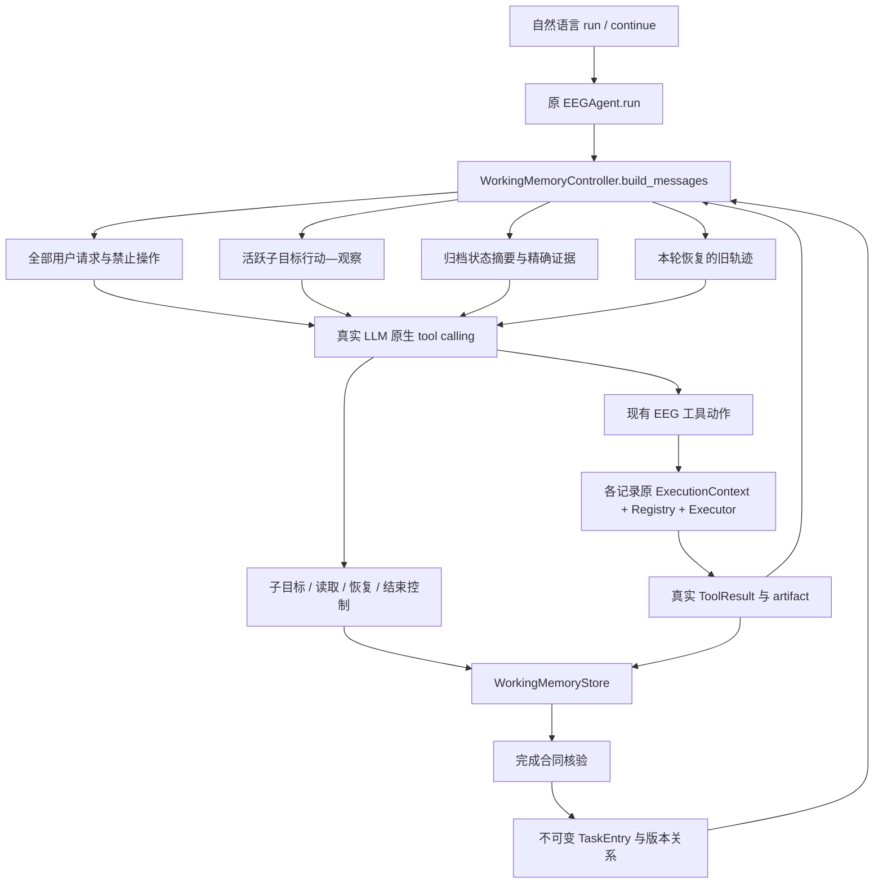
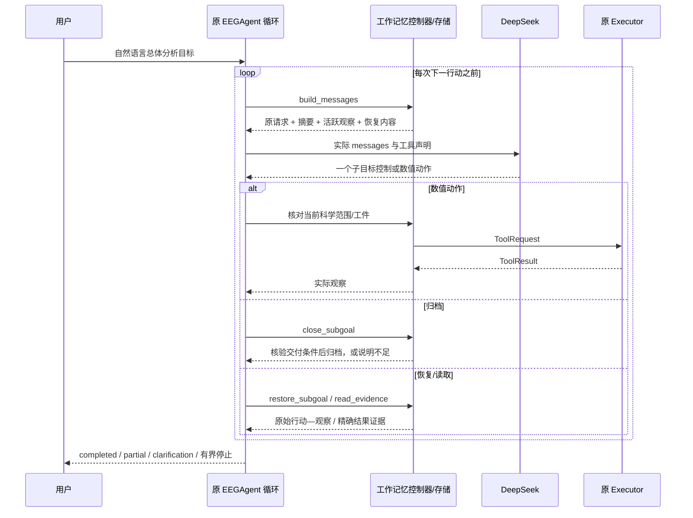

# HiAgent→EEG 工作记忆：适配依据与 Agent 集成

日期：2026-10-26；Issue #45；起点 `e6f7829`，继续 Draft PR #37。本文先冻结实现选择，再追加真实验收与修订。旧 Issue #44 的资格判断及全部历史结果保留；本阶段优先落实执行期工作记忆，不运行策略排行榜。

**最终状态：核心机制和统一 Agent 入口已交付，真实完整任务验收尚未全部通过。** 真实模型实际完成连续/事件工具动作、恢复旧轨迹、修订旧窗口并复用真实事件工件；同时出现子目标归档失败与确认阶段重复分析。预算已安全停止，不能把这些轨迹包装成完整成功。以下区分方法实现、系统接入和效果证据。

## 原方法核对（原始事实）

核对 [HiAgent ACL 2025 正文](https://aclanthology.org/2025.acl-long.1575.pdf) §2–3、§5.1、§5.3：它面向单次长任务，以模型提出的子目标组织当前行动—观察；完成后以摘要替换详细轨迹，必要时恢复旧轨迹。摘要围绕子目标状态与达成情况，可由 LLM 或其他摘要模型实现；不是另训专用模型的必要要求。消融区分了分解、摘要和恢复，原游戏实验收益不能移植到 EEG。

官方仓库检查版本 `cebdd8e4eacec1a532ce2c0041db8902217b90ba`：[evaluate_model.sh](https://github.com/HiAgent2024/HiAgent/blob/cebdd8e4eacec1a532ce2c0041db8902217b90ba/evaluate_model.sh) 传入 `ContextEfficientAgentV2`；`agentboard/eval_main.py:122` 覆盖 YAML 的 agent 名称；`agents/__init__.py` 注册加载 `cme_final.py::ContextEfficientAgentV2`。该类 `make_prompt`（106）、内部 `serialize_history`（114）按子目标替换旧轨迹，`run`（285）处理子目标与 `retrieve(...)`。代码还按环境选择最后观察或 `TrajectorySummarizer`，不能只据论文抽象声称所有任务都调用摘要模型。`summarize.py::generate_summary` 使用已有 llm_model，并有回退。仓库根树未见明确 LICENSE；本项目不复制其代码、不安装 AgentBoard 环境，只按机制独立实现。LongMemEval 继续仅用于索引/选择/读取分层评价。

## 设计依据与取舍（实现前冻结）

| EEG 场景/已有缺口 | 原机制与直接采用的适用性 | 选择与更简单替代 | 代价/风险与验收 |
|---|---|---|---|
| 事件功率需要先建立真实 Epoch；有效试次/质量观察决定能否继续。旧一次 `run_instances` 后才存卡无法观察中间决策。 | 模型提出子目标再行动适用；游戏动作粒度不能直接搬成逐样本计算。 | 一个子目标是有科学范围和可核查终端产物的分析目的，可含多次原工具调用；直接简单幅值可一次原工具自动形成单步档案。替代是所有任务全历史 ReAct，保留同权参考。 | 开始/关闭子目标增加控制调用；不能把每个工具换名成子目标。验收实际 create_epochs 观察出现在下一次模型决定之前。 |
| 模型说完成不代表请求的结果已计算；失败与缺参不能被摘要抹去。 | 原模型提议完成，适合控制；EEG 需增加真实产物检查。 | 模型声明终端能力、scope 与必要检查，程序根据成功工具、同记录/同 Epoch 输入和参数验证完成。暂挂、失败、待用户与完成区分。 | 只能校验所声明合同，不能证明模型没有漏解用户总目标；不加新意图 Planner。无产物的完成必须拒绝。 |
| 后续比较要知道状态、范围、版本及结果；只有 task_id 索引太弱。 | 围绕子目标归纳达成状态适用；LLM 改写数值有风险。 | 确定性状态摘要＋有界真实字段预览＋来源/单位/修订/依赖/未决项；模型仅提供非权威的简短目的说明。替代为完整轨迹。 | 字段预览可能不足，必须明确遗漏并允许读回；不为摘要额外调用付费模型，不调 HC 阈值。 |
| 标量追问只需一个结果；修订先前分析或诊断失败需要过程、输入工件与实际失败观察。 | §3.4 恢复完整行动—观察适用。 | 分开 `read_evidence` 与 `restore_subgoal`；恢复的真实轨迹进入下一步行动上下文，可引用其中工件/版本再分析。已有摘要足够时不强制恢复。 | 恢复增加上下文/调用，设容量及次数上限；真实演示未自然触发则只报告离线覆盖。 |
| 相同数字可能来自不同记录、连续绝对窗或事件相对窗；修订不能覆盖旧值。 | 一般 provenance 足够表达一部分；需要 EEG 工具的真实 scope/单位来绑定。 | 使用原 EEGRecord/ExecutionContext/TaskEntry 和证据合并；读回声明的记录/参数须匹配存储身份，工具 artifact 只能来自同记录实际产物。 | 不能承诺任意自然语言意图正确；不沿用会误拒新分析依赖的“当前句子必须逐字含旧 scope”要求。 |
| 旧脚本预定 turn.kind；模型未在真实循环内选择分析/回顾/继续。 | 工作记忆应参与每次行动前的输入。 | 给 `EEGAgent.run` 增加默认关闭的可选 memory hooks；工具仍走原 Executor；正式统一 run/continue 只收自然语言。替代是独立控制器复制 Agent Loop，放弃以避免两套循环。 | 需保持原生 assistant tool_calls 与 tool 消息配对；记录每次实际 messages，所有旧 baseline 测试应保持通过。 |

范围：本阶段仅合成记录联网；支持现有连续信息/质量/幅值/PSD、事件发现/Epoch/质量/计数/频带功率。筛选、重参考和模型推理不在本轮新入口开放，缺失能力明确报告；用户禁止操作与全部原请求始终保留。多记录按独立原 ExecutionContext 保存工件，数值执行器不复制。存储仍进程内，不新增数据库或跨进程恢复。

## 拟实施模块与可核查边界

- `working_memory.py`：执行期子目标、同记录工具观察、完成合同、归档摘要、精确读回/轨迹恢复、TaskEntry 与版本。
- `working_memory_agent.py`：现有 EEGAgent 的可选上下文/控制钩子，统一自然语言入口、消息配对、终止及预算之外的本地边界。
- `working_memory_cli.py`：默认需显式开启的合成演示/交互入口；实验脚本只构造合成记录、传用户请求和后验评分。
- 旧研究脚本仍可重跑，不修改 EEG 数值算法。程序能核对产物、参数、版本、错误和状态，用户目的的语义完备性与最终自然语言仍由模型负责，不新增回答审查 Agent。

## 验收与资源预留（实现前冻结）

先离线检查：活跃观察→下一次模型 messages；有/无产物完成；归档压缩与合法原生协议；轨迹恢复→下一行动；修订保留旧值；错对象/版本拒绝；缺参/暂挂/失败/部分交付；重复/轮数/取消/超时/容量停线。数值来自真实工具，RMS、PSD、事件均值与计数从原采样独立核验。Fake 只验证机制。

真实阶段独立追加账本上限 **96 completions / 240,000 API tokens**；默认请求单次输出 ≤1200，自动重试关闭。预留至少 40 次/100,000 tokens 给方法锁定后的完整演示；开发最多两轮根因驱动实现修订，预算不是目标。开发先一条高层组合分析加同会话修订/比较，再锁定不同组合确认与短任务/缺参。不向正式入口提供 turn.kind、正确任务 ID 或子目标序列；工具动作/恢复由模型真实决定。日志明确首次失败、修订、实际触发及未触发机制，实验收益不由本轮实现验收推断。

## 迭代状态

- 设计冻结：已核对原论文/官方实际加载路径与当前代码；尚未实现或进行新的真实模型调用。后续条目在实际验证后追加。
- 实现检查点 `1f5f6fe`：原 Agent 可选钩子＋工作记忆模块＋统一自然语言入口已完成；374 tests（359 pass、15资源跳过），Fake 机制回归与原采样数值 oracle 通过。
- 首次真实开发失败（保留）：2 completions / 6,319 tokens，无数值工具执行。模型先并行 begin/list_events 被单动作边界拒绝；改成单步后把事件输出通道误放进计算 scope，接口返回笼统错误，并把同批两次拒绝计为两次无进展，提前停止。原始输出为 `development-20261026T041329334721-audit.json`（本地忽略目录），不重写失败。
- 根因修订 1：能力输入范围与结果选择的公共接口边界不清，修为结构化 allowed/required/unexpected/missing 字段与输出选择说明；仍拒绝非法范围，不静默删除参数。连续相同错误才累积 no-progress，其他纠正过程仍受总轮数/工具/重复上限约束。科学标准和原请求不改；新增离线反例通过后重跑相同开发请求。此为接口/恢复工程修订，不称新方法贡献。
- 开发复跑：第一轮事件和连续数值均正确，但模型把事件交付暂挂，重复关闭未激活目标，20轮后 repeated_action；续接11轮完成窗口修订，真实恢复原事件完整轨迹并据其 artifact 执行 epoch_summary/epoch_quality，没有重算事件功率。旧事件目标仍 suspended，首轮不能记为完成。最终回答大部分事实正确，但“不同窗口功率不可直接相减”等表述过强，且整体意图完成未自动证明。
- 根因修订 2（最后一次）：双 ID 和“恢复不等于激活”的生命周期负担使已正确算出的目标无法归档。增加由实际完成合同计算的 delivery_check/合法后续操作；允许按明确 subgoal_id 关闭已满足合同的暂挂目标，不重算、不跳过校验；已完成 subgoal 明确解析到其唯一 TaskEntry 版本。恢复过的未完成目标不能被随后 completed 隐藏。去掉已在恢复载荷/档案中出现的成功 control 协议整对副本，不留下孤立消息。
- 预算偏差：开发已用33次/202,622 tokens，虽然未超阶段上限，但仅请求数的阶段限制未保护预留100k tokens，这是本轮执行/预算工程缺陷。新增累计开发token保护，停止开发调用；剩余37,378 tokens只做修改前冻结的缩小完整确认单元（见协议 amendment），不追加预算。不再声称原跨记录事件确认已执行。

## 实际架构、权责与运行时序





四个层次：**总体目标**是用户请求原文；**科学子目标**是记录＋作用域＋交付物＋可选前置检查/可观察条件；**动作**是一次原数值工具或控制操作；**档案**是已核验完成的 TaskEntry。事件子目标通常需建立工件、检查、分析多个动作；连续 PSD 可以一动作隐式归档。Welch、滤波等工具内部计算仍是原子动作，未拆开或重写。

| 代码与实际入口 | 职责 | 谁决定/什么尚未证明 |
|---|---|---|
| `agent.py::EEGAgent.run`（L80） | 原循环增加默认关闭的 memory hooks，仍负责原生工具消息、LLM 异常及步数边界 | 模型选动作；旧 baseline 无 hooks 时保持原行为 |
| `working_memory_agent.py::WorkingMemoryEEGAgent`、`continue_run` | 接受已加载记录和自然语言；复用同一个 `run` | 没有 turn.kind、gold、正确任务 ID、预定动作列表 |
| `WorkingMemoryController.build_messages`（L110） | 每次行动前实际组织原请求、活动观察、归档摘要、恢复轨迹和证据并保存 messages | 程序构造，不执行关键词排名；当前全部简短档案可见，非大规模检索系统 |
| `WorkingMemoryStore.begin_subgoal`（L97） | 记录与能力范围、不可变版本父项、checks/criteria | 模型提出；程序核验声明与真实工具，不核验完整用户意图 |
| `execute_numeric`（L189） | 逐动作走原 Executor，同记录 artifact、相同科学 scope | 无第二套数值执行器，不调用旧 `analyze/run_instances` 整条同步链 |
| `completion_check`（L232）、`close_subgoal`（L283） | 必要工具真实成功、同工件、最新失败、声明的结果字段条件；成功/暂挂分开 | 科学前提没有被模型声明则程序不能自动补全；不把合同通过当作科学意图完备 |
| `summary`（L349） | 状态/未决项/依赖/版本、实际检查事实、终端结果固定前12个精确叶子及可读路径 | 不额外调用摘要 LLM；不修改数值。其余详细结果仍保存，未声称所有摘要足够 |
| `read_evidence` / `restore_subgoal`（L400） | 按真实版本查字段/结果，或恢复完整行动—观察；scope 与记录匹配 | 模型选择目标和恢复理由；已完成 subgoal alias 仅解析其确切 TaskEntry |
| `task_memory_evidence.py::merge_evidence` | 旧结果可见值与新读回值取有来源的并集 | 共有工程基础；索引/错误不成为数值证据 |
| `working_memory_cli.py` | 明确 `--real` 的合成入口、持久预算、逐轮原始日志 | 凭据仅环境；输出留忽略目录；不跨进程恢复会话 |
| `research/working_memory_validation.py` | 仅加载请求与合成记录，事后独立核验数值 | 评分器不能决定 Agent 子目标/顺序；audit 通过也不代表完整任务通过 |

控制工具：`begin_subgoal`、`close_subgoal`、`resume_subgoal`、`read_evidence`、`restore_subgoal`、`finish_task`。数值工具白名单：`record_info`、`amplitude`、`psd`、`record_quality`、`list_events`、`create_epochs`、`epoch_summary`、`epoch_quality`、`event_bandpower`。本模式没有筛选、重参考、基线校正和模型推理；不把这些禁用项写成整个仓库没有的能力。

程序状态为 active/blocked/suspended/awaiting_input/completed；总体回答另有 partial/clarification_required。有界轮数/动作数/重复/无进展、恢复次数、上下文和证据容量限制；取消在下一调用前生效，外部调用有45秒超时，不能承诺中断已发送请求。所有用户原请求始终保留，容量不够返回容量错误，不悄悄删禁令。证据合并沿用8任务/24KB边界；工作上下文96KB，非人为压低的实验设定，未调 HC 阈值。

## 实际真实轨迹与失败保留

请求 `deepseek-chat`，40/40 响应报告 **`deepseek-flash`**；不是保证服务端权重的独立身份认证。所有出站数据为明确合成记录元信息与真实工具结果，没有波形数组、真实受试者事件、私有路径或权重。原始 API 响应、逐次输入和追加预算保存在被 Git 忽略的 `artifacts/point1_task_memory/issue45/`。

公开可核查的最小样本：[合成实际轨迹摘录](evidence/issue45_synthetic_trace_excerpt.json)，包含原始文件哈希、真实动作、scope、数值、归档状态、恢复理由、下一动作前可见信息、被接受的回答与失败结局。它是首次输出的摘录，不是另跑出的演示。

| 运行/版本 | 实际调用与结果 | 能支持的判断 |
|---|---|---|
| 开发首次 `1f5f6fe` | 2 calls / 6,319 tokens；并发动作、非法事件 scope，no_progress；无数值输出 | 首次失败；不能计为任何 EEG 任务成功 |
| 开发复跑 `0226293` 第一轮 | 20 calls；模型提出事件子目标，实际 list_events→create_epochs→epoch_summary→epoch_quality→event_bandpower；随后越范围 PSD 被拒，事件暂挂；另建连续子目标成功。重复归档后 repeated_action | 连续与事件工具链真实存在、观察可见；高层请求完整交付失败 |
| 同会话第二轮 | 11 calls；旧版本 ID 误用被拒后修正，3–5秒 PSD 新版本；模型主动 restore 旧事件轨迹，随后引用原 artifact 做 epoch_summary/epoch_quality；没有重算 event_bandpower；最终回答成功返回 | 真正统一入口续接、真实轨迹恢复参与后续分析；旧事件目标仍暂挂，不能把整体两轮记成全通过 |
| 锁定后缩小确认 `bf744c6` | 7 calls / 26,112 tokens；RMS→PSD→record_info 数值正确，首次并发被拒；关闭幅值目标后模型又声明重复子目标；第8次调用前预算预约拒绝，未生成最终回答 | 未通过完整确认；非 DeepSeek 不可用。原日志保留 `llm_error/LLM_ERROR`，事后依据账本归因为预算停止，未重写旧记录 |
| 原完整跨记录确认、短请求/缺参确认 | 未执行 | 不得宣称通过。短请求/缺参只有离线 Fake 机制覆盖 |

真实成本总计 **40/96 completions，228,734/240,000 API tokens**（输入221,577，输出7,157；无未结算请求；API墙钟累计约60.47秒）。最后余11,266 tokens，少于当前完整请求的保守预约，因此停止；不是补领旧余额或压缩接口继续刷分。开发未保住原确认预留是明确不足，已添加跨运行开发token保护及离线重启测试。预算错误新代码单独报告 `budget_exhausted/STAGE_BUDGET_EXHAUSTED`，不再伪装服务故障；此为诊断工程修复，没有第三轮方法试验。

### 一个可审查的真实续接

1. 首轮模型自行提出事件功率子目标；真实 `create_epochs` 得到3个试次、0边界拒绝。
2. 后续模型调用 `epoch_quality`，实际标记0、可用3、经验阈值未经临床校准。模型看到该观察后才调用 `event_bandpower`；不是脚本直接运行整条流程。
3. 事件 SYNTH-C1 alpha = `3.2799997787269497e-10 V²`；连续0–2秒 alpha=`2.00e-10 V²`。首轮归档控制失败保留。
4. 用户续接要求3–5秒修订、核对旧质量过程。模型以新 PSD 结果 `3.92e-10 V²` 建立 `revision_of`，旧结果未覆盖。
5. 第二轮第5个动作恢复旧事件子目标，恢复理由在原始消息中；包含原 create/check/power 及失败 PSD 观察。实际下一决策输入含恢复内容。
6. 第二轮第7个动作提出核对事件试次与质量的子目标，第8/9个动作使用**旧的真实 artifact_id**计算计数与质量。没有建立新 Epoch，也没有重算已有事件功率。该恢复具有后续分析用途。
7. 最终回答正确列出连续前后数值、3试次、0标记、无筛除及经验阈值限制；但旧事件任务仍 suspended。此时 `completed`只证明当前新声明的交付，遗漏历史未决状态的问题由第二次修订加以收紧，修订后长任务尚缺真实确认。

不能把实际观察进入输入等同于因果证明模型必然依赖它；本轮没有随机干预/消融。能确认的是动作发生顺序、可见输入、真实 artifact 复用和数值一致。

### 独立数值核验

对已成功执行的观察逐一核验，包含未归档结果，不只挑 completed 档案：

| 真实工具输出 | 原合成采样独立 oracle | 结果 |
|---|---|---|
| 开发事件 alpha `3.2799997787269497e-10` | 同值 | 通过 |
| 开发连续0–2秒 `2.00e-10` | `1.9999999920083944e-10` | 原工具字符串舍入，允许0.5%误差，通过 |
| 开发修订3–5秒 `3.92e-10` | `3.9199996720862273e-10` | 同上，通过 |
| 确认1–3秒 RMS `1.60e-05` | `1.598061305042897e-05` | 同上，通过 |
| 确认1–3秒 alpha `2.55e-10` | `2.553800122762073e-10` | 同上，通过 |

这些是数值与范围校验，**不是5/5完整任务成功率**。事件计数、质量与未筛选来自实际 Epoch/质量结果；科学阈值本身不作临床有效性声明。

## 运行、回归及版本

在现有 `eegagent` 环境（Python 3.10 / 项目现有依赖）从根目录运行：

```powershell
$env:PYTHONPATH='src'
$env:PYTHONIOENCODING='utf-8'
python -m compileall -q src tests
python -m unittest tests.test_working_memory -v
python -m unittest discover -s tests -q
python -m pip check
python -m eeg_harness.research.working_memory_validation --offline-audit
```

最后一条只读取本机本轮忽略日志；无日志则没有数据，不会联网。远端可检查公开摘录并运行真实工具的离线机制测试。最终全套 **379 tests：364 passed、15 resource-gated skipped、0 failed**，新增工作记忆24项。compileall/pip check/diff check通过。恢复/身份别名/暂挂后核验关闭等第二次修订有真实工具离线反例；不冒充改进后的真实长任务成绩。

正式自然语言接口，无评测器参数：

```python
from eeg_harness.working_memory_agent import WorkingMemoryEEGAgent
from eeg_harness.research.task_memory import synthetic_records
# client 必须使用有持久预算的适配器；本阶段真实额度已停止。
agent = WorkingMemoryEEGAgent(client, synthetic_records())
first = agent.run("分析 A 的 SYNTH-C1 连续0到2秒 alpha 功率，不筛选。")
followup = agent.continue_run("保留旧结果，改为3到5秒并比较。")
```

CLI（仅说明复现入口，**本轮不要再运行真实调用**；需未来明确授权新阶段预算，不能重置本账本）：

```powershell
# 服务、模型、凭据由 EEG_HARNESS_LLM_* 环境变量提供；勿打印或写入仓库。
python -m eeg_harness.working_memory_cli --real --request "当前 A 的采样率和通道是什么？"
```

`--request` 可重复，后续请求走同一会话；`--context-mode full` 是同权限、同合同的完整历史参考模式，仅离线验证过共享控制，没有本轮真实对照胜负。脚本 real开发/确认命令保留，但本轮不继续使用。跨进程重启预算不会归零，真实会话本身不持久化恢复。

提交：`94aaaf3`设计；`1f5f6fe`核心集成；`0226293`修订1；`bf744c6`修订2及确认锁定；`a15c173`预算诊断和失败交付数值核验。后续仅文档交付，没有第三轮方法调整。均沿 PR #37 原分支普通提交/推送，不合并 main。

## 方法、集成与效果分别如何评价

| 层面 | 已完成 | 未完成/不能宣称 |
|---|---|---|
| 核心方法落实 | 活跃子目标逐动作观察、核验后归档、执行前上下文替换、按需真实轨迹恢复、精确事实不被模型摘要改写 | 单终端档案不足以表达子目标中多个有效输出；条件解析/全部用户目的仍有遗漏风险 |
| Agent 集成 | 原循环＋原数值执行器；同入口真实自然语言分析/续接/版本修订/恢复/工件复用，非 turn.kind 脚本路由 | 真实首轮高层目标没有完整交付；修订后完整事件闭环和真实短任务/澄清未确认 |
| 实验效果 | 真实机制轨迹、独立数值正确性、离线错误/状态/协议回归 | 无优于强 S 或降低总成本证据；本轮不做方法排行榜，不能称完整 HiAgent复现或论文创新成立 |

可以称为**已嵌入 Agent 决策输入的实验性工作记忆**，不能称为已经稳定完成任意自然语言 EEG 多任务。继承的是 HiAgent 子目标—活动轨迹—摘要—恢复；EEG 适配是实际科学范围、原始工件/版本、可验证交付、数值来源及两种时间基准；生命周期反馈、别名解析、预算错误分类属于工程修复。共有 provenance/结构化工具技术不算独有创新。

更简单的替代方案仍有价值：短请求用原 EEGAgent/直接工具；短历史强 S 可保留全部必要结果并减少控制动作。本模式增加显式生命周期动作、摘要/恢复结构和验证开销；本轮未证明其节省 token，反而观察到归档/恢复错误与冗余调用。暂不替换强 S 默认，不扩 HE，不新增摘要 LLM 或验证 Agent。

**下一步唯一值得解决的核心环节**是“子目标可交付结果集合与记忆归档闭合”：本轮确认中 amplitude 子目标已经产生 PSD/record_info，但仅 amplitude 被编为独立 TaskEntry；其余数值留在轨迹，模型随即重建含三个 checks 的重复子目标。这说明当前完成合同与科学目的的多结果关系仍不够明确。应在现有档案/原 Executor 上研究最小多结果交付表达，先用本轮失败做离线回放，检查全部已产生结果可用且无需重算、暂挂不被隐藏；之后才申请一个完整连续＋事件配对确认的新预算。不是新增 Planner/第二工作点，也不是改阈值追分。

如果该最小改动仍需大量专用流程或更多控制动作才能可靠完成，应收缩为“任务历史＋明确证据读取”的简单实现，不继续堆工作记忆层级。本轮有真实集成进展，但不足以把工作点一宣布定型；保留负结果，停在此检查点等待下一阶段决策。
