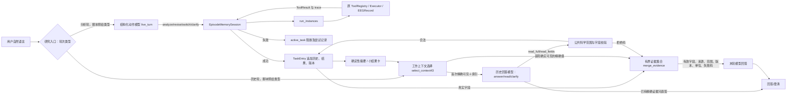
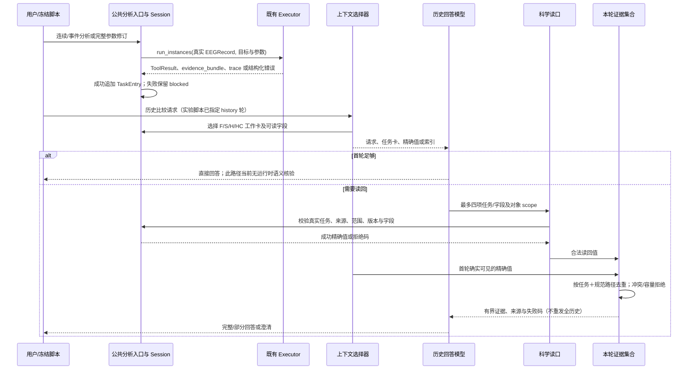

# 工作点一整体评审：EEG 任务记忆的实际架构与研究资格

日期：2026-10-26。审查基点：`research/point1-eeg-task-memory` 的 `0780419280f7eaf6c81f191336bdf7acb8ffe522`；对应 Draft PR #37、Issue #44。本文是研究判断，不是学位授予标准，也不是新的模型实验报告。代码和结果的版本以基点为准，后续纯文档提交不改变算法。

## 先回答四个问题

**1. 系统是什么？** 这是现有多任务 EEG Harness 上的一个**合成数据限定、进程内、opt-in 的任务级上下文层**。每次成功分析生成一个带记录、科学范围、参数、修订父项、真实工具结果及 trace 的任务条目；失败分析保留活动/阻断状态。完成条目可转为确定性摘要或小结果精确卡；模型可以在工作上下文中直接回答，或通过公共读口取回完整/部分结果。读取时校验记录、连续/事件时间基准、条件、通道、窗口和版本。Issue #43 的公共交接把首轮确实可见的精确值与合法新读回值合成有界末轮证据集合。**默认使用强通用摘要 S；HC 是可选表示对照，HE 暂置。** 这不是完整 HiAgent 复现，也不是任意自然语言自主多目标 Agent。

**2. 解决了什么？** 代码和离线测试确证：旧分析与修订结果可以同时保存，历史读取不会重算 EEG；显示路径与实际字段读口一致，错记录/时间基准/条件/版本的显式读回可被拒绝；首轮精确值不会仅因随后读取另一份证据而从末轮输入消失。两条新的合成完整任务经真实工具与有限 DeepSeek 验证了部分有效交付。**尚未稳定解决**自然语言能力误选、模型擅加版本、直接回答的数值/过程措辞误述、合法表达的误拒、多任务完整交付，以及真实用户/真实 EEG 泛化。存储存在、首轮可见、读回成功、末轮可见和模型正确使用是五件不同的事。

**3. 够不够作为硕士论文第一个工作点？首选判断：B——有应用方法雏形，但现在尚不足以宣称已成立的独立工作点。** 问题真实、系统可运行、领域约束也比普通聊天摘要具体；对硕士应用方法研究，成熟记忆机制的严肃 EEG 适配本可构成贡献。但任务分块/摘要/读回来自成熟方法，科学来源与版本合同由 F/S/H/HC 共享，HC 对强 S 没有稳定净收益，HE 也没有可信增量；最终回答仍可误述版本。**主要缺口是对“科学对象绑定与证据交接”相对合理成熟直接迁移的独立作用缺少可归因证据，同时末轮生成没有运行时忠实性保证。** 代码量、测试数和两个成功示例不能填补这个缺口。不存在可据此保证学校认可的已知门槛。

**4. 下一阶段只做什么？** 只做一次**预注册的科学证据闭环归因验证**：冻结自然的连续、事件和跨记录/版本追问，比较本系统的科学对象绑定与一个享有同样原始事实、记录/时间/版本字段、正常读取权和公共工具安全性的强通用任务记忆直接迁移；分开统计证据定位、有效读取、末轮实际可见、完整科学回答、危险错归属、误拒、总 token/调用/延迟。先做离线同历史与现有日志再审，只有差异会改变 B 判断时才申请有界真实配对。若双方实质等价或新增约束只增加误拒/成本，**停止把这条适配称为独立方法优势**，保留为 Harness 基础模块；不要继续调 HC 阈值、扩 HE 或拉长无关历史。这是下一阶段建议，本 Issue 未执行。

## 真实架构图与职责



图中的 `G` **不是已实现的通用自然语言轮次路由器**。Issue #42/#43 的 `run_workflow` 根据冻结脚本 `turn.kind` 预定分析轮或历史轮；分析轮内部由模型调用 `submit_memory_action` 决定能力、参数和动作，历史轮内部由模型决定直答、最多四项读取或澄清。真实数值和状态转换由程序/原 Executor 决定。`TaskEntry` 以 `frozen=True` 声明，按完成项追加，但内部字典并未深度冻结；“不可变”是接口与实验行为约束，不是不可篡改存储。会话只在 Python 对象中；实验 JSON/账本是忽略 Git 的运行记录，**不是可恢复的生产持久化数据库**。

| 决策/事实 | 当前责任方 | 没有实现的自主性 |
|---|---|---|
| 进入分析轮还是历史轮；脚本目标、参数真值及评分 | Issue #42/#43 冻结实验脚本；真值仅在事后评分 | 没有统一的开放语言轮次判别与自动多目标分解 |
| 分析轮的工具能力、记录、参数、修订/澄清动作 | `live_turn` 中真实 LLM 的结构化调用；Executor 最终校验 | 模型会误选能力，程序不会用 gold 自动纠正 |
| 任务成功/阻断、真实数值、证据 token、修订关系、摘要、top-3 排序 | Session、原 EEG Registry/Executor 与确定性选择器 | 没有 LLM 自主决定子目标边界或主动摘要时点 |
| 历史轮直答/读取对象及字段/澄清；末轮自然语言 | 真实 LLM；离线回归使用 Fake | 最终语言没有逐断言运行时核验 |
| 读口合法性、末轮合法证据并集、容量限制 | 程序依据可见请求、真实任务和 ToolResult | 不能推断任意自然语言未明说的科学意图 |

### 证据传递时序



### 代码映射与现状

| 职责 | 实际文件与入口（基点行号） | 状态与真实边界 |
|---|---|---|
| 合成记录与公共条目 | `src/eeg_harness/research/task_memory.py:34` `synthetic_records`；`:61` `TaskEntry`；`:85` `MultiTurnEEGSession` | 已实现、测试。只接受 `is_synthetic=True` 的记录进入本研究多轮接口；记录 A/B 为合成；任务条目有 task_id、序号、record、capability、parameters、user_text、revision_of、status、result、evidence、tool_trace。无深度冻结/跨进程恢复。 |
| 分析、切换、旧值读回 | 同文件 `:98` `switch`、`:105` `analyze`、`:135` `read_task` | 已实现。分析新建 `ExecutionContext`，调用既有 `run_instances`；修订要求父项同记录、同能力；成功才追加条目。`read_task` 不重算。 |
| 原 EEG 工具链 | `src/eeg_harness/research/integrated_method/v3.py:75` `capability_catalog`、`:399` `run_instances`；`src/eeg_harness/tools.py:253` `build_default_registry`；`src/eeg_harness/context.py:78` `ExecutionContext` | 已实现，记忆层复用而非另造 Executor；合成 EEG 数值经独立原样本 oracle 校验。研究入口 `ALLOWED_GOALS` 仅 7 种能力，**并未把已有癫痫推理迁入此多轮研究入口**。 |
| 结构化多轮动作 | `task_memory.py:276` `live_turn` 与 `MEMORY_ACTION_TOOL` | 已实现且有限真实模型测试；模型选 analyze/revise/switch/history/clarify 和参数。Issue #42/#43 的完整流程由脚本预定轮次类型，模型没有自主统一识别“现在是分析还是回顾”。分析轮常 `deliver_answer=False`。 |
| 活跃/阻断/归档/焦点 | `src/eeg_harness/research/task_memory_v3.py:16` `EpisodeMemorySession`，`:27` `analyze`、`:65` `switch`、`:75` `read_task` | 已实现并有 Fake/离线回归。`blocked→resumed` 是同记录/能力/父项下携带**完整新参数重新执行**，不是从 EEG 工具检查点续跑；换记录清除焦点。一次同步分析中的内部子目标并非 LLM 自主分块。 |
| 摘要与选择 | `task_memory_v3.py:131` `_summary`、`:199` `select_context_v3`；`task_memory_v2.py:99` `parse_visible_query`、`:128` `_generic_score`、`:167` `select_context_v2` | 已实现。摘要在任务成功后由**确定性字段投影**生成，S 的旧卡 rolling summary 在查询时投影；H/HE 以通用排序选 top-3、其余为摘要索引。不是 LLM 主动决定何时压缩，也没有 LLM 生成的事实摘要。自然语言作用域识别用有限显式规则，开放表达未充分验证。 |
| 结果粒度与公共读口 | `src/eeg_harness/research/task_memory_issue41.py:69` `result_view`、`:110` `GranularEpisodeSession`、`:137` `read_task_fields`、`:197` `select_context41` | 已实现。HC 对 JSON ≤256 UTF-8 字节的小结果原样内联；大结果展示字段结构；所有臂可读完整结果或每次最多四个小字段。阈值/表示是成本策略，不是 EEG-specific 核心算法。 |
| 范围与字段绑定 | `task_memory_v3.py:98` `scientific_read_mismatch`；`src/eeg_harness/research/task_memory_evidence.py:44` `add_readable_paths`、`:174` `bind_read_scope` | 已实现并有正负离线回归。显式记录/连续或事件时间/条件/通道/窗口/版本同真实任务检查；路径从真实结果产生。基于有限文本识别会误拒或漏检自然表达；读口保护不等于模型意图理解完备。 |
| 首轮精确值与末轮交接 | `task_memory_evidence.py:75` `exact_visible`、`:103` `normalized_read`、`:136` `merge_evidence`；`src/eeg_harness/research/task_memory_issue43.py:96` `history_turn` | 已实现，消息级反例与 Fake 回归通过，有限真实模型见证。按 `(task_id, path)` 去重并保存来源/单位/参数/版本；最多 8 任务、24 KB，溢出澄清。索引、失败读取不升格为数值；直接答路径不经末轮集合，也无运行时答案语义核验。 |
| 评价与记录 | `task_memory_issue43.py:288` `score_history`、`:347` `audit_equivalent_epoch_count`、`:422` `offline_preflight`、`:446` `run_phase`；`task_memory_issue42.py:406` `run_workflow` | 已实现的研究脚本；gold/等价条件只在评分，非模型上下文。完整任务的分析/历史入口由配置指定。原始响应和追加预算账本仅在本机被 Git 忽略的 `artifacts/`，公开只保留报告、哈希及部分脱敏结果。自动评分是初筛，逐例人工审查仅由开发者完成，不是独立 EEG 专家标注。 |

`TaskEntry` 的“一条已完成分析”是 episode 边界；没有支持一个复杂自然语言任务内部自主拆成若干 LLM 子目标并边做边压缩。`active_task.attempts` 留请求、参数和实际工具错误，成功时 `_summary` 写缓存，原始 `tool_trace` 留在条目中。`focused_task_id` 表示上一次成功恢复的证据；分析或切记录会清除。S、H/HE 和 HC 的工作视图不同，底层条目与读取权限相同。**未实现**跨进程任务记忆服务、并发安全存储、任意长上下文容量管理、真实临床会话接入、模型生成答案的全面运行时真实性证明。

核心流程可简述为下列**现存代码的抽象**，没有额外隐藏的 Planner：

```text
分析轮（实验入口已定）：
    action ← LLM(请求, 能力目录, 选中的任务卡)
    if action 是分析/修订：
        outcome ← EpisodeMemorySession.analyze → run_instances → Executor
        成功：追加 TaskEntry(result, source, scope, revision, trace)，写确定性摘要
        失败：在 active_task.attempts 中保留错误；完整参数重试才算 resume
历史轮（实验入口已定）：
    view ← select_context43(完整历史, 请求, F/S/H/HC)
    first_visible ← exact_visible(view)          # 仅首次消息的精确值
    action ← LLM(请求, view)
    if action 是 answer/clarify：直接返回模型文本/澄清
    else：逐项 bind_read_scope → read_task/read_task_fields → normalized_read
          handoff ← merge_evidence(first_visible, 合法读回)  # 拒绝冲突/溢出
          answer ← LLM(请求, handoff, 失败码)
    事后评价器用独立 oracle 检查；不是运行时 gold 守卫
```

| 实验表示 | 实际选择/展示差异 | 相同权限与结论 |
|---|---|---|
| F 完整历史 | 所有已完成任务的真实结果卡及消息，短历史可直接回答 | 与其余方案读口同权；成本是强参考，未被强迫读回 |
| S 强通用摘要（推荐默认） | 最近三任务完整卡，更旧任务确定性滚动摘要，仍含记录/版本/来源/读取 ID | 不是弱文本压缩；可直答或合法读回 |
| H / HE | 通用任务检索 top-3 与其他完成项摘要；HE 再加多版本科学对象组 | H/HE 的额外正确性/净成本优势未证，HE 暂置 |
| HC | H 的选择结果上小结果精确保留、大结果索引 | 所有方案都能使用字段/完整读口和公共交接；HC 仅 opt-in 对照 |

## 一个可重跑的跨任务例子

复用已存在的 `config/point1_task_memory_protocol_v2.json` 中 `N-long`，不是为本评审新造成功案例。它在两份合成记录上执行 10 次真实工具分析：A 连续 alpha PSD 0–2 s（`N-long-t1`）→连续幅值→A cue 有效试次→A rest 事件功率（`t4`）→B 连续功率→B target 事件功率（`t6`）→A 连续 PSD 修订为 3–5 s（`t7.revision_of=t1`）→其他事件计数/功率与幅值；然后问旧版、新版及两个事件条件。`EpisodeMemorySession` 已缓存完整结果、来源和 trace，H/HE 仅将 3 项带到工作集，其余 7 项以摘要索引存在；按需读取旧结果时不改写新版。

在已激活、具备本仓库依赖的 `eegagent` 环境中重跑（环境可按 `README.md` 配置）：

```powershell
$env:PYTHONPATH='src'
$env:PYTHONIOENCODING='utf-8'
python -m eeg_harness.research.task_memory_eval --mode replay-v3 --sessions N-long --policies F S H HE
```

本次重跑输出忽略 Git 的 `artifacts/point1_task_memory/replay_v3_20261026T025912163956Z.json`，`real_llm=false`、4 个策略×5 问=20 个离线选择/读取检查。H/HE 的 5 问 top-1 和真实读回均为 5/5，S/F 的目标也都可读；F/S 顺序卡的 top-1 不作为其能力指标。工具条目中旧/新版 A 连续 alpha 分别为 `2.00e-10` 与 `3.92e-10 V²`，A rest 事件后 0–1 s alpha 约 `2.96e-10 V²`，B target 事件后 0–1 s alpha 约 `1.68e-10 V²`，cue 有效试次 3；A 新版的父任务为 `N-long-t1`。这些数值来自真实合成工具输出，独立 oracle 代码在 `task_memory_v2.py:233`；**下述文字是可由证据支持的示范交付，不是本次模型生成的回答**：A 连续 PSD 的 3–5 s 值高于 0–2 s 旧值；A rest 与 B target 是各自记录/事件条件的事件相对时间功率，不能当成上述连续窗口的同一科学对象。Issue #39/#42/#43 的真实 DeepSeek 完整回答另见历史报告，不能把本离线示例追加为一次新模型成功率。

## 问题—机制—证据—限制

| 实际问题与合理直接迁移 | 本方案实际改变 | 既有证据 | 未解决的边界 |
|---|---|---|---|
| 多轮切换记录后，整段聊天或通用任务块都可能包含旧结果；普通强摘要也可按任务存原文与版本。 | 公共 `TaskEntry` 把真实结果与记录、参数、修订父项、来源及 trace 同存；修订追加新条目。 | `test_task_memory_v3` 与 `N-long` 十任务离线读回；Issue #42/#43 自然语言分析建立历史。 | 这证明**保存与可查**，不证明候选选择胜过强 S；会话不持久化，嵌套字段非深度只读。 |
| 摘要省上下文但可能把小精确值移走；直接迁移 HiAgent 的分块/读回或强 S 都能处理。 | H 活跃详情＋完成摘要＋按需完整读；HC 小值精确卡、大值索引及公共字段读取；F 有值时允许直答。 | Issue #40 六问 F/S/H 各 6/6，H 18,141 tokens/12 calls、S 19,364/9、F 19,031/6；Issue #41 确认 S/HC 各 4/4，HC 10,030 vs S 10,416 tokens，但延迟更高；闭环 HC 有时更贵。 | 表示压缩不等于总成本下降。HE 额外分组未证增益；HC 对 S 净收益未稳定出现。 |
| 读错记录、事件条件、连续/事件时间或旧新版会让同一数值具有错误科学含义；通用结构化记忆可保存这些元信息，也可由模型自行判断。 | 公共读口用真实任务与显式请求绑定记录、范围、窗口、条件、版本，错读拒绝；来源/单位随数值。 | Issue #43 离线正负矩阵、独立原数组 oracle；N-mixed HC 三次未请求 `version:new` 被拒，避免错误数值外推。 | HC 仅部分回答，**安全拒绝不是完整成功**；有限文本/结构解析可能误拒合法问题，直接答不经过读口。未有强通用直接迁移的独立增益实验。 |
| 首轮有精确值，读另一值后若末轮输入只含读回，模型无法完整交付；任何成熟方案都应正确维护调用间证据。 | 所有臂共用 `exact_visible ∪ normalized_read`，保留逐字段 provenance、范围与版本，拒绝错误和冲突。 | Issue #43 旧路由消息级反例、新 Fake 最终 messages 回归；开发旧/新有限 DeepSeek 观察两值均可答。 | 这是**公共接口 Bug 修复**，不是 HC 的记忆策略优势；新确认未再次自然触发“首轮值＋新的合法读回”的同一组合。 |
| 证据存在与模型理解/最终交付分离；普通强摘要也会遇到能力误选或生成误述。 | 最终 prompt 只给有界真实证据及失败码；评分后检查完整性/来源/单位/版本。 | Issue #43 N-continuous 严格初筛 F/S/HC 4/4；N-mixed F 5/5，S 原 4/5 但同对象有效计数替代证据经单独审计，HC 4/5 且安全部分答。 | HC 把未修订 B 说成新版、把首轮可见说成“已读取”；运行时**没有**最终回答逐断言科学核验。Issue #42 C-mixed 亦有公共动作与读口失败。离线 gold/后验评分不是 Agent 安全门。 |

最新真实模型结果都是**合成 EEG、少量固定工作流、各策略独立建史的开发/确认**；不能由一个比率推断统计优势。Issue #42 `C-continuous` 的追加评分 F/S/HC 均 6/6，而 `C-mixed` F/S/HC 分别 3/6、4/6、5/6，HC 更贵并中途漏目标。Issue #43 修复后 N-mixed 的 F/S/HC 原严格初筛为 5/5、4/5、4/5；S 的科学等价计数只是**追加审计**，旧分不改。若目标已经存在但没有选中，归为选择错误；选中了但模型没有读取，归为读取决策；末轮没看见是交接；看见却误说版本，是模型生成/语义校验缺口。把这些混记为“记忆检索率”会掩盖问题。

## 方法继承、适配与贡献归属

[HiAgent 原论文，ACL 2025，摘要及论文](https://aclanthology.org/2025.acl-long.1575/)明确研究单次长任务内的工作记忆：LLM 先构造子目标，再主动决定用摘要观察替换已完成子目标的行动—观察，保留当前子目标细节。本项目**只借用“任务块、完成后压缩、必要时恢复”原则**：边界来自已执行分析，摘要是确定性字段索引，未实现自主子目标生成或主动摘要选择，不能引用 HiAgent 的实验提升作为本系统成绩。[LongMemEval 原论文](https://arxiv.org/html/2410.10813v2)将长期记忆拆为 indexing/retrieval/reading，评价跨会话、时间与知识更新等；本项目借此拆评价层次，不复现其基准或声称聊天记忆首创。[EEGAgent 原论文](https://arxiv.org/html/2511.09947v2)已经讨论多任务工具调用与用户交互，不能声称 EEG Agent 首次有互动或记忆；其论文能力亦不能代替本仓库源码证据。

| 组成 | 归属 | 本项目落实及诚实边界 |
|---|---|---|
| 子目标/任务块、旧块摘要、按需恢复；索引—检索—读取分解 | 成熟方法复用 | HiAgent 与 LongMemEval 给出思想；这里的一条 `TaskEntry` 是一次已完成 EEG 分析，而非 HiAgent 自主子目标。 |
| 原 EEGRecord、Registry、Executor、数值计算、JSON trace；修订 ID、公共结构化动作 | Harness 公共工程基础 | 提供真实结果和正常执行边界，不因被记忆层复用成为新记忆算法。 |
| 首轮数值与新读数合并、统一字段路径、失败读不授权、修正多对象 scope 误拒 | 公共正确性/缺陷修复 | 所有 F/S/HC 同权；能证明接口不变量和局部有效性，不能直接证明候选记忆优于 S。 |
| 记录来源、连续绝对/事件相对时间、条件/通道/窗口、参数修订版本、结果单位与真实字段的绑定 | EEG 领域适配 | 真实工具/记录元信息生成，多个 EEG 任务共用；相对通用直接迁移的可归因增量**未证**。若强通用方案同样实现科学绑定，应承认机制等价。 |
| HC 小值保留/大值索引；HE 对象分组 | 通用表示策略 / 未证增量 | HC 可运行但未稳定优于 S；HE 相对 H 的额外收益未证，均不作为论文首要主张。 |

最多保留两项**待验证而非已成立**的应用方法主张：

1. **任务—科学对象—版本联结**：相对把 EEG 结果仅作为通用文本历史，按已执行分析形成 episode，并把记录、来源阶段、连续/事件时间、条件和修订关系绑定到可读证据，可降低历史追问中的错记录/错范围/旧新版本混用，同时允许合法修订继续使用旧结果。验证必须与已有相同元信息、版本字段、读权的强通用任务记忆直接迁移配对；离线错读注入只证明守卫行为，不证明端到端优越。
2. **有界证据交接的完整性**：若一次历史回答同时需要初次可见和随后读回的 EEG 值，显式逐字段集合能保证末轮**输入**保留所有合法精确证据及来源。Issue #43 的消息级反例支持这一狭义正确性主张；最终语言完整/忠实仍取决于模型，且任何正常 Agent 都应修复同类交接 Bug，不能把它单独包装为新的记忆理论。

强 S 当前在 `select_context_v3` 中已经持有 TaskEntry 的记录、时间/版本、来源、配置和读取 ID，最近三条还是完整卡；再加上所有臂共享的科学守卫与 Issue #43 交接，**它不是“只会生成模糊文字”的弱摘要**。F 是完整历史强参考；H 是任务 episode/摘要/读回；HE 在 H 上加科学对象组；HC 在 H 上改结果呈现。Issue #40–#43 的 F/S/H/HC 比较主要识别**表示与读取成本策略**，不能隔离所有臂共有的 EEG 科学绑定。旧 G/E 排序实验和 HE/H 分组失败也不等价于整个适配失败；同理共有合同能运行不等于已经胜过合理的直接迁移。

## 工作点资格与唯一后续门槛

| 评审维度 | 判断 |
|---|---|
| 问题实际性 | **有**：跨记录、连续与事件时间基准、参数修订后的历史复用有实际 EEG 分析需求，不能归结为“聊天越长越好”。 |
| 方法连贯性与实现 | **有雏形**：任务 episode、真实结果保存、摘要/选择、字段读回、科学范围绑定、末轮证据交接连成一条实际运行链；复用原 Executor。 |
| 领域适配深度 | **中等**：对象/时间/事件/版本/单位是实质科学语义，不只是改名；但当前语义解析有限、只在合成记录研究入口内。 |
| 与合理成熟直接迁移的差异 | **未被公平隔离**：强 S 已共享多项领域合同，HC/HE 的附加成本策略未稳定贡献。 |
| 真实效果与复现 | **有限可信**：真实 DeepSeek 与原工具合成任务有逐轮结果、原始哈希、预算及失败；样本小、历史分叉、追加人工审计、模型版本响应为 `deepseek-flash`，不支持泛化或统计优越。 |
| 在多任务 Harness 中的作用 | **明确但范围受限**：连续与事件分析历史可统一回顾，参数修订保留旧证据；此研究入口未覆盖已有模型推理或真实受试者运行。 |

因此选择 **B**，不是 A，也不是 C。若定位为“HiAgent 启发的多轮 EEG 任务上下文与科学证据读回的系统化领域适配”，已有实现足以开展针对性研究；但当前材料不足以把它写成**已证明**的第一个论文方法贡献。缺口首先是**证据归因**：没有在同信息、同工具/读权、同正常安全边界下判别 EEG 科学绑定是否比成熟直接迁移更可靠；其后是**方法边界**：末轮语言并无逐断言验真，故不能声称完整科学回答被保证。保留 Session/TaskEntry、真实 ToolResult、强 S 与公共科学合同，停止扩 HC/HE 和无关长历史。下一阶段只做上述预注册的归因验证，所需资源为现有合成生成器、原 EEG 工具/独立 oracle、现有原始日志和少量有上限的真实配对；不需要真实受试者、训练或第二套 Executor。

**验收/停止判据（下一阶段拟议，不是本轮成绩）**：先冻结至少连续修订、事件条件/相对时间、跨记录多对象三类自然有效历史，保留既有开发案例以外的独立确认；两臂同一真实任务快照、相同模型与正常读取/纠错权，报告全部首轮可见、读回、末轮可见、完整答复、危险误归属、澄清/误拒与总成本。若 EEG 绑定在独立任务上稳定避免强通用方案仍犯的科学错归属，且不以隐藏信息、额外提示或大量误拒换来，则可继续把**领域适配**作为工作点一收敛；若差异为零、双方机制实质等价，或候选只改变表示成本而不能提升完整交付，则将记忆层收束为 Harness 工程，不再追称独立方法优势。这里没有假设候选一定更好，也没有把某个错误注入消融当成熟基线。

## 复核索引与本轮验证

- 历史冻结协议/结果：`EEG_TASK_MEMORY_ISSUE40_PROTOCOL.md` / `RESULTS.md`；`EEG_TASK_MEMORY_ISSUE41_PROTOCOL.md` / `RESULTS.md`；`EEG_TASK_MEMORY_ISSUE42_PROTOCOL.md` / `RESULTS.md`；`EEG_TASK_MEMORY_ISSUE43_PROTOCOL.md` / `RESULTS.md`。各阶段预算和开发/确认/补充的边界分别以原报告为准，不把旧开发题改称未见集。
- Issue #43 本机确认原始 JSON SHA-256：`0372f7893659793262c8e386336e2e7abda3f073c952584b6459c7476d8eccb3`；配置 SHA-256：`ffbb30dd1da2da939437ad95009a853cbde181ce1252608f6abacaaeb4a558fc`。本次只在本机核对哈希、行数、预算和证据层，不外发原始响应；若换机器没有原件，只能按公开报告引用，不能声称重审原始回答。
- 无 API 复跑：设置 `PYTHONPATH=src`，执行 `python -m eeg_harness.research.task_memory_issue43 --offline`、`python -m eeg_harness.research.task_memory_eval --mode replay-v3 --sessions N-long --policies F S H HE`、`python -m unittest tests.test_task_memory_issue43 -q`；完整测试 `python -m unittest discover -s tests -q`。未提供 `--enable-paid-issue43`、不读取私钥，本 Issue #44 新增 external completion **0/64**、API tokens **0/160,000**。
- 自查：图中的程序/模型/脚本决策已区分；旧 H/HE/HC 是实验版本，不是系统层级；摘要不是完整 HiAgent；离线 top-1 不是最终回答率；Issue #43 公共修复未归 HC；科学等价计数是追加审计，不覆盖原分；没有人工 EEG 专家双标或受试者泛化证据。
