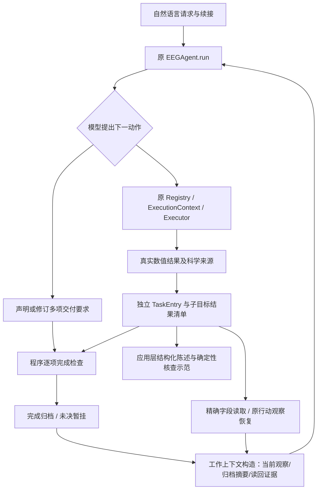

# 开题研究简报：多任务 EEG Harness、科学任务工作记忆与报告证据复用

> Issue #50最新事实：已在原Agent接入职责重划后的managed入口，真实跨轮连续/事件计算、修订及旧值读取可行；冻结确认的差值与事件解释仍错，不能写完整自主科学验收或压缩收益成立。539项离线回归（524通过/15跳过），本阶段26次/309,095tokens；三模式真实层2未运行，过程恢复本轮仅离线验证。具体主张以[写作包B.5](THESIS_PROPOSAL_WRITING_PACK.md)和[集中结果](EEG_WORKING_MEMORY_ISSUE50_PROTOCOL_AND_RESULTS.md)为准，以下旧阶段事实保留。

核查日期：2026-10-26。主线：《面向多任务脑电分析的智能体执行框架研究与应用》。代码起点 `2c34049`；本阶段设计 `555fa84`、多结果实现 `24d4cd2`；继续 Draft PR #37，不合并 main。本文集中供开题讨论，不替代历史实验报告。

> Issue #47 后续核实：完整学校栏目及20项来源/BibTeX集中在[开题写作包](THESIS_PROPOSAL_WRITING_PACK.md)。三项可靠性缺口已修复，412 tests（397通过/15跳过）。新版真实DeepSeek确认已执行：36次/277,191 tokens，短查询成功；复杂交付、修订续接和缺参澄清未通过，不再称“新版完全未做真实验证”，也不能称“已稳定”。下文旧阶段的0次调用、397项测试保留原阶段口径。最终结果以写作包B.2及主方法文档Issue #47末节为准。

> 2026-10-26 论证结构修订：[开题写作包](THESIS_PROPOSAL_WRITING_PACK.md)现已按“实际需要—共同问题—P1/P2—方法—独立评价”重组，并补引已提供的前期学位论文（20项公开来源＋1项学位论文稿）。共同问题是实际计算结果及其科学条件怎样在持续分析和最终表达中得到正确使用。P1研究执行期间的任务工作上下文，P2研究计算证据向报告陈述的转换；师兄成果用于支撑实现可行性。下文历史实验与数字继续保持原阶段记录，正式开题的整体论证以新版写作包为准。

## 1. 明天可以怎样准确介绍

**先说共同问题，再说研究内容。** 多任务 EEG 分析中，结果的含义依赖记录、分析范围、处理版本和任务状态；追加、修订与报告都会再次使用这些结果。本文研究如何使这些实际分析依据在后续使用中保持一致、可核查。由此分出两个相邻问题：执行时怎样组织当前目的与历史结果，支持正确继续分析；表达时怎样使报告事实和解释分别获得计算与适用知识的支持。工作点一和二分别回答这两问，具体问题树、接口与独立评价见写作包第一至四节。保存全轨迹是来源基础，不能单独保证最终报告忠实；报告方法也可在其他合法流程产生的固定证据上评价。

**研究主体是通用多任务 EEG Agent Harness。** 连续信号特征、事件相关分析和已有模型任务是不同任务族；并非注册多个工具便等于证明多任务能力。已建立共同的数据、Profile、Registry、Executor 和证据接口。R3 是数据来源之一，ASD 儿童辅助评估是后续应用，均不进入通用层的疾病/组别假设。

**工作点一聚焦多步骤、多轮 EEG 分析中的科学任务工作记忆管理。** 借鉴 HiAgent，以科学子目标组织当前行动—观察和已完成摘要；结合 EEG 记录、连续/事件时间范围、参数版本、真实结果及工件，支持完成检查、精确读回、过程恢复和合法复用。本阶段补齐“一项科学目的对应多项有效结果”的闭环。不是新通用记忆理论，不再把 CIEDG 投影、证据图或工具数量包装为算法创新。

**工作点二目前是复用设计：把可追溯的计算证据和文献解释依据连接到研究用途报告，并核查关键陈述。** 师兄 Stage1/Stage2、特征分类和知识图谱资产是候选复用资源，不是我们的原创成果；Stage2 情绪能力受损等级不等于 ASD 诊断。当前只实现一条合成工具结果到模板陈述的确定性核验样例，尚未验证报告模型效果或临床用途。

**研究判断：保留工作点一并收敛为成熟记忆技术的 EEG 领域适配，下一项唯一实证优先目标是新多结果版本的真实自然续接确认。** 已有可运行方法主体，但不能宣布相对强摘要或合理直接迁移已经有收益。工作点二可作为开题中的拟研究方案，不能写成已完成创新。学校是否认可取决于最终问题、适配实质和可信实验，不由测试数量决定。

## 2. 研究问题、范围与可证伪假设

典型请求是先测连续窗口幅值/功率，再按条件分析 Epoch；随后修改窗口或追加质量测量，最后比较旧新结果。一个 RMS 数值只有连同记录、导联、绝对窗口、单位及版本才可解释；事件功率还依赖条件、相对窗口、实际保留试次及同一 Epoch 对象。值相同不代表来源相同，计算成功不代表整体要求完成。

完整聊天记录可保存这些信息，强摘要也能保留结构化事实，二者并非天然不可靠。潜在问题在于模型每次决策如何定位适用结果、识别未完成交付、区分新旧范围，以及什么时候有必要恢复处理过程。过去日志确有“已计算多个结果、只正式归档一个”和“证据首次可见但读另一份后丢失”的工程缺陷；不能把其存在直接当成领域研究贡献。

可证伪主张只保留一项：**在需要多结果交付、参数修订或已有工件续算的 EEG 会话中，科学子目标工作记忆在相同科学信息与读取权利下，可能降低不适用结果复用、未交付即结束或重复计算的发生率，并使完整交付/总成本的取舍优于或不劣于简单方案。** 如果强 S 或合理 HiAgent 迁移同样可靠且更省，应采用更简单方案，将该工作准确定位为领域适配与系统验证，而非独立算法优势。

本实现核验的是 LLM **已经声明且系统可表达**的要求，不证明自然语言意图全覆盖，不判断临床效应，不替代统计确认。故障必须分解为需求遗漏、动作选择、工具执行、合同匹配、上下文交接、模型读取和最终回答问题，不能都计入“记忆错误”。

## 3. 有针对性的原始文献核查

以下只陈述所读公开版本中的明确内容。“正文未明确描述或验证”不等于整个领域无人做过。

|来源、状态与核查位置|明确相关内容|对本研究的约束|
|---|---|---|
|[HiAgent，ACL 2025 正式论文](https://aclanthology.org/2025.acl-long.1575/)，正文§3.1–3.4、§4.1，PDF pp.3–4|按子目标组织当前行动—观察，完成后替换为摘要，模型按需恢复完整旧轨迹；实验为规划/文本游戏等长程任务|继承组织与恢复机制；没有复现其全部环境或性能。本文 EEG 合同/参数版本不是其原论文性能的必然推论|
|[EEG Agent，AAAI 2026 正式论文](https://ojs.aaai.org/index.php/AAAI/article/view/38867)，DOI 10.1609/aaai.v40i21.38867，方法部分/工具箱，pp.18063–18071|已有通用 EEG 工具编排、探索、检测、用户交互/报告及反馈/记忆描述|不能声称 EEGAgent 没有记忆。我们的源代码审计与其论文分开；公开描述未直接给出本项目所测多结果归档和修订会话协议|
|[EEGAgentBench v1](https://arxiv.org/html/2609.31632v1)，2026-09-10 预印本，§3.1–3.2、§4.5、附录§6.6|六类短/长程 EEG 任务，统一交互工具，讨论长记录错误与调用成本|长记录分析不等于多轮任务记忆；论文错误分析不能直接归因为记忆。借鉴完整任务和成本评价，而不借其成绩证明本机制|
|[CogEEGAgent v1](https://arxiv.org/html/2607.25045v1)，2026-07-27 预印本，§3.1–3.5|语义选择与确定性科学权限分离，科学合同、过程/证据绑定、确认和发布约束|与我们在科学范围和证据约束上明显重叠，不能回避。其正式确认控制与本项目工作记忆用途不同，不能据此声称全面优于其科学有效性|
|[NeuroAct v1](https://arxiv.org/html/2610.25211v1)，2026-10-18 预印本，§3.1–3.3|研究/开发/审查的上下文分工、证据交接；外环将经验作为带适用条件的建议并验证迁移|已经存在 EEG 证据交接与经验复用。本文限于既有工具上的会话内任务工作记忆，不复现自主训练/跨任务研究经验库|

HiAgent 官方实现的入口核查承接主方法文档：固定提交 `cebdd8e4eacec1a532ce2c0041db8902217b90ba`，实际 `ContextEfficientAgentV2` 路径而非只看 README。该核查用于理解机制，不复制许可证未明确的实现，也不宣称本项目是完整 HiAgent 复现。

### 问题—依据—机制—代码—验证对应

|研究问题|已有工作处理到哪里|本项目待研究环节与 EEG 理由|采用机制及代码|可观察验证|
|---|---|---|---|---|
|长过程每次全部携带的冗余|HiAgent 已有子目标摘要/恢复|摘要不能把同名不同窗口或事件相对秒变成同一结果|`working_memory_agent.py::build_messages`，当前观察＋多结果摘要＋按需恢复|检查每次真实 messages，统计完整成本；与 F/S 比较|
|工具成功但科学目的未完整交付|EEGAgent 有工具闭环；CogEEGAgent 有成功证据及发布约束|一个目的可能同时需要试次数、质量、功率，不能以单个 terminal 代表全部|`working_memory_deliveries.py::completion_check/close_subgoal`|缺必需项、可选失败、部分恢复；对照也有公共完整性核验|
|修订或恢复混用不适用结果|CogEEGAgent 已有合同和证据绑定；NeuroAct 已有条件化经验|本项目具体是记录/窗口版本及当前 Epoch 工件，不是跨任务建议迁移|`remember_observation/reuse_result`，独立 TaskEntry、指纹、revision_of|同内容不同 artifact、同名不同 record、旧新参数；检查无重复计算|
|历史有值，最终上下文丢值|成熟 Agent 需要可靠工具消息交接；本项目已有实际缺口|多结果可能在不同调用得到，最终回答须同时看见|共用 `merge_evidence`，结果摘要/读回 union|首次可见、成功读回、最终输入三层分别记录；所有臂共享修复|
|数值进入报告后失去条件|EEGAgent 有报告，CogEEGAgent 有证据发布，TC 有报告生成|报告应可定位计算依据，同时与解释文献区分|`applications/evidence_statement.py` 仅最小示范|改错值/单位/记录/版本应失败；不等价临床正确性评价|

## 4. 方法继承、适配、代价与实际结构

|机制|继承/适配/省略|为何需要及最简单替代|新增代价与风险|
|---|---|---|---|
|科学子目标＋当前行动—观察|继承 HiAgent 分块；允许短任务直接运行|复杂请求需要暂存尚未完成的分析目的；短任务只存一条结果即可|模型声明控制动作；可能漏声明用户要求|
|完成判断|适配为多项真实交付核查|一个科学目的可有多输出，API成功或模型自称完成不足；列表比图简单|需维护工具/作用域合同；只覆盖已声明项|
|摘要|继承完成后替换；适配为程序生成事实/限制/定位|精确数值、单位、来源不能任意改写；自由文本强摘要仍应作为合理对照|固定字段预览不一定最适合当前问题；摘要及索引也消耗tokens|
|恢复|继承旧轨迹按需恢复；分开标量读取|查询一个 alpha 与了解如何生成旧 Epoch 不是同一需求|恢复过多会抵消压缩收益；没有引入新检索器|
|版本/科学范围|EEG 适配，公共工程也应具备|必须区分绝对/事件相对时间、参考、条件和真实工件|本地指纹校验成本随数组大小增长；尚未大记录基准|
|跨试验经验、向量RAG、多Agent|省略|本轮研究会话内工作记忆，已有工具足够|不具备跨任务学习经验或任意研究自动化能力|



模型决定目的划分、数值动作、读取/恢复、是否提出关闭和最终回答；程序决定输入是否合法、实际值、来源身份、已声明合同是否满足及预算边界。新正式入口不读取 evaluator 的 turn.kind、正确 task ID、gold 或预设调用序列。**本轮测试驱动为了可重复而指定 Fake 动作，不能据此证明模型已会自主决定这些动作。**

简明执行规则：

```text
在每次模型行动前，构造当前观察 + 过去任务摘要 + 已恢复过程 + 精确证据并集。
执行数值工具时仍调用原 Executor；成功即保存独立实际结果，失败保存诊断。
复用时校验记录、参数、版本、数据配置和工件身份；不伪造新计算。
完成时逐项检查必需交付与用户给定条件，事件同范围结果校验同工件。
未完成则继续剩余项、暂挂或澄清；完成后用完整结果集合摘要替换详细过程。
```

结果清单/字段核验属于必要正确性；可能形成应用方法贡献的是其与任务工作记忆的实质结合及经过公平实验证明的使用收益。**“新增一个列表”“hash更严格”“测试更多”都不能单独作为创新。**

## 5. 当前证据：已完成、待验证、计划实现

|状态|内容|不能推出什么|
|---|---|---|
|已实现、离线验证|新 opt-in 多结果存储/完成/归档/复用；原 Agent 循环、原数值工具；连续与事件均走同一方法|不等于真实模型可靠使用|
|已实现、离线验证|两轮21次受控决策，7次真实工具调用、4子目标、7结果；5项原采样oracle；恢复后原工件追加质量；旧新PSD可读|不是未见任务成绩，不与基线比较胜负|
|已实现、离线验证|模板陈述与原证据核查；错值、错单位/记录/版本、未完成目标限制检查|不是自然语言报告验证器，不证明 TC 模型或医学报告质量|
|历史真实现象|Issue45曾真实恢复旧轨迹并继续分析，但整体归档与确认失败、40 calls/228734 tokens|不能写成本阶段新版真实完整验收，也不重算旧成绩|
|本阶段待验证|多结果新版的模型自主选择、完整任务端到端、相对强S/HiAgent直接迁移收益|无新API授权，明确未执行|
|计划实现|跨进程恢复、更多工具迁入、报告模型安全适配及解释依据核验|本轮不以计划冒充已有能力|

本阶段397 tests中382通过、15因资源条件跳过，compileall通过；测试用于正确性，不是论文效果证据。新外部completion为0，旧账本保留。首轮新增测试2项误用字段名，依据原工具真实输出修正，未改真值；完成检查还修订了“失败尝试后显式复用”的时间优先关系。详见主方法文档末节。

公开样例：[多结果合成执行与陈述核验](evidence/multi_result_closure_example.json)。连续 A/SYNTH-C1/0–2秒 alpha 为 `2.00e-10 V²`；stimulus事件0–1秒的3试次 alpha 均值约 `3.2799997787269497e-10 V²`。这些是所构造合成波形的实际计算结果，不能迁移成受试者或临床结论。样例保留精确结果、来源、版本、行动和各次输入可见性。

已知实现边界：原公共精确证据上限8项/24KB，总消息96KB，超限安全停止；多交付合同最多12项不等于保证12项可在当前上下文容量内完成。没有跨进程持久化恢复；摘要保存事实但不保证模型正确理解；最终自由文本仍可能漏项/歪曲；新工作记忆模式未迁移已有模型推理、筛选和重参考。不要再把能力扩张当成本阶段主要目标。

## 6. 后续公平评价：先真实确认，再少量决定性配对

**先确认而非先排行榜。** 获得新预算后，冻结当前版本，在统一入口运行一条多结果请求、一次自然追加/参数修订、一个短请求或缺参会话。用户仅给科学目的/参数；所有正确ID、工具序列和oracle留评价器。保存完整首次失败、模型实际名称、所有输入/输出tokens与调用/延迟，不复用旧预算。未来CLI已具独立持久账本；本次未创建启用配置。

真实确认通过后，建立小规模完整会话单位：连续2类、事件2类、跨对象组合2类，每类短会话包含修订/续算/历史问题的自然需求，不填无关文字。开发与确认使用不同合成配置和表述，冻结确认集后不调方法。分析层面正确答案由结构化需求和独立原采样oracle获得，不能LLM自问自评。

|比较臂|合理能力与相同资源|只允许改变什么|
|---|---|---|
|F 完整历史|可直接回答；所有真实结果/工具/科学信息和读回权限|保存全部真实行动—观察|
|S 强通用摘要|可保留结构化结果、通用时间/版本、字段索引并按需读回；不强迫多调用|摘要和历史压缩组织|
|合理 HiAgent 直接迁移|当前子目标观察、完成摘要、恢复旧过程；保留全部实际结果，不故意单terminal丢数据|通用子目标组织，不独占/剥夺科学事实|
|本 EEG 适配|相同结果/工具/科学权限，利用科学对象和多交付状态组织记忆及续接|科学任务工作记忆的组织和使用方式|

公共范围/版本/数值合法性、完整证据交接及必要缺陷修复各臂共享。不能将候选有Validator、对照无Validator产生的优势归因于记忆。当前 full 模式可作接口参考，**还没有把全部旧S/直接迁移实验统一迁移到新版入口**；正式实验前必须补一致性检查，不能直接拼接旧成绩。

评价完整交付、科学范围/版本错用、实际重复数值计算、工件/结果合法复用、必要澄清、最终证据支持程度及全链费用（分解、摘要、恢复、回答、失败重试均计入）。首轮能力误选或历史没建立单列，不混入检索率。同一原始历史的读取实验与自然闭环分别报告。对照共享证据，允许完整历史直接回答。预算按完整配对单元预留，不足便减少整个样本单位。

最小停止线：若短自然确认仍无法稳定完成已支持交付，优先修公共接口/表示问题，不立即扩展任务；若多轮合理强S具有相同科学正确性且更低总成本，采用“结构化结果档案＋强S＋按需精确读回”，把任务分层保留为复杂任务选项。不得为了保留候选拉长无关历史或反复调阈值。

## 7. 工作点二：TC 的实际资产、复用接口与缺口

用户授权的私有 [TC 仓库](https://github.com/lzy123-web/TC) 可读。核查远端树 `80622e2aff063e61ecd13c159bc92abf991716ec` 与本机现有材料；七个核心模型/特征脚本 Git blob 相同，三个知识图谱/采集脚本仅换行差异。下面是接口级审计，不向公开仓库复制私有源码、样本、标签行、特征、权重或连接凭据。未执行任何师兄脚本，也未安装依赖、训练、推理或连接数据库。

|资产（TC相对路径、入口）|实际作用、输入→输出|可复用/需适配|未验证与风险|
|---|---|---|---|
|`autodl_latest_data/stage1_inference.py::generate_output` L33；组合`stage1+stage2_inference.py::generate_stage1_report` L36|instruction＋特征文本→报告文本；Qwen2.5-7B-Instruct加载LoRA，确定性生成|报告结构和特征文本接口作为候选；改成显式调用，输入附计算证据引用|当前是文本输入，非直接EEG；加载/读文件/写CSV在顶层，不可直接import；报告事实忠实度未知|
|`stage2_inference.py::generate_output` L38；组合`stage1+stage2_inference.py::generate_stage2_decision` L73|instruction＋报告→标签；独立脚本扫描轻/中/重三级，组合脚本取首行|仅在标签定义、使用授权、模型验证完备后作独立研究输出；不能当ASD诊断|独立与组合生成上限不同（256/16）；训练标记为多源评估证据/医学决策结论，推理提示标记不同，不能假定等价|
|`stage1_model_train.py::preprocess_function` L57；`stage2_model_train.py::preprocess` L61|instruction/input/output JSONL→训练文本→LoRA|仅复用已确认的数据/提示契约，暂不训练|训练来源、受试者隔离、目标标签依据未由代码证实；顶层有Trainer.train|
|两个 `qwen2.5-asd-stage*-lora` 目录|LoRA r=32、alpha=64、q/k/v/o投影；依赖7B基座|后续单独模型适配层，核实版本/许可证/校验值/资源后加载|远端adapter是133字节LFS指针；本机顶层文件各80,770,432字节且头部224张量，但未实际加载；本环境缺peft和bitsandbytes|
|`eeg_feature_param.py` L104–144；`RandomForest.py`、`RandomForestPredict.py`|读预计算CSV特征/ability_score→标准化、分类/概率；后者仍会训练|可复用经过重新验证的预处理/模型接口思想；提取、训练、评估应解耦|不是原波形特征提取器。标准化先于train_test_split存在泄漏风险；未复现或认可原指标|
|`知识图谱/data_search/Neo4j_autism_graph.py` L8/20/34/42|Disorder/Paper字段→COMORBID_WITH、RESEARCHED关系|论文DOI/URL等溯源结构可作解释证据候选；要增加具体段落、适用人群、证据等级与版本|顶层Graph连接且L116调用写图；不执行。普通疾病—论文关系不足以支撑某EEG数值到能力结论|
|`data_pure.py::clean_data/process_file`；`paper_crawler/pubmed_crawler.py::crawl_pubmed`|资料清理、论文采集→结构化资料|在版权/许可和内容质量确认后复用采集清理流程|不是已验证医学知识库；量表/图书资料的使用和再发布许可不能假定|

模型卡的许可/训练说明存在占位，仓库元数据 license=null，未找到统一许可。代码可读、头部有效与“模型实际可运行/可自由再许可”是三个不同结论。本轮没有建立师兄对应论文、训练数据和实验指标的可核对映射，因此不引用其论文性能作为已验证结果。所查数据文件只检查键名和instruction的任务词，未向外发送input/output；其任务描述涉及情绪能力/受损程度，不据目录名推断ASD诊断。

### 特征接口不能虚构映射

当前 Harness 有幅值、传统频带PSD、事件整窗频带功率和质量测量；TC 分类脚本消费 `higuchi_fd`、`arousal_max`、`arousal_mean`、`faa_when_avoid`、`parietal_alpha`、`beta_gamma_mean`。所查脚本没有提供从原EEG到这些CSV字段的完整可复现公式/流程。

- Higuchi FD 尚无已迁入工具及其参数定义。
- arousal字段缺算法、时间聚合和来源定义；不能用RMS替代。
- FAA缺参考、左右ROI、频带/对数定义和“avoid”事件含义，不能由合成事件名猜测。
- parietal_alpha需要准确ROI、参考、绝对/相对功率、窗口和归一化规定；单通道alpha不能直接改名。
- beta_gamma_mean需要频带边界、合并方式、时间和通道聚合；不是任意beta/gamma平均。
- ability_score 的评分依据、年龄/人群、分级阈值、受试者级拆分、标注可靠性和授权来源未确认。

因此今天不把通用 evidence_bundle 伪装成 TC 已兼容输入，也不调用其模型碰碰运气。下一步资料优先级是**特征字典＋训练/标签及拆分说明＋模型/资料使用许可**，随后才是本地安全推理适配。

### 两类证据分开，报告陈述逐项定位

拟设计的计算证据条目来自实际 ToolResult：result_id、record、source、tool、scope、time_reference、单位、参数/参考/采样率、revision_of、artifact引用、数值字段、有效性/未决限制。解释依据条目来自经审查文献/知识库：source_id、DOI/URL、精确段落、适用人群/任务、证据类别和版本。**计算证据不自动推出解释，文献也不替代个人计算。**

报告中的结构化 claim 应声明所用计算字段及解释来源；生成前检查资料足够，生成后检查关键值、范围、版本是否对应，未完成分析保留限制。对未知解释/能力映射应明确不足，不生成等级。未来可复用师兄Stage1作为生成组件，但模型是否忠实引用还要测试；Stage2只在独立科学条件充分时作为可选研究输出，不作为默认报告结论。

当前最小例子 `applications/evidence_statement.py::make_statement/verify_statement`：真实事件工具产生alpha→带3试次/条件/相对窗/单位/来源/版本的原结果→固定模板描述→逐字段及模板一致性检查。历史合法值可以作为历史陈述；若标记current但已被修订，则拒绝。目标未完成时必须带限制。解释来源列表为空，表示没有生成医学解释。此接口测试不是报告生成研究效果。

## 8. 开题可能追问与有依据的回答

**与直接用大模型＋MNE有什么区别？** 数值算法继续用已有工具；研究对象是多轮科学任务的工作上下文及交付生命周期。普通工具链已有科学校验，我们的增量必须在修订、恢复、完整交付和成本上验证，不靠替换算法。

**是不是只把HiAgent换个数据集？** 继承组织原则，但 EEG 多结果、绝对/相对时间、参数版本及实际工件不能只作为自由文本摘要。已实装程序约束和可恢复真实结果。是否“实质性领域适配有效”仍需与合理直接迁移公平比较；不能把所有工程绑定都列成独立创新。

**科学合同已有论文做了，创新在哪里？** 不主张合同/证据追踪新颖。可研究的是它们怎样约束工作记忆的归档、读取、恢复与继续分析，并验证在完整多轮任务中的收益。若更简单方案同样好，就保留系统价值、收缩方法主张。

**已有DeepSeek跑通了吗？** 旧版有真实工具执行、历史恢复和参数修订证据，也有整体失败。新多结果版目前仅受控Fake＋真实工具验证，0次新付费调用；尚不能说新版真实自主完整验收完成。

**为什么现在不再跑一轮排行？** 首要缺口是真实闭环与公平公共接口，不是样本量。先验证新版是否能自主完成，再在预算内做完整配对；旧开发样例不能冒充未见数据。

**工作点二是不是复用师兄成果便算创新？** 不是。复用模型/图谱只能降低工程起点；拟新增的是实际计算证据、解释依据与报告陈述的可核查连接。当前只有设计和模板样例，报告质量提升、领域解释及临床相关性都未验证。

**能否评估ASD儿童能力/严重程度？** 当前不能。需要特征科学定义、量表/标签来源、人群适用性、伦理/授权与独立验证；已有癫痫模型和通用PSD不能被解释为ASD能力分值。

**论文怎么稳定收敛？** 保留多任务Harness成果，将工作点一表述为任务工作记忆的领域适配和可信验证；下一阶段只做新版真实自然续接确认。工作点二先补师兄输入/标签资料，再做最小安全接入。若适配无独立收益，采用强S和通用证据档案并如实收缩贡献，停止无目的增加模块。

## 9. 复现与阅读顺序

先读本简报第1/5/7节，再读 [主方法文档](EEG_WORKING_MEMORY_METHOD_AND_INTEGRATION.md) 的后续阶段实装；执行样例见 [JSON](evidence/multi_result_closure_example.json)。

```powershell
$env:PYTHONPATH = 'src'
python -m eeg_harness.research.working_memory_deliveries_validation --output artifacts/working_memory_multi_result/proposal-replay.json
python -m unittest discover -s tests -p 'test_working_memory*.py' -v
python -m unittest discover -s tests -p test_evidence_statement.py -v
python -m unittest discover -s tests -q
```

文件已存在时选新文件名，不覆盖旧证据。真实入口和单独预算配置方法见主方法文档；本简报未授权任何新模型调用。本阶段不拷贝TC私有代码、数据、LoRA、图谱正文或个人配置到公开仓库。

