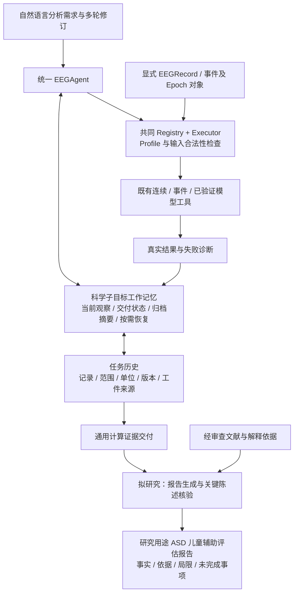

# 硕士论文开题写作材料：多任务 EEG Harness、科学任务工作记忆与证据约束报告

论文题目：**《面向多任务脑电分析的智能体执行框架研究与应用》**。资料核查日期：2026-10-26。承接 `research/point1-eeg-task-memory`、Draft PR #37 和 Issue #47；本材料不替代历史实验报告，也不将拟研究内容写成既成成果。

## 使用说明与学校要求对应

Issue #47 转录的学校标准要求硕士开题正文不少于 **3000 字**，包括下表栏目；没有给出参考文献最低篇数，也没有要求开题前完成全部实验。下面提供可裁剪的中文正文和写作依据，20 项参考来源是本阶段整理量，不是学校硬性篇数要求。正式提交时仍须按学校原模板填入个人信息、日期、排版和审批栏目。

|学校栏目|已有依据|本次补齐|可用位置|
|---|---|---|---|
|选题价值与意义|项目定位、工具链及任务历史问题|从 EEG 多任务分析需要推导研究问题，限定研究用途|正文一|
|国内外研究现状及趋势|HiAgent、EEGAgent 等五项定向核查|补科学工具、元数据规范、记忆评价及报告事实支持来源|正文二；附录 A|
|研究目标、思路、方法、技术路线|现有工作记忆实现及 TC 接口审计|两工作点的边界、方法步骤、总体路线、相互关系|正文三|
|研究难点、可能创新与不足|实际失败和现有能力边界|将领域适配、公共修复和待证明贡献分开|正文五|
|主要内容、论文框架|已有研究简报|形成六章框架及章节证据要求|正文七|
|进度安排|没有经核实的正式提交日期|按验收门槛编排相对进度，不编造校历|正文七|
|主要参考文献|已有五项相关论文|20 项原始来源的元数据、状态、章节与论点映射，另附 BibTeX|附录 A；`THESIS_PROPOSAL_REFERENCES.bib`|

“国内外现状”按研究问题而非作者姓名分类。EEGAgent 正式论文的作者单位可核实为浙江大学；其他工作的机构和人群信息只依原文，不根据姓名猜测国别。下文中的“拟”“计划”均为研究方案；代码可运行、离线正确性和真实模型自主效果是不同证据层级。

<!-- MAIN_TEXT_START -->

## 一、选题意义与研究问题

脑电分析既包括连续信号的幅值和频带特征，也包括以事件为中心的试次构建、条件比较及满足特定输入约束的模型推理。这些任务共享数据加载、预处理、数值计算和结果解释基础，但科学要求并不相同。例如，同一频带功率只有结合采样率、参考方式、通道、时间范围和处理历史才具有明确含义；事件分析还需要事件定义、相对时间窗及实际保留试次。因此，多任务能力应体现为不同科学任务能够分别执行，并在合法条件下共享对象和结果，不能以工具数量代替。

EEGLAB、MNE 等成熟工具已经提供可靠的 EEG 分析构件，本研究不重复设计基础数值算法。现有工具可组合为分析流程，但使用者仍需将需求转化为参数，追踪数据版本，判断中间结果是否适合后续分析，并在多轮修改后解释结果差异。大语言模型能够通过自然语言操作工具，为降低使用门槛提供机会；同时，流畅回答可能掩盖错误范围、过期结果或未完成分析，故不能把生成文本视为执行成功的充分证据。[1](https://sccn.ucsd.edu/eeglab/download/eeglab_jnm03.pdf)、[2](https://www.frontiersin.org/journals/neuroscience/articles/10.3389/fnins.2013.00267/full)

本论文以通用 EEG Agent Harness 为系统主体，研究自然语言分析需求、科学工具执行、任务上下文和证据交付之间的连接。工作点一关注多步骤、多轮 EEG 分析的工作记忆：如何保留当前目的及未完成事项，如何压缩已完成过程，如何准确读取或恢复旧结果并继续分析。工作点二拟研究计算证据与解释依据共同约束的研究用途报告，在 ASD 儿童辅助评估场景检验系统应用价值。R3 仅是可选数据来源；疾病、组别和标签解释不进入通用数据结构。

本研究的应用意义在于减少重复整理历史和核对结果的负担，提高分析过程可追溯性。其研究价值须由公平比较证明，而非由软件规模决定。论文不承诺自动诊断，不将癫痫概率、频带功率或情绪能力标签直接转换为 ASD 严重程度；任何人群相关解释均须满足资料、授权和科学依据要求。

## 二、国内外研究现状与发展趋势

### 2.1 EEG 分析工具与科学信息规范

EEGLAB 和 MNE 支撑单试次、时域和频域等分析，为算法复用提供基础。Roy 等对 EEG 深度学习研究的系统综述展示了任务、数据和评估方式的异质性；其覆盖的文献截止于 2018 年，不能当作当下模型性能综述。对本课题更重要的启示是：任务适用性和评价条件必须随结果保留，不能从一个数据集的模型分数推导通用能力。[3](https://arxiv.org/abs/1901.05498)

EEG-BIDS 将通道、事件和记录说明组织为可交换元数据，COBIDAS MEEG 强调采集、处理与报告的透明性。这些工作说明“数值之外的信息”属于科学结果解释的必要条件，但数据格式规范本身不会自动解决 Agent 的历史选择和续接问题。本项目借用其信息完整性原则，尚未宣称完整实现 EEG-BIDS 或自动满足 COBIDAS 的全部建议。[4](https://www.nature.com/articles/s41597-019-0104-8)、[5](https://www.humanbrainmapping.org/files/2020/COBIDAS-MEEG_NatNeuro_revised.pdf)

### 2.2 EEG Agent 与通用工具使用

EEGAgent 已提出统一工具编排与反馈框架，论文包含探索、检测、交互和记忆相关描述，不能将其概括为“没有记忆”。EEGAgentBench 将短程与长程 EEG 任务纳入工具交互评价，但长记录处理不同于多轮任务记忆。CogEEGAgent 强调语义选择与确定性科学权限的分离、执行证据及确认控制；NeuroAct 研究双循环自主 EEG 研究和经验复用。后三项在本材料核查时为预印本，应按所读版本讨论，其主张和实验不能直接移作本项目成绩。[6](https://ojs.aaai.org/index.php/AAAI/article/view/38867)、[7](https://arxiv.org/abs/2609.31632)、[8](https://arxiv.org/abs/2607.25045)、[9](https://arxiv.org/abs/2610.25211)

通用 Agent 方面，ReAct 通过推理与行动交错利用外部观察，Toolformer 则研究模型学习何时及如何调用工具。这说明工具闭环、计划更新和工具选择并非本论文新提出。当前 Harness 已具备共同 Registry、Executor、结果和运行轨迹，本轮不会另建执行器。待研究的问题是既有执行能力之上的工作上下文组织，而非重新证明语言模型可以调用 EEG 工具。[10](https://openreview.net/forum?id=WE_vluYUL-X)、[11](https://proceedings.neurips.cc/paper/2023/hash/d842425e4bf79ba039352da0f658a906-Abstract-Conference.html)

### 2.3 工作记忆及其 EEG 适配

HiAgent 以子目标组织当前行动—观察，完成后保存摘要，并按需恢复既往过程；其评价主要涉及规划和文本交互环境，不是 EEG 科学分析。本研究继承这一组织思路，不声称完整复现原论文。MemGPT 的显式内外存管理说明归档存储与工作上下文分离已有成熟基础。LongMemEval 区分信息提取、跨会话推理、时间关系、更新与拒答，为分解记忆失败提供参考；其聊天记忆评价不等于实际 EEG 工具闭环验收。[12](https://aclanthology.org/2025.acl-long.1575/)、[13](https://arxiv.org/abs/2310.08560)、[14](https://openreview.net/forum?id=pZiyCaVuti)

EEG 适配不能仅把一般摘要换成脑电术语。同一科学目的可能需要试次数、质量和频带结果共同交付；相同数值可能来自不同记录；同名条件可能对应不同 Epoch 对象；旧窗口结果不应因仍在历史中就被视作当前答案。因此，本研究将科学范围、参数版本、真实结果和工件关系用于约束完成、归档、恢复和合法复用。FAIR 和 PROV 已为数据可复用性及来源描述提供原则和模型，来源追踪本身不构成新的算法贡献。[15](https://www.nature.com/articles/sdata201618)、[16](https://www.w3.org/TR/2013/REC-prov-dm-20130430/)

### 2.4 报告生成与证据支持

检索增强生成能够利用外部文本，但检索到材料不保证回答中的每项陈述都得到支持。ALCE 将引用质量与回答质量分开评价，FActScore 采用原子事实视角检查长文本事实支持。这为工作点二的陈述拆分和来源核验提供依据，但其通用文本评价不能直接担当 EEG 或临床真值。TRIPOD+AI 强调预测模型报告的透明性，可指导披露标签、人群、划分和限制，不能据此认定现有模型已适用于 ASD 儿童。[17](https://aclanthology.org/2023.emnlp-main.398/)、[18](https://aclanthology.org/2023.emnlp-main.741/)、[19](https://proceedings.neurips.cc/paper/2020/hash/6b493230205f780e1bc26945df7481e5-Abstract.html)、[20](https://pure-oai.bham.ac.uk/ws/portalfiles/portal/280668502/CollinsG2024TRIPOD_AI.pdf)

总体趋势是从“能够生成分析步骤”走向“执行有依据、结果可核对、过程可恢复”。已有研究与本项目存在明显重叠，故本论文只保留一个工作点一主张：科学任务工作记忆是否能在相同信息和工具权限下，改善多结果交付、修订续接和合法复用的可靠性与成本取舍。若合理强摘要已经同样可靠且更省，应采用简单方案并收缩优势主张。

## 三、研究目标、方法与技术路线

### 3.1 总体目标与工作点一

总体目标是构建能完成代表性连续分析、事件分析及资源允许的模型任务的通用 Harness，并研究多轮科学任务的可靠上下文管理。基础层保留显式 EEGRecord、TaskProfile、Registry、Executor 和实际 ToolResult；任务层声明输入条件；记忆层组织执行上下文；应用层消费证据。当前新工作记忆模式只覆盖已接入的数值工具，不能将旧版已有推理能力自动计入新版验收。

工作点一拟采用科学子目标工作记忆。模型根据自然语言提出子目标和交付要求，程序保存声明及实际观察。每次行动前，构造当前目的、必要行动—观察、已完成摘要及合法读回的证据。数值计算仍由原 Executor 执行；每项实际结果独立保存，并绑定记录、连续或事件范围、单位、参数版本和工件。完成判断逐项检查已声明的必需交付，不接受模型仅凭一句“完成”结束。多结果属于同一事件对象时，还须保持工件身份一致。

已完成子目标归档为事实摘要、未决限制和定位信息，详细过程保留在历史存储。查询历史数值时读取相应字段；需要继续旧过程时恢复其行动—观察和有效工件。这两种操作分开，避免为简单查询恢复整段轨迹。归档数量不应直接占满精确证据工作集；模型下一步所需证据经选择后进入上下文，新读回证据与本轮有效证据合并，失败读取不构成结果。字段单位来自字段语义，不能将同一工具的功率、频率和试次数统一标为功率单位。

额外代价包括控制动作、合同维护、索引和摘要 tokens、恢复延迟及可能的模型误选。短任务允许直接执行。程序只验证系统已声明且可表示的交付，不能保证自然语言所有意图都被提取；最终自由文本也仍需独立评价。对照共享科学校验和公共缺陷修复，避免把接口不公平当作记忆收益。

### 3.2 工作点二及其与工作点一的关系

工作点二拟研究证据约束的研究用途报告。计算证据记录个人分析的实际数值、范围、版本和有效性；解释依据记录经审查文献的段落、适用人群、任务条件和版本。二者用途不同：文献不能替代个人计算，个人功率值也不能自动推出能力等级。报告中的关键陈述应定位到实际字段；涉及解释时另列相应来源，不满足条件时明确说明信息不足。

拟复用师兄 TC 的 Stage1 报告模型、Stage2 决策模型、特征分类和知识资料，但先核对输入契约、许可和科学定义。模型是候选组件，不是本论文原创；其情绪能力受损标签不等于 ASD 诊断。计划实现输入证据整理、生成约束和关键陈述核验，在相同生成模型下比较直接生成、加入执行证据及加入陈述核验的差异。当前仅有合成结果到模板陈述的确定性示范，未完成自然语言医学报告验证，也不在本阶段训练新模型。

两个工作点共享证据但评价对象不同：工作点一关注分析过程中的决策上下文、继续执行和完整交付；工作点二关注交付后报告陈述与计算、文献之间的对应。应用仅检验通用方法的使用价值，不把 R3 或 ASD 标签写入共同核心。

图中执行、任务历史及证据交接已有实现；报告生成与解释依据连接为拟研究，不能将图中箭头全部当作已验证能力。

## 四、实验设计与可证伪评价

工作点一采用受控合成 EEG 和真实工具计算建立可追溯真值。任务包含连续窗口特征、事件条件分析、参数修订、旧工件续算以及历史比较；由独立原采样计算检查数值、记录、范围和版本，不能仅核对 task_id。模型输入不给正确工具顺序、任务 ID 或评价答案。开发样例用于定位公共接口与机制问题，锁定方案后再用独立确认样例；首次失败和旧结果保留。

比较包括完整历史 F、合理强摘要 S、合理 HiAgent 直接迁移和 EEG 适配。全部方案拥有相同真实工具、科学信息、结果存储和读取权限，完整历史可直接回答；通用方案也能保存时间和版本，不故意丢失多结果。只改变上下文组织与恢复方式。单个完整会话是主要评价单位，同一历史下的读取比较与模型自主建立历史的多轮闭环分别报告，避免把首轮能力误选算作检索错误。

指标包括完整科学交付、部分交付、合理澄清、范围或版本错用、无效结果复用、重复计算、证据支持程度以及全链调用、tokens、读取量和延迟。分解、摘要、恢复、失败和回答均计费，不能用字符压缩代替总成本收益。错误按需求遗漏、动作选择、工具执行、完成合同、上下文交接、模型读取和最终回答分别归因。小样本主要用于机制确认和失败描述，不宣称普遍优越；后续正式比较先冻结任务与评分规则，再按完整配对单元确定预算。

工作点二在相同计算结果、生成模型和可访问解释资料下比较报告方案。确定性检查覆盖数值、单位、记录、时间范围、参数版本、必要字段和引用定位；文献是否真正支持解释、适用人群是否匹配等仍需可信领域评价。可通过受控错值、过期版本或缺少来源检验检错能力，但这种合成评价不能证明临床有效性。若复用预测模型，数据划分必须按受试者隔离，预处理只能在训练折拟合，不能沿用未经核查的历史指标。

停止条件是科学边界而非追求胜率：若合理强 S 已达到相同正确性且更低成本，保留结构化档案与按需读取作为默认实现；若报告所需特征、标签或授权不足，停止相应医学解释，只展示可验证事实及缺口。不会为获得正结果延长无关历史、削弱对照、修改确认真值或增加未经支持的任务规则。

## 五、重难点、拟创新与不足

第一项难点是区分科学目标与一次工具调用：一个目标可能产生多项结果，计算完成不代表用户要求完整交付。第二项难点是让摘要足以支持决策，同时保留可精确恢复的记录、范围和版本，避免混用内容相同而来源不同的对象。第三项难点是成本归因：额外读取及模型调用可能抵消摘要收益。第四项难点是报告解释边界，尤其不能用一般文献关联代替个人评估依据。

|难点|为何困难|拟解决路径|验收证据|
|---|---|---|---|
|科学目的与多项交付一致|LLM可能漏项或自行填科学范围，合法参数未必获授权|显式交付、参数来源、缺参澄清及可纠正的完成条件|完整自然请求与真实轨迹对照；未授权条件不执行|
|摘要后仍能正确续接|结果数值相同不代表记录、窗口和版本相同|科学事实摘要、独立结果档案、旧新版本及工件绑定|旧新证据对照、恢复后继续执行且不重算|
|可靠性与总成本取舍|控制、读取和末轮调用可能抵消压缩节省|同信息同读权配对，报告完整会话总成本|科学正确性、实际tokens/调用/延迟，不以压缩字符替代|
|报告事实与解释都受支持|个人计算与群体文献回答不同问题，特征标签可能未定义|字段语义核验与独立解释来源关联，缺依据时限定结论|可定位陈述、错误注入检错及后续领域审阅|

工作点一拟贡献应准确表述为：**将子目标工作记忆实质适配到多轮 EEG 科学分析，使多结果交付、对象范围和版本关系参与归档、恢复及继续执行，并通过公平实验评价可靠性与成本。** 子目标摘要、分页读取、来源追踪本身不是新算法，公共证据丢失或字段单位错误的修复也不是独立创新。工作点二的候选贡献是计算证据、解释来源与报告关键陈述的可核查连接，是否达到独立工作点要求仍取决于实现和验证。

当前不足包括受控任务规模有限、新版工具覆盖不完整、跨进程恢复尚未验收、自然语言意图遗漏未被完全解决、自由文本科学解释缺少领域有效性证据，以及师兄模型输入和标签资料尚不完整。课题可以作为成熟方法领域适配与系统研究继续收敛，但不能以代码量、单例跑通或测试数量证明创新，也不保证最终学校评审结论。

## 六、可行性与已有基础

现有工程已经建立显式数据对象、任务 Profile、统一工具执行、结构化结果和任务历史，能在不依赖 LLM 的条件下复现基础 EEG 数值链路。新工作记忆沿用原 Agent 和 Executor，减少重复实现风险。合成信号可控制幅值、频率和事件条件，支持独立 oracle；真实受试者数据仅本地处理，外部模型只接收合成数据必要信息。公开源码、冻结历史和独立预算账本为复现提供基础。

既往真实模型日志证明部分工具调用、历史恢复与修订实际发生，也保留整体交付失败；这些不是新版成绩。旧阶段 397 项测试中的 382 通过、15 跳过仅证明当时相应软件检查。本阶段最新实现、离线结果和真实调用须以附录 B 的最终验收块为准，不能从代码存在推定自主效果。

TC 资料已有接口级审计，具备报告和决策模型的候选资产，但尚未运行验证。单独 Stage1 和 Stage2 推理文件的入口均为 `generate_output`；组合文件分别为 `generate_stage1_report` 与 `generate_stage2_decision`。特征脚本读取预计算字段，并不提供完整原波形提取流程；另一个脚本还要求 `arousal_std`，说明输入版本需要核对。代码能确认 `ability_score` 出现数值 1、2、3，但不能据此确定其与轻中重、量表或诊断的映射。缺少的关键资料是特征公式及参考、窗口和 ROI，标签依据及人群，受试者划分，以及模型和资料许可。因此，可行性来自可复用工程和明确补齐路径，不能表述为模型即插即用或已具临床效果。私有源码、样本、权重和知识图谱正文均不复制到公开仓库。

## 七、论文内容与相对进度

论文拟分六章：第一章说明研究背景、问题和贡献边界；第二章介绍 EEG 任务、科学数据条件、Agent 工具执行和工作记忆基础；第三章研究多任务 Harness 与科学子目标工作记忆，给出方法、实现和公平评价；第四章研究计算证据与解释依据约束的报告生成及核验；第五章开展系统和 ASD 儿童研究用途综合应用验证，披露资料与适用限制；第六章总结结论、失败边界和后续工作。章节名称可依学校模板调整，但方法、实验和应用贡献不混写。

进度采用相对阶段：先完成新版闭环确认与开题材料；随后冻结工作点一方案、统一对照入口和实验协议，再完成配对实验及归因；并行补齐 TC 特征、标签与许可资料，在满足条件后做最小本地报告接入；最后开展报告核验和应用评价、整理论文与复现材料。每阶段以交付验收为转段条件。若工作点一适配没有额外收益，及时采用强 S 并保留领域方法验证；若应用资料未满足，缩小报告内容至可追溯研究事实，不以编造解释维持进度。

<!-- MAIN_TEXT_END -->

## 附录 A：经过核实的参考文献及正文论点映射

核实日为 2026-10-26。论文正式/预印本状态按可访问原始出版页判定；DOI 存在不等于经过同行评审。章节位置指原文标题或节号，便于复查，不把摘要中的效果数字当成本项目证据。BibTeX 文件与本表一一对应；大型作者列表的 `and others` 是明确缩写，不猜测未列作者。

|编号 / BibTeX key|书目信息与核实状态|原始来源及核查位置|支持的正文论点；不能推出什么|
|---|---|---|---|
|1 / `delorme2004eeglab`|Delorme A, Makeig S. EEGLAB: an open source toolbox for analysis of single-trial EEG dynamics including independent component analysis. *Journal of Neuroscience Methods*, 2004, 134(1):9–21. 正式论文；DOI `10.1016/j.jneumeth.2003.10.009`|[作者机构原文](https://sccn.ucsd.edu/eeglab/download/eeglab_jnm03.pdf)，§1 Basic functions|成熟 EEG 工具与可复用分析；不是 Agent 记忆收益证据|
|2 / `gramfort2013mne`|Gramfort A, Luessi M, Larson E, et al. MEG and EEG data analysis with MNE-Python. *Frontiers in Neuroscience*, 2013, 7:267. 正式论文；DOI `10.3389/fnins.2013.00267`|[期刊原文](https://www.frontiersin.org/journals/neuroscience/articles/10.3389/fnins.2013.00267/full)，数据结构、工作流与 Conclusion|Raw/Epoch 等科学对象及算法复用；不代表本项目已覆盖所有 MNE 能力|
|3 / `roy2019review`|Roy Y, Banville H, Albuquerque I, Gramfort A, Falk TH, Faubert J. Deep learning-based electroencephalography analysis: a systematic review. *Journal of Neural Engineering*, 2019, 16(5):051001. 正式论文；DOI `10.1088/1741-2552/ab260c`|[作者预印原文](https://arxiv.org/abs/1901.05498)；[出版元数据](https://pubmed.ncbi.nlm.nih.gov/31151119/)，综述方法、任务及可复现性讨论|EEG 任务异质性和评估条件；覆盖截至 2018 年，不是 2026 年模型排名|
|4 / `pernet2019eegbids`|Pernet CR, Appelhoff S, Gorgolewski KJ, Flandin G, Phillips C, Delorme A, Oostenveld R. EEG-BIDS, an extension to the brain imaging data structure for electroencephalography. *Scientific Data*, 2019, 6:103. 正式出版 Comment；DOI `10.1038/s41597-019-0104-8`|[期刊原文](https://www.nature.com/articles/s41597-019-0104-8)，EEG-BIDS Summary / Data Analysis Pipelines and Beyond Sharing Raw Data|记录、通道、事件元数据；本项目未声称完整 BIDS 合规|
|5 / `pernet2020cobidas`|Pernet C, Garrido MI, Gramfort A, Maurits N, Michel CM, Pang EW, Salmelin R, Schoffelen JM, Valdes-Sosa PA, Puce A. Issues and recommendations from the OHBM COBIDAS MEEG committee for reproducible EEG and MEG research. *Nature Neuroscience*, 2020, 23:1473–1483. 正式论文；DOI `10.1038/s41593-020-00709-0`|[OHBM 原文副本](https://www.humanbrainmapping.org/files/2020/COBIDAS-MEEG_NatNeuro_revised.pdf)，Overview / 采集、分析及报告建议|科学处理透明性；不是自动化临床解释标准答案|
|6 / `zhao2026eegagent`|Zhao S, Peng M, Jiang H, Li T, Li S. EEG Agent: A Unified Framework for Automated EEG Analysis Using Large Language Models. *AAAI*, 2026, 40(21):18063–18071. 正式论文；DOI `10.1609/aaai.v40i21.38867`|[出版页及 PDF](https://ojs.aaai.org/index.php/AAAI/article/view/38867)，框架与工具箱部分|已有 EEG 工具编排及反馈/记忆；不能声称其无记忆，也不把论文功能直接当源码事实|
|7 / `wu2026eegagentbench`|Wu H, Weng W, Liu Y, Chen Y, Gu Y. EEGAgentBench: Benchmarking LLM Agents on Short- and Long-Horizon EEG Analysis. arXiv:2609.31632v1，2026-09-10，预印本；DOI `10.48550/arXiv.2609.31632`|[原文 v1](https://arxiv.org/html/2609.31632v1)，§3.1–3.2、§4.5、§6.6|完整 EEG 任务与成本评价；长程错误不等于记忆因果证据|
|8 / `hou2026cogeegagent`|Hou D, Jiang L, Lin F, Yamada KD. CogEEGAgent: Toward Autonomous Cognitive EEG Analysis with Grounded Execution and Selection-Aware Verification. arXiv:2607.25045v1，2026-07-27，预印本；DOI `10.48550/arXiv.2607.25045`|[原文 v1](https://arxiv.org/html/2607.25045v1)，§3.1–3.5|科学权限、合同和证据绑定的已有研究；不得隐去重叠或声称首次提出|
|9 / `xiong2026neuroact`|Xiong W, Li J, Zhao H, Yang L, Li J, Jiang C. NeuroAct: Advancing EEG Analysis and Decoding via Dual-Loop Autonomous Research. arXiv:2610.25211v1，2026-10-18，预印本；DOI `10.48550/arXiv.2610.25211`|[原文 v1](https://arxiv.org/html/2610.25211v1)，§3.1–3.3|EEG 研究证据交接与条件化经验；不等于本项目会话内科学任务工作记忆|
|10 / `yao2023react`|Yao S, Zhao J, Yu D, Du N, Shafran I, Narasimhan K, Cao Y. ReAct: Synergizing Reasoning and Acting in Language Models. ICLR 2023，正式会议论文|[会议原文](https://openreview.net/forum?id=WE_vluYUL-X)，§2 方法|推理、行动及观察交错已有基础；不声称发明工具闭环|
|11 / `schick2023toolformer`|Schick T, Dwivedi-Yu J, Dessì R, Raileanu R, Lomeli M, Hambro E, Zettlemoyer L, Cancedda N, Scialom T. Toolformer: Language Models Can Teach Themselves to Use Tools. NeurIPS 2023, 36，正式会议论文|[会议原文](https://proceedings.neurips.cc/paper/2023/hash/d842425e4bf79ba039352da0f658a906-Abstract-Conference.html)，§2|学习工具使用与本项目运行时记忆不同；本项目不训练新工具调用模型|
|12 / `hu2025hiagent`|Hu M, Chen T, Chen Q, Mu Y, Shao W, Luo P. HiAgent: Hierarchical Working Memory Management for Solving Long-Horizon Agent Tasks with Large Language Model. ACL 2025:32779–32798，正式论文；DOI `10.18653/v1/2025.acl-long.1575`|[ACL 原文](https://aclanthology.org/2025.acl-long.1575/)，§3.1–3.4、§4.1；[官方代码](https://github.com/HiAgent2024/HiAgent)|子目标、当前观察、完成摘要及恢复的主要继承来源；非 EEG 实验，非完整复现|
|13 / `packer2023memgpt`|Packer C, Wooders S, Lin K, Fang V, Patil SG, Stoica I, Gonzalez JE. MemGPT: Towards LLMs as Operating Systems. arXiv:2310.08560，2023；本次读 v2（2024-02-12），预印本；DOI `10.48550/arXiv.2310.08560`|[原文 v2](https://arxiv.org/html/2310.08560v2)，§2|主上下文与外部记忆及显式分页；不将工作集分离包装成新算法|
|14 / `wu2025longmemeval`|Wu D, Wang H, Yu W, Zhang Y, Chang KW, Yu D. LongMemEval: Benchmarking Chat Assistants on Long-Term Interactive Memory. ICLR 2025，正式会议论文；预印本 arXiv:2410.10813|[会议页](https://openreview.net/forum?id=pZiyCaVuti)；[可读原文 v1](https://arxiv.org/html/2410.10813v1)，§3.1–3.4、§4|提取、时间、更新、拒答及读取分解；不是 EEG 自主执行任务基准|
|15 / `wilkinson2016fair`|Wilkinson MD, Dumontier M, Aalbersberg IJ, et al. The FAIR Guiding Principles for scientific data management and stewardship. *Scientific Data*, 2016, 3:160018. 正式论文；DOI `10.1038/sdata.2016.18`|[期刊原文](https://www.nature.com/articles/sdata201618)，FAIR principles|可发现、可访问、可互操作、可复用；元数据完备不自动保证科学正确|
|16 / `moreau2013prov`|Moreau L, Missier P（编）. PROV-DM: The PROV Data Model. W3C Recommendation，2013-04-30。技术标准，无期刊 DOI|[固定版规范](https://www.w3.org/TR/2013/REC-prov-dm-20130430/)，§2、§5|实体、活动、使用与派生的来源建模；不是新记忆算法依据|
|17 / `gao2023alce`|Gao T, Yen H, Yu J, Chen D. Enabling Large Language Models to Generate Text with Citations. EMNLP 2023:6465–6488，正式论文；DOI `10.18653/v1/2023.emnlp-main.398`|[ACL 原文](https://aclanthology.org/2023.emnlp-main.398/)，§2 Benchmark and Evaluation|引用支持与覆盖评价；有引用不等于陈述真实|
|18 / `min2023factscore`|Min S, Krishna K, Lyu X, Lewis M, Yih WT, Koh P, Iyyer M, Zettlemoyer L, Hajishirzi H. FActScore: Fine-grained Atomic Evaluation of Factual Precision in Long Form Text Generation. EMNLP 2023:12076–12100，正式论文；DOI `10.18653/v1/2023.emnlp-main.741`|[ACL 原文](https://aclanthology.org/2023.emnlp-main.741/)，事实分解及评价方法|原子陈述与来源支持；其通用文本/模型评分不能充当 EEG gold|
|19 / `lewis2020rag`|Lewis P, Perez E, Piktus A, et al. Retrieval-Augmented Generation for Knowledge-Intensive NLP Tasks. NeurIPS 2020, 33，正式会议论文|[会议原文](https://proceedings.neurips.cc/paper/2020/hash/6b493230205f780e1bc26945df7481e5-Abstract.html)，§2|利用外部知识的成熟路线；不是本阶段建设新 RAG 平台的理由|
|20 / `collins2024tripodai`|Collins GS, Moons KGM, Dhiman P, et al. TRIPOD+AI statement: updated guidance for reporting clinical prediction models that use regression or machine learning methods. *BMJ*, 2024, 385:e078378. 正式论文；DOI `10.1136/bmj-2023-078378`|[作者机构原文](https://pure-oai.bham.ac.uk/ws/portalfiles/portal/280668502/CollinsG2024TRIPOD_AI.pdf)，清单及数据/结局/评价报告条目|模型报告透明性和适用边界；不证明 TC 标签或模型已经临床有效|

EEGAgent、HiAgent、EEGAgentBench、CogEEGAgent、NeuroAct 五项前阶段关键来源均保留。参考文献中未列师兄论文性能：当前缺少其论文、实际训练版本与实验记录的可核对映射，不能以私有目录名称替代文献证据。

## 附录 B：机制落实、当前证据及正式写作口径

### B.1 继承、适配与代价

|内容|继承或适配|代码与观察位置|额外代价及当前限制|
|---|---|---|---|
|子目标、当前行动—观察|继承 HiAgent 的工作记忆组织|`working_memory_agent.py`；原 `agent.py`|控制调用与模型误选；不保证用户所有要求已被声明|
|多项真实交付、范围与版本|EEG 任务适配及公共正确性基础|`working_memory_deliveries.py` 的结果保存、`completion_check`、复用与关闭|合同维护、对象身份检查；不是新数值算法|
|摘要、索引和按需恢复|成熟压缩/恢复思路；摘要保存科学事实|`working_memory.py`、`working_memory_agent.py::build_messages`|恢复调用抵消压缩收益的风险；跨进程恢复尚未完整验收|
|证据合并、字段语义和失败隔离|各方案共用的工程可靠性|`research/task_memory_evidence.py`、`applications/evidence_statement.py`|字段合同需维护；模板正确不等于自由文本医学正确|
|原数值工具执行|直接复用共同系统|`executor.py`、Registry、EEGRecord、ExecutionContext|具体工具/Profile 限制仍存在；新版未迁移能力不能算作新版成果|

### B.2 本阶段最终验收块

<!-- ISSUE47_RESULTS_START -->
**本阶段已交付，但新版复杂自主验收未通过。** 修复 `f29f139`；开发诊断后仅一次修订 `83e2c00` 增加真实轮次元数据，确认之后不修改方法追分。412项回归为397通过、15资源跳过，compileall与pip check通过。四目标正常关闭、超过旧累计容量后继续/读回/版本比较、计数/Hz/功率字段单位和错误单位拒绝均已离线覆盖。

真实DeepSeek开发1会话1请求，确认3会话4请求；全阶段 **36次completion、277,191 API tokens**（输入271,817、输出5,374），独立账本零未结算，未越48/300,000上限。请求别名deepseek-chat，36次服务实际返回deepseek-flash；不推断具体权重版本。只有合成元信息与结果出站。

开发幅值/PSD完成多结果归档与数值交付，但“本次未重算”措辞存在时间来源歧义，导致上述一次修订。确认混合任务实际算出连续和事件主要结果，同轮复用已有结果，独立核对全部相关频带/计数；然而模型使用了不存在的事件计数字段路径，控制动作反复后达到24次工具请求上限，**没有最终回答**。追加窗口修订/原工件质量请求未执行完成，后续大请求被预算预约保护拒绝。短查询正确交付128Hz及两个通道。缺参请求**没有正确澄清**，模型自行选−0.5～0.5秒窗并创建Epoch，随后预算保护停止；参数合法未证明科学选择获用户授权。确认未触发旧轨迹恢复，不把本轮已有结果复用冒充跨轮恢复。

23个已产生字段与原采样独立oracle一致，只支持数值核验，**不支持完整任务成功或方法相对收益**。原始失败、配置、响应和账本保留，公开[最小合成证据](evidence/issue47_reliability_and_confirmation.json)记录用量/动作/数值/哈希；[主方法文档末节](EEG_WORKING_MEMORY_METHOD_AND_INTEGRATION.md#issue-47-最终结果可靠性反例通过自主完整验收未通过)给出归因、范围与命令。本轮API可用，停止源于任务及预算边界，不应写成网络不可用。

复核命令（无API）：`python -m compileall -q src tests`、`python -m unittest discover -s tests -q`；先设置`PYTHONPATH=src`。本机原日志审计为`python -m eeg_harness.research.working_memory_issue47_audit --output artifacts/point1_task_memory/issue47/new-audit.json`，输出不得覆盖。

历史口径保持不变：Issue #45 的 40 次调用、228734 tokens 与整体未完整交付属于旧版真实记录；前阶段 397 tests（382 通过、15 跳过）及受控 Fake＋真实数值工具的多结果样例属于前阶段离线证据，均不是本阶段新版自主成绩。
<!-- ISSUE47_RESULTS_END -->

### B.3 可直接写入与应避免的表述

|可以准确写|应避免|
|---|---|
|已建立多任务 EEG Harness 的共同数据、工具执行与证据基础；在明确支持范围内研究科学任务工作记忆|已支持任意 EEG 分析，或多个工具等于多数据集验证|
|借鉴 HiAgent 并针对科学范围、版本、多结果交付及过程恢复进行领域适配|首次提出子目标记忆、科学合同、证据追踪或全新通用记忆理论|
|离线正确性、真实机制触发与比较效果分别验证|通过若干单元测试或个别真实样例即证明方法优于基线|
|拟研究计算证据和解释依据约束的研究用途报告|已能诊断 ASD、自动评分能力，或 Stage2 标签就是 ASD 严重程度|
|师兄模型与资料是待核对契约和许可的复用资产|模型文件存在即验证通过，或可以自由再许可|

## 附录 C：开题追问与简要回答

1. **题目中的“多任务”究竟指什么？** 指连续信号特征、事件相关分析、满足输入条件的既有模型任务等不同科学任务分别执行及合法组合。任务族有不同数据、参数和验收条件，不能仅按工具数量计数。
2. **工作点一和直接保存完整聊天记录有何区别？** 完整历史是强参考方案。候选按科学子目标保留当前观察、归档完成过程并按需恢复，用真实交付和科学范围约束续接；是否值得付出额外控制成本必须配对验证。
3. **是不是只是 HiAgent 换到 EEG 数据？** 组织原则来自 HiAgent；适配在于多结果目的、绝对/相对范围、参数版本、实际工件以及可核验完成状态参与记忆操作。若合理直接迁移同样有效，应承认增量有限。
4. **为什么不用一个更强的大模型解决？** 模型理解能力影响执行，但来源身份、单位和实际计算事实应由程序保存。实验应固定模型先定位上下文机制，不能把更换模型的收益归给记忆。
5. **有很多测试是否说明方法有效？** 测试说明所测实现行为，真实样例说明特定条件下可运行；只有独立配对评价才支持使用收益，临床用途还需要另行科学验证。
6. **摘要会不会丢数值或让旧结果冒充新结果？** 精确结果保留在原始档案；工作上下文与归档分离，摘要携带范围、版本和读取定位。模型仍可能读错，故应检查最终实际可见内容和回答而非仅检查存储存在。
7. **两个工作点是否重复？** 前者研究分析期间如何组织、恢复和使用任务上下文；后者研究报告陈述是否忠实于计算与解释依据。共享证据接口，但实验对象、失败类型和输出不同；后者目前仍主要是设计。
8. **师兄 Stage1/Stage2 能直接复用吗？** 可复用资产和接口思路，但特征语义、训练标签、人群、划分、许可及本地推理尚需确认。独立文件两者均为 `generate_output`；不能直接 import 带顶层加载和读写的脚本。
9. **没有两位 EEG 研究者能否做实验？** 可用结构化任务、确定性合成信号及独立数值 oracle 验证计算和机制，不需假造人工标注；解释合理性、临床标签和实际报告有用性仍需相应资料与领域评价，不能以自动评分替代。
10. **若强摘要更好，论文如何收敛？** 保留共同 Harness、科学结果档案和复现证据，采用强 S 作为简单默认，将分层任务记忆作为适用范围明确的选项；如实报告领域适配的收益边界，不靠新缩写或增加规则维持结论。

## 附录 D：最小未知事项、资源与阶段门槛

### 明天正式落稿需要确认的最小事项

- 学校原始模板中的个人信息、学院/专业、提交日期、签字与排版。当前 Issue 转录已经明确正文门槛及栏目，不再重复询问这些已确认要求。
- 两个工作点在开题中的暂定名称是否采用本文准确口径；这是写作命名选择，不影响先使用现有方法与证据。
- B.2 已填写本阶段真实结果，可直接引用，无需等待新的实验；正式稿保留“复杂自主验收未通过”的事实，不把旧成绩改写为新成绩。

### 后续应用实施才需要补齐的资料

|最小资料|为何需要|未具备时仍可做什么|
|---|---|---|
|TC 特征输入版本及公式、参考/ROI、频带、时间聚合、事件定义|`eeg_feature_param.py` 的六项字段来自 CSV；`test.py` 另要求 `arousal_std`。RMS 不能代替 arousal；`find_the_thrould.py` 的分类阈值 bootstrap 不是 EEG 提取公式|通用工具、合成证据交付及报告事实核验|
|标签/量表来源、年龄和人群、分级阈值、受试者级划分|已核实代码出现 `ability_score` 1/2/3，不再询问它是否存在；尚不能映射轻中重、量表或诊断，也不能据普通随机划分推定受试者隔离|仅描述已核实数值与缺失解释条件|
|模型版本、基座/适配器来源及许可证，资料使用授权|模型和图谱可读不等于可部署、可公开或可再许可|接口级设计，不复制私有内容|
|师兄论文—训练版本—实验记录对应关系|区分可复用成果与未经复现指标|不引用原性能，保留审计事实|

**当前实质障碍：** 新版模型的科学交付合同与澄清行为尚不可靠，阻断“完整自主任务已稳定”的主张，尚不宜直接扩大正式方法比较。API已成功调用，不能把它归于服务不可用。缺少TC特征/标签定义会阻断相应能力评分或解释；缺少许可/授权会阻断相应资源使用。这些均不阻断明天撰写研究计划，也不阻断现有离线工作记忆及合成机制实验；后续真实模型阶段需要新的明确预算，旧额度不自动继续。

### 相对进度与唯一优先顺序

|相对阶段|主要产出|转段验收与停止条件|
|---|---|---|
|当前：Issue #47|可靠性收尾、离线回归、预算内新版自然闭环、本文和 BibTeX|完整日志说明什么触发/未触发；失败保留；不以 Fake 替代真实|
|随后第 1–2 周（建议窗口，非学校日期）|先收束科学交付合同/必要澄清，再统一 F/S/合理迁移/适配入口|先完成一条真实跨任务续接；无法完成则缩小支持范围，再冻结完整配对|
|随后第 3–4 周|工作点一配对评价、成本和失败归因、方法收敛|支持或否定预注册主张；无收益时简化，不扩无关规则|
|资料满足后第 1–2 周|TC 本地最小安全适配与报告证据接口|特征、标签和许可明确；无依据解释拒绝；不训练新模型作为补救|
|再后第 2–4 周|报告核验、综合应用及论文实验章节|区分机制准确性与领域有效性；资料不足则缩小应用主张|
|最后整理阶段|论文、复现配置、来源和限制清单|所有成绩可追溯，模板及正式截止日期另行填入|

工作点一近期唯一优先目标是：**让模型提出的科学交付合同可正确接纳、澄清和有界修正，完成一条真实跨任务续接。** 具体先解决字段条件错误与数据条件不满足难区分、依赖引用易混、科学参数缺少用户授权来源的问题；在共同动作接口内收束，不新建Planner或换研究方向。只有这一门槛通过后才冻结公平比较。本阶段已停止额外联网，不扩HE、不调阈值追分、不将报告应用写成已完成成果。
